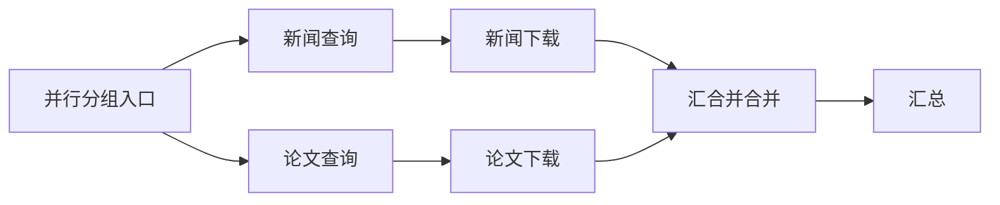

# 1.6 扩展：动态分派、子 Agent 与并行节点展开

更新日期：2026-10-08。任务状态见[架构审查报告](架构审查与改进报告.md)，已有静态并行能力及验收记录见[1.6 原方案](架构改进实施方案.md#task-1-6)。

**当前范围**：项目尚未投入使用，不要求兼容或迁移开发期旧检查点，包括并行节点展开前的旧包装记录。下文历史实施与复核记录保留实际验证结果，旧格式适配不再作为交付要求；当前格式的审批恢复、完成结果复用和运行契约校验继续按原方案验收。

## 一、要实现什么

让使用者在运行过程中生成任务，交给不同执行者，并由图引擎统一管理执行、通信、审批和恢复。例如，主 Agent 收到项目审查请求后，临时创建安全审查、测试检查和性能分析三个子任务，继续处理自己的工作，最后收集结果。

Agent 仍然是基于 Graph 的流程。`pkg/agent` 提供 Basic、ReAct、Routing、GroupChat 等可直接使用的图配方；使用者也可以自己建图。父 Agent 与子 Agent 都使用同一个图引擎，创建子 Agent 的工具可以接入预置配方，也可以接入使用者自建的 Agent 图。

本次有三项交付：

1. **动态分派普通任务。** 编译时注册执行节点，运行时生成数量和输入各不相同的任务，完成后明确汇合。
2. **动态创建和管理子 Agent。** 模型调用分派工具，框架根据任务描述构建或复用 Agent 图，启动独立执行，并提供等待、通信和取消能力。
3. **展开现有并行包装节点。** `AddParallelNode` 内的分支进入普通图拓扑，能够独立连接后续节点，同时保留现有调用方式和合并语义。

前两项先完成；第三项可以独立实施。每项均按自己的验收条件交付，已有静态分支、并行审批和父子恢复的完成状态继续保留。

## 二、已编译的图为什么还能动态创建任务

编译固定的是节点实现、输入输出类型和连接规则。每次运行的任务清单属于执行状态，可以在运行过程中生成。同一节点或同一份已编译的 Agent 图，可以承接多个各自独立的任务。

动态创建子 Agent 时，父图预先配置的是创建工具及其执行入口。具体子 Agent 在调用发生后确定：通用配置相同的任务可以复用已编译图；使用者提供的构建函数也可以在调用时组装并编译一张新的子图。子图通过子执行记录接入父运行，父图无需因此增加节点或重新编译。

因此，动态任务不要求模型生成 Go 代码，也不要求为每一种任务预先写一张专用业务图。模型可以临时描述职责，实际能力来自使用者提供的模型、工具和图组件。

## 三、谁决定任务和配置

采用“使用者规定可选范围，模型提出任务与选择，框架解析并执行”的规则。

| 内容 | 使用者负责 | 模型负责 | 框架负责 |
| --- | --- | --- | --- |
| 任务与交付要求 | 可以设置通用要求 | 写出具体任务和期望结果 | 保存任务，组装子 Agent 输入 |
| 模型 | 注册模型及默认选择规则 | 可选择模型名称，也可省略 | 查找模型实例，应用默认值并校验选择 |
| 工具 | 注册实现、默认集合和允许使用的范围 | 可选择工具名称，也可省略 | 校验并装配对应工具 |
| 角色 | 可提供角色模板及通用执行指令 | 可选择模板，也可补充本次职责 | 合并模板与任务指令 |
| 上下文 | 设置默认传入内容及继承规则 | 在任务中提供必要资料 | 创建独立上下文并冻结初始输入 |
| 并发、超时、预算与深度 | 设置默认值和上限 | 首版工具不开放这些参数 | 统一调度，落实根运行和子任务的限制 |

模型和工具名称是对使用者注册组件的引用。框架不根据模型输出临时猜测 Provider、创建工具实现或读取新的连接凭据。

配置优先级固定为：使用者的默认配置 → 所选角色模板的默认配置 → 模型明确提供的可选项。允许使用的范围始终由使用者确定。不存在的名称、超出范围的选择和不兼容的组合返回明确的工具配置错误，供模型修正；不能静默换成另一个组件。

省略模型时采用解析后的默认值。若使用者设置“默认使用父模型”，框架在创建时读取父模型的配置引用并保存；恢复时沿用该引用。工具参数省略或为 `null` 时采用默认集合，明确传入空数组时使用空工具集合。没有角色模板时，使用通用执行指令和本次任务要求，仍然可以动态创建新职责。

现有 `runnable.Option` 继续用于组件的调用配置。模型提交的任务描述属于业务输入，不能把父 Agent 的全部 Option、Metadata 或会话状态自动复制给子 Agent。需要继承的配置由上面的规则逐项解析，各子执行拥有独立 State 和会话。

## 四、图引擎的动态任务能力

### 4.1 编译期声明与运行时清单

增加与 `AddFork` 同级的动态分派入口。声明分派来源、允许的目标节点、清单生成函数和汇合节点。编译时检查目标存在、连接合法、State 和合并配置完整；与静态扇出一样，一个来源不能同时声明互相冲突的路由方式。

拟新增 `graph.Send` 和包级泛型函数 `graph.AddDispatch`。`Send` 从传入值推导输入类型，生成一个持有目标名称和输入的 `DispatchTask`；`AddDispatch` 从图与清单函数推导类型，沿用 1.7 的类型推导方式。接口签名为：

```go
func Send[T any](nodeID string, input T) DispatchTask

func AddDispatch[I, O, S any](
    g *Graph[I, O],
    from string,
    targets []string,
    join string,
    handler func(context.Context, S) ([]DispatchTask, error),
) error
```

`DispatchTask` 由 `Send` 构造，内部保留输入的实际类型，不要求使用者直接填反射信息或 JSON。`AddDispatch` 登记来源到允许目标的拓扑关系，各目标到汇合点的普通路径由使用者显式连线。输入类型在清单生成后逐项与目标声明比较，编译期不能替模型预知尚未产生的任务输入。

运行时，清单生成函数根据已经产生的业务结果返回“目标节点＋独立输入”。框架检查整份清单的输入类型、可编码性和任务预算，全部有效才登记任务，避免执行到一半才发现后面的成员非法。

清单中的多个成员可以指向同一个节点。框架为每个成员生成独立任务 ID 和成员序号；节点名表示实现，任务 ID 表示这一次执行，不能继续用节点名判断成员是否重复或已经完成。

首版使用一个明确的任务组和汇合点，支持零个、一个或多个成员。零个成员直接进入汇合节点；多个成员全部到齐后汇合一次。动态分派不依赖尚未实现的通用 `Command`，也不顺带放开静态分支内循环等已有拓扑限制。

### 4.2 输入、State 和结果

动态成员的独立输入在执行前编码冻结，按目标节点的静态输入类型恢复。该成员首次调用直接使用分派输入，不再调用入口 PreHandler 覆盖它；节点内部和后续节点继续使用现有 Pre/Post 与 StateNode 规则。

每个成员从本次分派入口 State 创建独立副本。普通节点的 PostHandler 将输出写入该成员 State，汇合时仍使用显式合并函数。输入为当前 State 类型的 StateNode，以分派的 State 快照作为成员入口；其他业务输入需要先由普通适配节点写入局部 State，再接 StateNode。

现有 `StepResult[S]` 只有成员身份和 State，不能假定它已经提供任意业务 Output。普通动态任务继续通过成员 State 合并业务结果；子 Agent 的最终消息由后文的受管子任务记录保存并通过等待工具读取。

汇合结果按清单的成员序号排序，不能按完成时间排序。每次再次进入分派点都创建新的组实例，同样内容的任务也可以再次执行。

### 4.3 登记与恢复

开启检查点时，把分派后的入口 State、组实例、完整成员清单和冻结输入一起保存，确认成功后再启动成员。这是任务登记的提交边界；后续普通进度仍遵循现有 sync/async 规则。没有检查点时，在内存中登记后执行。

恢复直接读取已经保存的清单，复用已完成结果，继续未完成成员。清单已保存后，不再次调用模型或清单生成函数规划这一组；清单尚未保存时失败，才从最近已提交的边界重新规划。

`StepTask` 增加动态成员身份与输入来源，`StepGroup` 保存本次实例的成员清单。调整当前“组任务不能携带 Input”的校验，以及按静态分支节点名称判断成员的逻辑。动态分派声明、允许目标及恢复需要的类型契约纳入 revision 校验。

## 五、让模型创建和管理子 Agent

### 5.1 构建函数与默认实现

新增可复用的 `pkg/subagent` 组件，负责资源查找、配置解析、图构建适配和模型可调用工具。`pkg/graph` 提供通用子任务接口，处理身份、运行、状态和恢复；它不导入 `pkg/agent` 或 `pkg/subagent`。

`pkg/subagent` 可以使用 `agent.New` 作为默认构建函数。使用者可以替换构建函数，返回自己的 Agent 图。`pkg/agent` 保持快捷配方的定位，使用者把分派工具配置到它的 Tools 中即可，无需让 Agent 配方实现新的调度器。

拟提供的构建契约如下。这里的类型和接口属于本次新增内容：

```go
type ResolvedSpec struct {
    Instructions   string
    Model          string
    Tools          []string
    Role           string
    BuilderID      string
    BuilderVersion string
}

type Builder func(
    context.Context,
    ResolvedSpec,
) (runnable.NamedRunnable[[]schema.Message, []schema.Message], error)
```

`Model`、`Tools` 是已经校验的组件引用，`Instructions` 是合并后的执行指令。模型实例、工具实现和凭据由构建函数关联的资源配置提供，不进入可持久化的任务描述。配置相同的构建结果可以复用，只读图定义与每次运行的 State 分开。

**构建参数不含任务文本。** 任务通过运行输入传给 Runner（默认是最后一条用户消息），构建函数只接收最终的组件配置与指令。创建预构建、追加任务和恢复重建因此使用同一份构建参数，相同配置下的不同任务复用同一个构建结果，也不会出现“首次有值、恢复为空”的字段。

使用者自建图同样需要遵守子执行的接入与恢复契约。默认构建适配负责现有 Agent 的独立会话 bypass，子进度仍由根检查点保存。自建图返回具备对应调用契约的 Runnable，并且必须**明确声明恢复能力**：实现 `Recoverable() error`（`graph.CompiledGraph` 已实现；包装图时嵌入具体图类型使方法被提升、显式转发，或用 `subagent.WithRecovery` 声明）。开启持久化时，框架在登记任务之前确认——没有声明、或声明不可恢复，都按接入错误（`ErrNotRecoverable`）上交，不能在已经挂起后才发现无法重建，也不把“能力未知”当作通过。

构建函数及资源注册随分派组件接入根运行，在恢复受管任务之前完成绑定。不能依赖再次执行 `spawn_agent` 的工具处理函数才注册构建能力，因为该工具的已完成结果可能在恢复时被直接复用。

### 5.2 创建请求

模型使用 `spawn_agent` 一次完成创建和启动。请求字段为：

| 字段 | 含义 | 默认行为 |
| --- | --- | --- |
| `task` | 具体任务与交付要求，必填 | 空任务返回配置错误 |
| `instructions` | 本次额外职责说明 | 使用任务与通用指令 |
| `model` | 可用模型名称 | 使用解析后的默认模型 |
| `tools` | 要使用的工具名称列表 | 省略使用默认集合；空数组表示无工具 |
| `role` | 使用者提供的角色模板名称 | 使用通用模板 |

例如：

```json
{
  "task": "检查登录模块是否存在权限绕过，给出问题位置与复现条件",
  "instructions": "只做审查",
  "model": "review_model",
  "tools": ["read_file", "search_code"]
}
```

框架先解析配置、验证构建结果及恢复契约，再登记任务，最后交给图引擎启动。返回值包含任务 ID 和当前状态，不等待整项任务完成。任务 ID 由根运行、创建调用身份及调用内序号稳定关联；模型提供的文本名称只作说明，不作为去重键。

这样，相同内容的两个新请求可以创建两个任务，恢复重放同一次创建调用则找到原任务。创建工具已经返回并被工具结果登记器复用后，子任务仍由运行时持有，不能随父工具节点的进度清理而丢失。

### 5.3 管理工具的语义

| 工具 | 参数 | 行为 |
| --- | --- | --- |
| `spawn_agent` | 上述创建请求 | 创建并启动，返回任务 ID 与状态 |
| `wait_agents` | `task_ids`，必填且非空 | 等待本调用者直接创建的子任务，按请求顺序返回结果；已完成任务立即复用结果 |
| `send_message` | `task_id`、`message` | 向仍未结束的任务追加信息，返回消息 ID 和接收状态 |
| `cancel_agent` | `task_id` | 取消本调用者直接创建的子任务及其未结束后代，返回当前状态；重复取消不重复产生副作用 |

首版 `wait_agents` 等待所列任务全部结束。模型可以只等待部分任务，随后再读取其余任务。结果逐项包含任务 ID、状态、最终消息和模型可见的业务错误，不能因其中一个普通工具或模型调用失败而丢掉其他结果。

等待关系限定为父任务等待自己直接创建的子任务。自等待、等待祖先、等待兄弟以及其他非直属任务均返回工具参数错误；各子任务自行等待自己的后代。这个规则与创建树保持一致，从结构上避免互相等待形成环，不能只依靠释放并发槽位解决逻辑死锁。

`send_message` 通过受管任务的收件箱传递。正在执行的模型或工具调用不被强行修改输入，新消息在下一个模型调用边界并入任务上下文。等待人工审批的任务保留等待状态，消息不能代替审批答案。已结束的任务返回明确的已结束状态，不因一条消息自动重跑。新工作可以创建新的子 Agent；完成[跨轮次复用](#session-subagents)后，也可以给原来的子 Agent 追加任务。

`cancel_agent` 发出请求后，由运行时取消该任务及全部未结束后代的 Context，并在正在执行的调用退出后记为显式取消。保存取消原因，显式取消是终态，根 Resume 不重新启动这些任务。已完成结果保持可读；取消自身不能改变已完成任务的结果。根运行退出前收敛取消中的任务。

根运行 Context 取消、超时或执行被迫退出时，对未结束任务执行停止与收敛，保存可恢复的进度及退出原因。这类停止与工具请求的显式取消分开记录，符合既有 Resume 条件时仍可继续；已经显式取消的任务不因此重新变为可执行。普通图任务的可重试取消语义继续用于执行中断，不代替受管任务的显式取消标记。

本轮任务 ID 的可访问范围是当前根运行的执行树，等待和取消进一步遵守上述直属关系。跨轮次查询和追加任务使用会话内的 AgentID，具体要求见[跨轮次复用](#session-subagents)。各工具通过当前调用上下文取得运行时服务，不让模型选择另一份检查点或直接访问其他会话中的任务。

## 六、通信、并发和父子生命周期

### 6.1 本轮任务的执行与收敛

普通 `Send` 式分派有固定成员清单和显式汇合点。子 Agent 的受管任务允许跨越创建工具所在的父节点继续执行，随后由等待工具读取。两者共用任务身份、执行树、持久化和取消机制，等待方式分别记录。

图引擎需要补充受管任务集合，保存创建来源、父子关联、配置描述、状态、结果和收件箱。当前按父节点调用点登记的 `childExecution` 主要服务嵌套调用，不能直接假定它已经支持跨节点存活的后台任务。

父 Agent 可以在子任务执行期间继续推进自己的图。等待工具进入等待状态时释放执行槽位，子图等待自己的后代时也一样。根图和所有子图共同受根运行的并发与预算限制，不能通过创建多个子图绕过上限，也不能因父任务占着槽位等待而让子任务永远得不到执行机会。

子任务的调度沿用图引擎，不能在工具里自行启动脱离根运行的 goroutine，再只把 ID 放进内存 Map。每个子 Agent 都创建自己的 State、模型工作消息和进度，共享的是只读组件及明确传入的配置。

根图走到结束时，运行时等待尚未结束的受管任务；模型也可以先显式取消不再需要的任务。仍有任务等待人工输入时，根运行返回统一的挂起结果。根运行被取消时，取消所有未结束后代并等待执行调用退出，然后按现有退出规则保存进度。

错误分类沿用已有原则：子 Agent 的普通业务失败保存在任务结果中，交给父模型处理；检查点写入失败、恢复不兼容等框架错误向根传播。不能把存储失败当成业务失败，也不能用某个任务的挂起信号覆盖另一个任务已经发生的框架错误。

<a id="session-subagents"></a>

### 6.2 同一会话内跨轮次保留和继续使用（新增工作）

采用“本轮执行任务，任务结束后进入空闲，下一轮可以继续找原来的子 Agent”的方式。同一会话可以包含多次父图运行；一次图遍历结束，只结束本轮执行，子 Agent 的身份、已确定配置、上下文和结果仍归会话管理。空闲子 Agent 只保留记录，接到新任务时才启动执行。

例如，第一轮让子 Agent 审查登录模块，完成后保存问题清单；第二轮用户要求核实修复情况，父 Agent 找到原来的子 Agent，沿用其审查上下文再派一次任务。父图和子图仍可复用已编译定义，每轮都有独立的执行进度。

**区分 Agent 身份和任务身份。** `AgentID` 在会话内保持稳定；`TaskID` 标识一次派发，新任务生成新的 TaskID。同一次创建或追加任务的调用在恢复重放时复用原记录；两个真实的新请求各自执行。阶段 2 的受管任务记录继续负责本轮任务，不把已完成任务改回 running 来代表新工作，也不使用 Resume 启动下一轮新任务。

**保存位置与职责。** 在会话记录中增加独立的子 Agent 集合，保存 AgentID、所属会话、创建关系、最终配置及版本、独立上下文和任务结果索引。本轮的执行树引用这些身份并保存当前任务现场。新一轮替换 RunID 或 Execution 时，保留会话中的子 Agent 集合；不依赖保留上一轮整棵执行树来实现复用。上下文与任务结果在本轮结束前提交，Memory、Redis 的克隆、编码及读取路径都应覆盖这些记录。没有持久化时，由会话实例在内存中保留；重启后继续使用需要持久化。

**父 Agent 如何感知。** 每轮提供本会话可访问子 Agent 的 ID、职责、最近任务状态和结果摘要；详细结果按需读取。子 Agent 再接任务时沿用自己的上下文，父 Agent 的模型输入不自动包含其全部对话。默认 Agent 配方保存工作消息；用户自建图通过明确的上下文导出与下一任务输入适配参与，不能默认沿用任意业务 State 或已完成的调度现场。

**再次派发与工具接入。** 阶段 3 增加 `followup_task(agent_id, task)`，为已有空闲子 Agent 登记并启动新任务；提供查询子 Agent 列表、读取历史结果及显式关闭的入口。`spawn_agent` 的结果同时提供 AgentID 和本次 TaskID，等待、消息和取消仍针对具体任务。普通 `send_message` 只补充正在执行的任务，不自动启动新工作。已有任务尚未结束时拒绝给同一子 Agent 启动另一项任务，避免并发改写其上下文；审批挂起仍属于原任务，先按问题 ID 恢复。

**生命周期。** 本轮根图继续等待任务完成，审批挂起和运行中断沿用阶段 2 的规则。任务结束后保留子 Agent，后续任务仍按登记的组件配置与版本构建；实现变更需要既有版本适配或迁移。取消一次任务不等于关闭这个子 Agent；显式关闭后停止接受新任务，已保存结果仍可查询。会话释放时收敛运行中的任务并释放执行资源，历史记录按存储保留规则处理。

本项作为阶段 2 之后的独立交付，不追溯增加本次阶段 2 的验收条件。它借鉴 Codex 公开提供的“任务完成后保留、后续追加任务”能力；本方案明确采用本轮收敛的执行方式。

**验收场景：**

- 同一会话连续两轮，第二轮能够查询第一轮创建的子 Agent 和结果，第一轮任务不会自动重跑。
- 给原子 Agent 追加任务时，AgentID 保持不变、TaskID 更新，沿用子 Agent 上下文；父 Agent 仅得到列表和摘要。
- 重放追加任务的调用不会重复登记或执行；新请求允许使用相同任务文本再次执行。
- 新一轮更新根 Execution 后，旧子 Agent 记录仍在；开启持久化时，重建会话实例后也可查询并继续使用。
- 任务失败或取消不影响读取已有结果；同一子 Agent 的活动任务不会并发复用上下文，审批挂起不会被新任务替代。
- 其他会话无法访问这些子 Agent；关闭后拒绝追加任务，空闲期间没有继续执行的 goroutine。

## 七、检查点和恢复要求

开启检查点时，使用根运行的同一 writer 保存整个任务树及收件箱，不为每个子 Agent 再开独立会话检查点。

创建记录必须保存最终配置，而不仅是模型原始请求。记录包括稳定任务 ID、父子关系、模型与工具引用及相关配置版本、合并后的指令、构建函数身份与版本、冻结输入、子图契约和执行进度。恢复依据这些记录重建执行器，不再次让模型选择组件，也不重新应用可能已经改变的默认配置。

创建、消息入箱和取消请求先登记；开启持久化时确认保存后才向调用方确认已接收。消息拥有稳定 ID 与消费进度，消费进度随使用它的模型输入和任务 State 一起提交。恢复重放同一工具调用时复用原登记结果，不能再次创建任务或再次追加相同消息。

已完成结果可以重复读取；恢复重放创建或执行入口时仍需要校验保存的构建配置和子图身份。使用者升级了仍会执行的工具、构建函数或图恢复契约，应走明确的版本适配或迁移路径，不能悄悄换一份实现继续运行。单纯读取历史结果不要求重新执行任务。

挂起的子任务、未回答问题和父图等待关系一起保存。根入口按问题 ID 提交答案后，只恢复已获答案的任务；其他任务继续等待，已完成结果直接复用。无答案的恢复保持现有统一语义，不重复执行仍挂起的任务。

async 模式下未持久化的普通执行阶段仍可能重放，外部副作用继续使用已有工具幂等键和业务幂等能力。通信协议解决任务与消息的登记，不承诺外部接口恰好执行一次。

公共事件流为每个动态任务提供稳定任务身份，可复用现有 Namespace，并按需要扩充 `stream.Meta` 的 TaskID。创建、开始、等待、消息接收、完成和取消沿用公共生命周期与业务进度事件，用户能够区分同一节点的多次执行。

## 八、展开现有 AddParallelNode

这里的“现有节点”指 `AddParallelNode` 创建的包装节点。它已经具备分支级进度、审批和结果复用；本次改进针对外层拓扑和连线方式。

在 Builder 中登记并行分组及分支的稳定身份，编译时展开为普通分支节点和统一汇合关系。原名称作为分组的公共入口与整体连线标识，分支通过“分组名＋分支名”定位，内部汇合名称由框架分配并避免与用户节点冲突。

默认拓扑仍保持原行为：进入分组 → 执行全部分支 → 合并 → 原后继节点。新增显式分支入口、末端声明，让用户能够把某个分支接到额外步骤，例如：



追加后续步骤时，由分支末端声明替换默认的直接汇合边，不能同时留下两条冲突路线。编译验证每条分支的路径都到达该组汇合点；分支引用、定向 Option 和公共事件归属使用同一份稳定映射。

`WithStateMerger` 保留原签名、分支声明顺序和完整分支结束后的调用时机。分支中间状态可以作为该成员的恢复进度保存，全部到齐后才将结果合并到分组入口 State。不能简单把它换成每轮调用图级 `SetStepMerger`，否则会改变现有合并函数的行为。

对已有 `AddParallelNode` 调用，保留外层名称与原分支身份。展开后的图按当前格式保存并恢复分支入口快照、已完成结果、子调用和挂起问题；恢复同一运行时，已完成分支不重跑。项目尚未投入使用，不要求迁移展开前的旧包装检查点。

## 九、按什么顺序实施

每个阶段先补能复现目标行为的测试，再实现功能并完成该阶段验收。

| 阶段 | 主要改动位置 | 独立交付与验收 |
| --- | --- | --- |
| 1. 动态任务清单与汇合 | 新增 `pkg/graph/dispatch.go` 和对应测试；修改 `superstep.go`、`runtime_graph.go`、`runtime_execute.go`、`checkpoint.go`、`revision.go` | 注册允许目标，冻结独立输入，按成员身份调度；零任务、重复节点、稳定合并顺序和跨实例恢复通过 |
| 2. 受管子执行与通信 | 新增 `pkg/graph/managed_tasks.go` 和对应测试；修改 `exec_tree.go`、`runtime_execute.go`、`persistence.go`、`pending_calls.go`、`public_stream.go`；按需扩充 `pkg/stream/event.go` | 子任务在父节点结束后继续存在；等待释放槽位；消息、取消、嵌套审批和根运行退出具有确定行为 |
| 2.1 会话内跨轮次复用 | 在会话记录与存储中增加子 Agent 集合，区分 AgentID 与 TaskID；图引擎接入本轮任务与会话身份，提供上下文适配及查询、追加任务、关闭入口 | 本轮完成后保留身份、上下文和结果；下一轮查询及追加任务通过，重建会话实例后可继续使用，详见[跨轮次方案](#session-subagents) |
| 3. 配置解析与分派工具 | 新增 `pkg/subagent/config.go`、`builder.go`、`tools.go` 及对应测试；复用 `pkg/tool` 参数校验和结果登记能力 | 默认值、角色与模型选择规则可验证；接入预置 Agent 和用户自建图，创建、等待、消息、取消及跨轮次管理工具可完整运行并恢复 |
| 4. 并行包装节点展开 | 修改 `pkg/graph/parallel.go`、`compile_plan.go`、`runtime_graph.go`、`superstep.go`、`options_dispatch.go`、`revision.go`，补充接口行为与恢复测试 | 分支可以独立连线，现有接口和合并时机一致，当前格式的挂起记录正确恢复，已完成分支不重跑 |
| 5. 示例与文档 | 新增动态任务和子 Agent 示例；更新使用手册、`graph-branches.md`、`checkpoints.md`、`resume-input.md`、`public-stream.md` 和审查报告 | 用户按示例能够创建、等待、通信、取消和审批恢复；文档与实际接口及支持范围一致 |

- [x] 阶段 1：完成普通动态任务及恢复验收，见[第三轮复核](#review-dispatch-stage1-v3)。
- [x] 阶段 2：完成跨节点存活的子执行与通信验收，根收尾保存修复已通过[第五轮独立复核](#review-managed-stage2-v5)。
- [x] 阶段 2.1：完成同一会话内子 Agent 跨轮次保留、查询和继续使用；上下文恢复与配置冻结两项问题已修复，通过[第二轮独立复核](#review-session-stage2-1-v2)。
- [x] 阶段 3：完成模型工具入口及自建图接入验收；第二轮两项 P1 已修复，原复现与诊断回调补查均通过，见[第三轮独立复核](#review-subagent-stage3-v3)。
- [x] 阶段 4：完成现有并行节点展开及兼容验收。首次复核两项 P1 已修复，原复现与接续节点跨实例选路补查均通过，见[第二轮独立复核](#review-parallel-stage4-v2)。
- [x] 阶段 5：完成示例、文档和集成验收。上轮两处文档遗漏已补齐，示例实际运行及文档核对通过，见[第三轮独立复核](#review-stage5-v3)。旧检查点迁移不纳入交付要求；本方案全部阶段已完成。

子 Agent 创建与通信不依赖 `AddParallelNode` 展开；普通动态任务也不要求用户使用 `pkg/agent`。4.9 的 Handoff 与 Swarm 另有控制权转移语义，不作为本方案的前置条件。

## 十、验收场景

### 动态分派与配置

- 同一已编译图分别分派零个、一个和多个任务，同一 worker 可重复调用，汇合仅执行一次，结果按清单排序。
- 组内使用各自冻结输入和 State，恢复不调用入口 Pre 覆盖输入；普通适配节点到 StateNode 的路径能够恢复。
- 清单包含非法目标、错误输入类型、不可编码输入或超出预算时，一个成员也未启动。
- 任务说明相同的两个新请求创建不同任务；重放同一次创建请求复用原任务。
- 默认模型、明确选择模型、角色模板和工具空数组的解析符合规则；未知组件返回可供模型修正的工具错误。
- 默认构建函数与使用者自建 Agent 图都能作为子任务运行，无需修改父图拓扑。

### 生命周期、通信与错误

- 创建工具返回后，父图推进到其他节点，子任务继续存在；再次等待仍取得正确结果。
- 并发上限为 1 时，父等待子、子等待孙均不死锁；所有子图共同遵循预算与取消规则。
- 自等待、等待祖先和兄弟互相等待在登记前被拒绝，不留下无法收敛的等待记录。
- 消息在模型调用边界消费；重放不重复入箱，执行中工具不被修改输入，已结束任务不自动重跑。
- 部分任务业务失败、其他任务成功时，等待工具保留每项结果；框架错误与挂起同时发生时仍上报框架错误。
- 根图结束时收敛未完成任务；根取消时不残留脱离本运行的后台任务。
- 显式取消子任务会停止其未结束后代，根 Resume 保持显式取消终态；根 Context 取消导致的可恢复停止能够从保存进度继续。

### 检查点、审批与兼容

- Memory、Redis 分别在创建记录保存后重建运行实例，恢复时不重新规划，也不改变已确定的模型与工具配置。
- 注入任务登记、消息保存和结果保存失败，调用方不会收到虚假的接收或完成确认。
- 多个子任务分别请求审批，分批回答只推进已回答任务，已完成结果不重跑；无答案恢复仍返回原挂起结果。
- 构建函数、目标图或组件版本不兼容时明确拒绝恢复；已有迁移机制能够适配的变化按契约迁移。
- 现有 `AddParallelNode` 调用的 State、结果顺序、合并次数、定向 Option 和流事件与展开前一致；当前格式检查点中的完成结果和审批现场正确恢复。

最后在根模块和 extensions 分别运行 `go test ./... -count=1`、`go vet ./...`，对 Graph、Subagent、Agent、Tool、Control、State、Stream 和 Redis 相关包执行竞态检测。测试环境沿用项目现有 Go 工具链；Windows 竞态检测需要将 `D:\Program Files\msys64\ucrt64\bin` 加入本次进程 PATH。

## 十一、参考依据

- [LangGraph 总览](https://docs.langchain.com/oss/python/langgraph/overview)：底层编排与快捷 Agent 构建的职责区分。
- [LangGraph Send](https://docs.langchain.com/oss/python/langgraph/graph-api#send)：在已定义节点之间分派动态任务及独立输入。
- [LangChain 子 Agent](https://docs.langchain.com/oss/python/langchain/multi-agent/subagents)：通过工具调用子 Agent，使用通用任务入口选择执行者。
- [Codex 子 Agent](https://developers.openai.com/codex/agent-configuration/subagents)：创建子任务、追加指令、等待结果等运行时管理能力。这里借鉴其公开行为，不假定 Codex 内部采用本项目的图实现。

<a id="review-dispatch-stage1"></a>

## 十二、阶段 1 首次独立审核与修复要求（2026-10-05）

本轮只审核动态任务清单、成员执行、汇合与恢复。阶段 1 尚未通过验收：独立场景确认两项 P1、一项 P2，均涉及已经约定的功能。

### 12.1【P1】成员走到下一节点后，读到了其他成员的数据

**复现**：把 `a`、`b` 两个任务分派到同一个 worker。worker 的 Post 将自己的输出写入局部 State 的 `Last` 字段，后续 parse 节点用 Pre 读取 `Last`。预期结果是 `parsed:a,parsed:b`，实际得到 `parsed:b,parsed:b`；开启或关闭检查点都能复现。

**原因**：`runNativeStep` 每轮都从已经合并过的公共 State 创建全部任务的副本，没有保存成员跨节点的局部 State。第一轮合并后公共 `Last` 为 `b`，两个成员进入第二轮时都从这里起步。成员路由也读取合并后的公共 State，同样不能据此判断各成员自己的业务状态。

**修改要求**：动态组以成员 ID 保存各自的 State。入口初始化一次，后续节点的 Pre、Post、StateNode 和成员条件路由继续使用该成员上一节点提交后的 State。公共 State 仍通过显式 StepMerger 更新，但不能替代各成员的下一节点入口。成员 State、下一批任务和到达记录应在同一个提交边界保存；恢复时从对应成员快照继续，已完成结果和未回答的审批仍按原规则复用或等待。

**验收**：补充同目标双成员的多节点链，分别验证无检查点、开启检查点以及第二节点审批后重建实例恢复；两个成员始终处理各自的数据。再让成员根据局部字段走不同条件路径，确认路由也保持独立。不同长度的成员链仍须保留已到达成员的结果。

### 12.2【P1】分派给 StateNode 的 State 修改没有进入结果

**复现**：公共 State 的 `Value` 为 0，分派 `Send("worker", &State{Value: 7})`。worker 是 StateNode，执行 `Value++`。预期汇合读到 8，实际读到 0，运行却正常结束。

**原因**：冻结输入解码出一份 State 交给 StateNode，任务上下文、入口快照和 StepResult 使用的却是另一份从公共 State 复制的 `local`。节点修改了输入对象，框架随后保存与合并的是没有被修改的对象。

**修改要求**：目标是 StateNode 且分派输入为图的 State 类型时，让该分派快照成为成员的局部入口 State。先确定入口对象，再绑定运行时 State、快照提供器与审批现场；节点输入、Post、完成快照和 StepResult 都使用同一份局部 State。恢复重放仍从冻结的入口开始，不能保存到节点执行后的半成品。其他业务输入继续由普通适配节点写入成员 State。

**验收**：上述 7 加 1 场景在无检查点和开启检查点时均返回 8；增加 StateNode 内审批、重建实例恢复及后续 StateNode 链，确认入口值和修改都能保留，其他成员不受影响。

### 12.3【P2】部分动态分派拓扑变化绕过了恢复校验

**复现一**：成员审批挂起后重建同名图，节点和普通边完全不变，只把分派的汇合点从 `join` 改成已有的 `tail`。恢复本应拒绝这个契约变化，实际成功结束，并把 `w:a,w:b` 变成了 `w:a,w:b,w:a,w:b`：旧的汇合节点被当成每个成员的后续节点分别执行。

**复现二**：在分派来源节点审批挂起，尚未生成清单。重建图时把目标路径从 `worker → join` 改成 `worker → extra → join`。恢复仍被接受，执行了新增步骤，返回 `a,new-step`，没有报告图版本不兼容。

**原因**：活跃组的恢复种子包含成员入口，却没有校验仍在使用的 `Group.Fork` 分派声明；契约的邻接表又只保存普通边，没有来源到动态目标的连通关系。因此，分派声明虽已参与整图哈希，局部兼容判断仍可能漏掉这些变化。

**修改要求**：恢复闭包应包含分派来源到允许目标及汇合点的运行时连通关系。活跃动态组另外校验其引用的分派声明，包含允许目标和汇合点；来源已经执行完也不能跳过该声明。可以继续允许恢复范围之外的普通上游改动，但不能只因所有旧节点仍存在，就接受正在使用的分派契约或待执行路径变化。

**验收**：保留上述两个重建图场景，均明确返回恢复不兼容错误，并且不执行新路径。补查允许目标变化、目标输入类型变化、后续节点删除，以及只修改恢复范围之外的上游节点仍可恢复。

### 12.4 已通过的验证与证据

根模块和 extensions 的全量 `go test ./... -count=1 -timeout=180s`、`go vet ./...` 均通过；Graph、Agent、State、Control、Tool、Stream 的常规竞态检测通过。补充场景确认：默认 async 模式下，登记保存失败不会启动任何成员；重建运行实例后可使用已保存清单继续，不重新规划。两个同目标成员分批审批时，只推进获答成员；无答案恢复保持挂起，已完成成员不重跑。

上述问题在补充测试及其竞态检测中得到相同结果，未观察到数据竞争。测试失败来自业务结果或恢复契约不符合预期，不能用常规测试通过代替这些场景的验收。

复现测试、结果记录和相关源码归档在 `.bench/results/review-1-6-dispatch-stage1/`；临时测试从 `pkg/graph` 清理。修复后应将这些场景转为正式回归测试，再复核阶段 1。

<a id="review-dispatch-stage1-v2"></a>

## 十三、阶段 1 第二轮独立复核（2026-10-05）

上轮三项问题的原复现场景全部通过：成员跨节点保留局部 State、StateNode 的修改进入合并结果、修改汇合点或目标路径时拒绝恢复。登记失败不启动成员、重建实例后分批审批与完成结果复用也继续通过。

新增的 StateNode 审批场景通过：成员入口 `Value=7`，节点先加 1 再请求审批；重建实例回复后，从原始入口重放，后续节点再加 1，最终返回 9，没有重复累加。作者新增的成员条件路由及第二节点审批恢复测试同样通过。

阶段 1 仍未通过验收，补查确认一项 P2：新增的成员 State 快照没有接入现有版本迁移。

### 13.1【P2】升级 State Codec 后，成员快照仍留在旧版本

**发生场景**：动态成员第一节点已经执行并提交，第二节点尚未开始，系统在这个边界保存检查点并暂停。随后升级 State Codec，从版本 1 改为版本 2，并使用 `WithMigration` 提供旧快照转换函数。这是已有迁移能力应支持的恢复方式。

**实际结果**：框架迁移了主 State，却没有迁移 `Schedule.Group.Members[*].State`。第二节点恢复时读取该成员快照，报错：`Graph State checkpoint Codec "review-member-state"/1 does not match "review-member-state"/2`。独立测试中迁移函数只被调用一次，第一节点没有重跑，恢复无法继续到第二节点。

**原因**：`migrateFrameStates` 目前只遍历主 State 和任务记录的 Entry/Local。此次新增的成员快照保存着下一节点需要的局部 State，却不在迁移遍历中。若第二节点已经开始并保存了任务 Entry，部分场景会优先使用 Entry，掩盖这个遗漏；因此测试必须停在“上一节点已提交，下一节点尚未开始”的边界。

**修改要求**：把动态组中所有非空成员 State 快照纳入 `migrateFrameStates`，使用同一迁移函数、快照校验和当前 Codec 解码校验。迁移前的 `StepSchedule.clone` 也需要深拷贝新增的成员快照及 Data，避免迁移副本与旧现场共享可变对象。所有需要继续使用的快照准备成功后，再统一发布新版现场和契约；任一快照迁移失败都应拒绝恢复，保持原记录可供重试。成员快照的迁移归属当前 frame，嵌套子 frame 继续由自己的图处理。

**验收要求**：

- 在上述节点间边界暂停，升级 Codec 并提供迁移函数后，第二节点继续使用成员自己的数据，第一节点不重跑。
- 多个同目标成员的快照全部迁移，恢复与条件路由保持各自数据；不能只迁移当前第一个任务的成员。
- 某个成员快照迁移失败或新版 Codec 无法解码时，不发布部分迁移结果；修正迁移函数后，仍能从原检查点重试。
- 迁移后再次暂停并重建实例，所有仍会使用的快照和版本标记一致，不再要求重新应用旧版本迁移。

### 13.2 验证与归档

本轮根模块和 extensions 全量 `go test ./... -count=1 -timeout=180s`、`go vet ./...` 通过；Graph、Agent、State、Control、Tool、Stream 的常规竞态检测通过。上轮六项独立测试通过；新增 StateNode 审批重放通过，成员快照迁移测试失败。补充测试的竞态检测得到相同结果，没有数据竞争报告。

临时测试、验证记录和相关源码归档在 `.bench/results/review-1-6-dispatch-stage1-v2/`，临时文件已从 `pkg/graph` 清理。修复本项并通过复核后，再验收阶段 1；阶段 2—5 不属于本轮交付范围。

<a id="review-dispatch-stage1-v3"></a>

## 十四、阶段 1 第三轮独立复核（2026-10-05）

**结论：阶段 1 验收通过。** 上轮成员快照迁移遗漏已修复，首次审核的三项问题也继续通过，未发现影响本阶段验收的新问题。

`migrateFrameStates` 已把组内所有非空成员快照纳入同一迁移流程，逐份检查快照与当前 Codec 的可读性；`StepSchedule.clone` 深拷贝成员快照及 Data，迁移准备过程与旧现场隔离。作者新增双成员迁移的正式回归测试通过，原独立复现也通过。

本轮补查三个场景：正常迁移、第二成员的迁移函数报错、第二成员的迁移结果无法被新版 Codec 解码。后二者都在执行下一节点之前拒绝恢复，旧检查点版本和 Execution 数据保持不变；修正迁移函数后可从原检查点继续。成功迁移时，主 State 和两个成员快照均升级为版本 2，第一节点不重跑，成员各自的数据和结果顺序保持正确。

迁移后在第二节点再次审批挂起，重建新版图并携带答案恢复，可以直接使用已保存的新版现场，无需再次提供迁移函数。已完成成员的结果被复用；运行结束后再次 Resume 也复用最终结果，不重复执行节点。

**验证**：根模块与 extensions 全量 `go test ./... -count=1 -timeout=180s`、`go vet ./...` 通过；Graph、Agent、State、Control、Tool、Stream 与 Redis Store 的竞态检测通过，包含本轮补查场景。变更的 Go 文件格式检查通过。此前八项独立测试和本轮三种补查场景全部通过。

测试、结果记录和相关源码归档在 `.bench/results/review-1-6-dispatch-stage1-v3/`，临时测试已从源码目录清理。本次完成的是普通动态任务清单、成员局部 State、汇合与恢复；后续继续按阶段 2—5 实施受管子执行、通信与配置工具、并行节点展开、示例和文档。

<a id="stage2-impl"></a>

## 十五、阶段 2 实现记录（受管子执行与通信，2026-10-05 实施）

以下为作者的实施与自测记录。受管任务登记、跨节点等待、通信和根运行收敛已完成本阶段验收，最新结论见[阶段 2 第五轮独立复核](#review-managed-stage2-v5)。

### 15.1 结构与数据面

- `pkg/graph/managed_tasks.go`：`ManagedSpec`（构建函数身份+版本+最终配置+冻结输入）、`managedTask`（ID/归属任务/规范/状态/图身份/结果/收件箱+消费游标/子 frame）、`ManagedStatus`（running/suspended/completed/failed/cancelled）、`ManagedMessage`（稳定 ID+冻结载荷）、`ManagedResult`（对外结果视图）。
- `executionProgress.Managed`：frame 级受管任务清单，随检查点持久化；`Clone`/`Validate`/`JSON` 全链路覆盖；`commitFrame`/`updateFrame` 合并时保留运行期登记。
- `waitKind` 新增 `waitManaged`：等待记录引用本 frame 的受管任务集合；`resolveWait`/`validateWaitRef`/`taskWaitResolved`/`pendingInterruptsTree`/`applyResumeInputTree`/`validateExecutionTree` 全部递归穿过受管子 frame。
- `executionProgress.Output` + `ResumeNode=End`：末端等待挂起把进入 End 的边输出冻结进检查点，恢复后直接产出，不重放末节点。

### 15.2 运行语义

- **创建**：`SpawnManaged` 在任务内调用，序号空间独立于子调用（`callSite.managedSeq`）。先按 (父任务,调用身份,序号) 查重——命中已登记记录校验规范一致后直接复用、不再构建；新任务构建执行器成功才登记，登记先落盘再启动。规范字节拷贝冻结。
- **执行**：`runCoordinator.launchManaged` 起后台协程，生命周期挂根协调器而非创建节点；并发额度与根 `maxConcurrency` 共享（挂起的协程退出即释放额度，上限 1 时父→子→孙不互锁）。受管运行内再建孙任务登记进受管 frame 的子树。
- **等待**：`WaitManaged` 未全部终态时返回 `managedWaitSignal`（实现 `control.Suspension`）——任务按挂起处理释放槽位；目标的未答问题并入根挂起结果。同 frame 跨节点等待合法；目标存在但不在本 frame 报 `ErrManagedScope`，全树不存在报 `ErrManagedNotFound`——受管内部 frame 天然看不到兄弟/祖先/自身，结构上排除等待成环。
- **消息**：`SendManagedMessage` 生成确定性 ID（`msg/任务#序号`），重放命中已登记消息幂等返回；载荷不一致按恢复不兼容拒绝；终态任务报 `ErrManagedTerminal`。执行侧 `ManagedInbox` 读未消费视图、`AckManagedInbox` 推进游标，随任务进度同一边界落盘。
- **取消**：`CancelManaged` 级联标记任务与全部未结束后代为 cancelled 并取消其协程上下文，重复取消幂等；终态记录的结果保持可读。
- **收敛**：根图到达 End 时 `drainManaged` 等全部受管协程落位——受管运行内部不 drain（等待会自我死锁）。仍有挂起任务时按末端等待挂起（`ResumeNode=End`+冻结输出）；框架错误优先于挂起传播。
- **唤醒**：根运行拿到无待答问题的挂起时不向调用方暴露——等受管协程落位后经 `managedPendingWork` 判定还有推进可能（活跃协程/可重启挂起/未收尾 running）即从检查点内部重入恢复，直到等待解除或确认无推进再交还挂起结果。有待答问题立即返回。
- **关闭**：根运行退出 `defer stopManaged` 取消并等协程退出，running 保持可恢复现场；恢复时 `resumeManaged` 重新驱动非终态任务，构建函数缺失/版本不符按恢复不兼容拒绝。

### 15.3 关键修复

- 受管运行误闯独立检查点加载分支（`configured && adopted==nil` 未排除 `ms`）→ nil Store 空指针。
- 内部重入恢复沿用了带 `inputRun` 标记的 ctx → 被当作未登记嵌套运行清空检查点配置；重入前剥离。
- `encodeLocked` 原地写根 `Format`、主循环整树 `Clone` → 与受管协程并发写 `managedTask` 字段数据竞争；改为快照编码 + 主循环只做字段级克隆。
- 等待型挂起后 `managedActive==false`（任务已先行完成）时直接把挂起抛给调用方；改为按推进可能性判定（`managedPendingWork`）。

### 15.4 测试与验证

`managed_tasks_test.go` 9 项：spawn+wait 收敛、父节点结束后存活、直属范围校验（同 frame 合法/跨 frame Scope/未知 NotFound）、收件箱消费与游标、取消级联（检查点内父与后代均 cancelled）、受管内嵌套审批传播与恢复、重放去重（build/run 各 1 次、记录不重复）、构建函数缺失与版本不符拒绝恢复、并发上限 1 的父子孙链。

根模块与 extensions 全量 `go test ./...`、`go vet ./...`、`gofmt` 通过；`pkg/graph -race -count=3` 与受管测试 `-race -count=10` 通过。

<a id="review-managed-stage2"></a>

## 十六、阶段 2 首次独立复核（2026-10-05）

**结论：阶段 2 尚未通过验收。** 主体接口已实现，独立补查确认四项 P1、三项 P2。以下均针对本轮受管任务，不把新增加的跨轮次复用计入本次验收。

### 16.1【P1】子任务尚未结束，根运行已被保存为完成

**场景与结果**：父节点创建子任务后返回，父图到达 End，子任务仍在执行。此时检查点已写入 `StatusCompleted`；调用 Resume 直接返回父图的最终输出，跳过尚未完成的子任务。独立测试中，子任务还在等待释放，Resume 已成功返回 `root`。实际运行若在这个窗口退出，恢复同样会把子任务遗漏。

**原因与修改**：`runtime_execute.go` 在收敛受管任务前，以 `completed=true` 调用 `persistProgress`；`persistence.go` 随即写入根完成状态。应先保存进入 End 的输出和待收敛现场，根状态保持未完成；所有子任务收敛、框架错误确认不存在后，再统一保存最终完成状态。审批挂起保存统一挂起结果。需要把进入 End 的输出放进可恢复现场，避免恢复时重跑末节点，也避免仅推迟 completed 后缺少输出。

**验收**：分别在 sync、默认 async 下，把子任务停在未完成边界，确认根检查点仍可恢复；重建实例后继续子任务，末节点不重跑，全部收敛后才标为完成。

### 16.2【P1】子任务的框架错误被转换成普通失败结果

**场景与结果**：父节点通过 WaitManaged 等待子任务，子任务返回 `ErrResumeIncompatible`。预期根调用报恢复不兼容，实际返回 `failed:checkpoint resume is incompatible with saved progress`，根调用的 error 为 nil。普通业务失败作为子结果交给父节点是正确行为；这里丢失的是框架控制错误。

**原因与修改**：`launchManaged` 先把恢复错误保存为 failed 业务终态，再放进协调器的内存字段 `managedErr`。父图等待期间的内部重入重新建立协调器，内存错误丢失，恢复又跳过 failed 任务。应使用统一的框架错误分类，让框架失败向根传播；内部唤醒前先检查受管执行错误，不能以重建协调器抹掉错误。框架失败也不能保存为可供 WaitManaged 正常返回的业务终态，应保留可重试现场及错误原因，修正问题后仍能从已保存边界恢复。普通业务失败继续进入任务结果。

**验收**：父节点直接等待、跨节点等待以及 End 自动收敛三条路径都应上报框架错误；调整实现后可重试，普通业务失败仍能作为结果读取。

### 16.3【P1】消息已确认消费，但恢复时使用这条消息的节点仍会重放

**场景与结果**：子节点读取 `remember` 消息并调用 AckManagedInbox，随后在同一节点请求审批。审批恢复从节点入口重放，而消息游标已提前持久化，收件箱变为空；实际子结果为 `missing:yes`，预期为 `remember:yes`。

**原因与修改**：AckManagedInbox 单独提交消费游标，没有与使用消息后的输入、State 或节点重放记录一起提交。应在任务记录中保存本次消费的消息批次及其身份，让节点重放仍能取得同一批消息；游标与对应工作消息、State 进度在同一个提交边界生效。Ack 可以记录本次消费意图，不能在没有可恢复消费结果时独立跳过消息。

**验收**：消息消费后在同一节点审批、执行失败或运行中断，再恢复时既不丢消息，也不重复追加到已提交的上下文；连续消费多批消息时游标正确。

### 16.4【P1】两个独立子任务共用工具的外部幂等键

**场景与结果**：两个子任务复用同一张子图，各自调用同名工具，工具调用 ID 均为 `call-1`。两次真实工具调用得到完全相同的 IdempotencyKey，形如 `RunID/main@0/0/0/call-1`。外部接口若据此去重，第二个子任务的真实操作可能被当作第一个任务的重复请求。

**原因与修改**：受管执行从根协调器的 runCtx 启动，该上下文还没有运行范围；`run` 在 scope 为空的分支只取根 RunID，只有已有 scope 的另一分支才追加受管任务 ID。因此首次受管调用没有进入独立任务范围。应先确定根运行身份，再无条件按受管任务的完整父子路径派生运行范围，供工具幂等键使用；同一次任务的恢复保持相同身份，不同任务、不同层级和不同根运行各不相同。

**验收**：两个子任务和两层嵌套子任务使用相同工具名称及调用 ID，外部幂等键仍分别独立；恢复同一次调用时键保持稳定。

### 16.5【P2】父节点与子任务使用两份并发额度

**场景与结果**：根图设置 SetMaxConcurrency(1)，父节点创建子任务后继续处理本节点工作。独立测试观察到父节点与子任务同时执行，峰值为 2。

**原因与修改**：父图节点使用 runTaskBatch 的局部额度，受管驱动协程使用另一份 slots。两者容量虽都取根上限，合计并未受同一上限控制，子图内的并行节点也会使用自己的额度。应在实际执行单位上统一领取根运行额度，图驱动、登记和等待不占额度；接入子图的适配器不能持有一份额度包围整图，再让内部节点重复领取。普通叶子 runner 与图节点采用一致的额度规则，等待与挂起及时释放。

**验收**：根、子、孙的实际工作总并发不超过根上限；子图内部扇出也遵守上限，上限为 1 时父子等待仍能推进。

### 16.6【P2】不同层级的任务得到相同公开 ID

**场景与结果**：根节点创建一个子任务，该子任务的首节点再创建孙任务。两者均得到 `mt/task-1#0`。返回给模型或用户的任务 ID 无法区分这两个执行，也无法准确表达越权访问和事件归属。

**原因与修改**：managedID 只包含本 frame 的任务序号、调用身份和序号，各 frame 都从 task-1 开始。应加入根运行及所属 frame 的完整父子身份，使 ID 在当前执行树内唯一；查找、等待引用、消息、取消、公共事件与持久化使用同一份身份。恢复沿用已登记 ID，不按恢复后的执行先后重新分配。

**验收**：多个兄弟任务分别创建孙任务时，所有公开 ID 都不同；重建后 ID 不变，非直属 ID 正确拒绝访问。

### 16.7【P2】不开检查点就不能使用受管子任务

**场景与结果**：只配置 WithManagedBuilder，不配置 WithCheckpoint，节点调用 SpawnManaged 时立即返回 `managed tasks require a checkpointed run context`。这使使用者为了普通并发子任务也必须配置存储。

**原因与修改**：根协调器只在配置检查点时创建，运行服务与持久化绑定。应给无 Store 的调用建立内存受管运行环境，在内存中完成登记、调度、等待与收敛；持久化配置只控制落盘及跨实例恢复。内部等待唤醒应使用当前内存现场，不能只能从 Store 重入。人工审批的跨调用恢复继续遵守已有检查点要求。

**验收**：不提供 Store 时，创建、跨节点等待、收件箱、取消和父子嵌套均可运行，并在根退出时收敛；开启 Store 后保留原来的持久化与恢复能力。

### 16.8 验证与归档

本轮根模块和 extensions 全量 `go test ./... -count=1 -timeout=180s`、`go vet ./...` 通过；Graph、Agent、State、Control、Tool、Stream 及 Redis Store 的常规竞态检测通过。Windows GCC 为 `D:\Program Files\msys64\ucrt64\bin\gcc.exe`，测试使用 Go 1.26.4，GOCACHE 指向工作区内 `.bench/go-cache`。

七个独立复现场景均失败，竞态检测下得到相同结果，没有数据竞争报告；另两个验证场景通过：普通业务失败按结果交给父节点，任务登记及结果保存失败向根传播，登记保存失败不启动任务。因此，本轮问题主要是提交时机、错误分类和身份隔离，而非存储错误被统一吞掉。

测试源码、输出及相关实现快照归档在 `.bench/results/review-1-6-managed-stage2/`，临时测试从 pkg/graph 清理。阶段 2 保持未完成；修复以上问题并通过独立复核后，再推进阶段 2.1 的跨轮次复用。

<a id="stage2-fix"></a>

## 十七、阶段 2 首次复核修复记录（2026-10-05 实施）

七项复核问题已全部修复，回归测试随修复一并落地于 `managed_review_test.go`。

### 17.1【P1】End 收敛不再提前写完成

根运行到达 End 的三条路径统一处理：循环顶 `next==End` 路由路径、`routed==End` 的提交后路径、`pendingNode==End` 的恢复路径。未收尾受管任务存在时不写完成记录，改挂起为 `ResumeNode=End`+`waitManaged` 等待，输出冻结进 `progress.Output`；受管全部收敛后由 `coord.completeRun` 统一写 `StatusCompleted`、结果与执行树（同一版本），恢复时经 `decodeTaskInput` 复原冻结输出直接产出，不重跑末节点。

### 17.2【P1】框架错误传播而非业务化

`launchManaged` 按 `isRecoveryError` 区分框架错误：框架错误经 `markManagedFatal` 在任务记录置 `Fatal`+错误文本（同一边界落盘），任务保持 running 供恢复重试——不落入 failed 业务终态。`managedFrameworkErrorLocked`/`WaitManaged`/`drainManaged`/唤醒循环统一上报：**仍有驱动协程的 Fatal 任务视为重试进行中继续等待**，仅当 Fatal 且无协程时才报错；原始错误对象存 `coord.fatalErrs` 保留完整错误链（`errors.Is` 可用），跨次恢复按持久化标记重建文本。普通业务失败仍作为 `failed` 结果交给父节点。

### 17.3【P1】收件箱确认与任务提交同一边界

`managedTask.TaskInbox` 记录按内部任务键挂起的「已确认未提交」批次；`AckManagedInbox` 只登记批次不移动游标，`promoteInboxLocked` 在 `completeTask`/`suspendTask`/`mutateTree` 提交边界把批次按收件箱位置推进 `Consumed`——确认与使用消息的现场原子生效。审批挂起恢复时节点重放仍读到同一批消息；裸 runner（无内部任务身份）批次挂空键、run 结束时整体提升。

### 17.4【P1】子执行外部幂等键按任务路径隔离

`run` 的 scope 构造改为：先确定根运行身份（`scope==""` 时用根 RunID），子调用/受管执行无条件追加完整父子路径段；受管运行从 `ms.spec`/任务 ID 派生，未登记嵌套运行追加调用身份+随机后缀。兄弟任务、嵌套层级、不同根运行的外部幂等键互不共用；同一任务恢复的键保持稳定。

### 17.5【P2】父子共享同一并发额度

`runTaskBatch` 改为接收共享 `slots chan struct{}`，父批内任务与受管协程从同一 channel 取额度；`sharedSlots` 由 `maxConcurrency` 派生并在根协调器与批执行间共享。图驱动脊柱、登记与等待不占额度（避免收敛自锁）；上限 1 的父→子→孙等待链不死锁。

### 17.6【P2】任务 ID 纳入父子路径全局唯一

`callSite.owner` 记录所属 frame 的完整受管 owner 路径；`managedID` 由 owner 路径+调用位点+序号生成，不同层级、不同父任务的 ID 不冲突。`waitRecord`、事件、持久化共用同一身份；恢复沿用登记 ID。

### 17.7【P2】无检查点的内存受管运行

配置了 `WithManagedBuilder` 且非嵌套的根运行在无 Store 时创建内存协调器：`enabled()` 对 storeless 返回 true，`mutateTree`/`publishLocked` 走内存现场，`persistProgress` 用 `resolvedTicket` 无落盘等待。受管等待（`waitManaged`）可在内存中挂起并由唤醒循环内部重入推进；审批类可恢复挂起仍按 `ErrCheckpointRequired` 拒绝。未登记嵌套运行不建协调器，保留原中断行为。

### 17.8 回归测试与验证

`managed_review_test.go` 覆盖七项复核场景：End 收敛不提前完成（sync/async）、框架错误传播与可重试、收件箱确认跨审批恢复、兄弟/嵌套幂等键独立、共享并发额度峰值不超上限、层级任务 ID 唯一、无检查点全链路（创建/跨节点等待/收件箱/取消/嵌套）。

验证：`go test ./...` 根模块全量、`go vet ./...`、gofmt 通过；`pkg/graph -race` 与受管测试 `-race -count=5` 无竞态。阶段 2 待下一轮独立复核。

<a id="review-managed-stage2-v2"></a>

## 十八、阶段 2 第二轮独立复核（2026-10-05）

**结论：阶段 2 仍未通过验收，确认两项 P1。** 上轮七项问题中，六项的原复现场景通过；并发限制的原场景仍失败。另确认根图结束时的嵌套审批恢复问题。原消息重复读取项的判定依据不足，已撤回，见 18.3。

### 18.1【P1】并发额度没有覆盖普通节点，进入并行子图时还会卡住

**复现与影响**：根上限设为 1，普通父节点创建子任务后继续工作，两者仍会同时执行，峰值为 2。这是上轮并发问题的原复现。另让子任务执行一张含 AddParallelNode 的图，上限仍为 1，两个分支均无法取得额度，直到根 Context 超时退出；纯内存计算的子图也无法完成。

**原因**：本轮让受管驱动协程与 runTaskBatch 共用 slots，但普通串行节点直接执行，没有领取额度。受管驱动又在整个 runner 调用期间持有额度；runner 进入子图后，内部并行分支再次向同一池领取。额度为 1 时，外层等内层，内层等外层释放，形成等待环。当前新增测试覆盖“受管任务与父图并行分支共享额度”，没有覆盖普通父节点及受管子图内部的并行分支。

**修改要求**：统一在实际工作节点或普通叶子 runner 上领取根额度，普通串行节点也接入。图驱动和调用子图的包装层不能持有额度包围整张图，再让子图内部重复领取；嵌套图执行需按同一规则让出或转交额度。等待、登记和挂起不占额度。不能通过给子图改用另一份池来消除卡住，否则会重新绕过根上限。

**验收**：保留普通父节点与子任务的峰值检查；上限为 1 时，受管子图中的 AddParallelNode、原生扇出和动态分派都能完成；上限为 2 时总工作并发不超过 2，父子孙等待仍可推进。两组原复现分别为 TestReviewManagedSharedConcurrency、TestReviewManagedParallelSubgraphQuota。

### 18.2【P1】根图结束时保存的孙任务等待记录无法恢复

**复现与影响**：父图创建子任务后继续自己的工作；子任务创建孙任务并等待，孙任务请求审批。父图随后到达 End，框架返回审批问题。用户回答后 Resume 却报错：`invalid checkpoint: frame waiting record references missing managed task "mt/mt/task-1#0/task-1#0"`。这是一条已经保存成功、却不能读取恢复的检查点。

**原因**：managedSnapshot 和 drainManaged 遍历整棵树，将子任务和孙任务 ID 都放进根 frame 的 waitManaged 记录；validateWaitRef 与 managedWaitResolved 却只在当前 frame 的 Managed 集合里查找。孙任务位于子 frame，根查不到它。本轮 ID 隔离修复使不同层级的 ID 不再重复，也暴露了这个等待范围不一致的问题。

**修改要求**：把根图结束时的全树收敛等待与普通 WaitManaged 的直属等待区分清楚。根收敛记录需要明确全树范围，保存可稳定定位的任务引用，校验与解除等待按同一范围查找。普通工具等待继续限制在直属范围。待答问题按问题 ID 汇集，避免遍历多层任务时重复收集同一问题。子任务自身已完成而孙任务仍未完成时，根收敛也要能定位并等待孙任务。

**验收**：父图不显式 Wait，由 End 自动收敛两层以上任务；孙任务审批能够保存、重建实例、提交答案并返回原根输出。多个孙任务分批回答时，未回答任务保持挂起，已完成结果不重跑，根末节点不重跑。复现为 TestReviewManagedNestedTailApproval。

### 18.3 原消息重复读取项撤回

**原测试实际证明的行为**：第一节点读取消息并调用 AckManagedInbox，第二节点仍能读取同一条消息。TestReviewManagedSequentialInboxCommit 只检查剩余消息数量，没有验证消息被重复追加到上下文，也没有验证业务处理被重复执行。

**判定修正**：受管子任务由整张子图完成，到达 End 才产出最终结果；节点执行结束只代表推进了一步。多个节点可以读取或使用同一条任务信息，能够读取也不代表一定会使用。因此，仅凭第二节点仍能读取消息，不能认定业务处理发生重复。原测试要求“第一节点结束后收件箱必须为空”，不足以作为本阶段的验收条件。

**处理**：撤回该 P2 及原先按节点推进消费游标的修改要求，不将本项计入阶段 2 的待修复问题。审批恢复不丢消息的既有验证继续有效。归档测试和日志保留原始结果，并在验证记录中注明此断言已撤回。

### 18.4 已通过范围与验证证据

上轮提前完成、框架错误业务化、审批恢复丢消息、外部幂等键共用、受管层级 ID 重复、无检查点无法创建的六个原场景通过；普通业务失败及登记、结果保存失败的验证也继续通过。并发上限原复现仍失败，新增场景确认并行子图卡住和嵌套审批恢复失败。串行消息测试只证明消息可再次读取，其缺陷判定已撤回。

根模块和 extensions 的常规全量测试、go vet 通过；Graph、Agent、State、Control、Tool、Stream 及 Redis Store 的常规竞态检测通过。原补查日志有四个断言失败，竞态检测下得到相同结果，无数据竞争报告；其中串行消息读取断言已撤回，其余三个场景对应两项 P1。恢复原复现文件时运行的根全量测试因该文件中的并发断言失败；清理后重新运行常规全量测试通过，不能把这两种结果混为一谈。

环境为 Go 1.26.4、Windows UCRT64 GCC，GOCACHE 位于工作区 `.bench/go-cache`。复现测试、日志和实现快照归档于 `.bench/results/review-1-6-managed-stage2-v2/`，临时测试已从 pkg/graph 清理。阶段 2 保持未完成；阶段 2.1 的跨轮次复用仍作为后续独立工作。

<a id="stage2-fix-v2"></a>

## 十九、阶段 2 第二轮复核修复记录（2026-10-05 实施）

本轮两项 P1 已修复，回归测试落地于 `managed_review_test.go`（`TestReviewManagedSharedConcurrency`、`TestReviewManagedParallelSubgraphQuota`、`TestReviewManagedNestedTailApproval`）。

### 19.1【P1】并发额度按实际工作单元统一领取

新增 `slotLease` 额度令牌：领取、让出（yield）、取回（resume）、归还（release），经 ctx 在工作单元与嵌套运行间传递。

- **顺序节点接入额度**：`executeRuntime` 在顺序节点执行前 `acquireSlotLease`（`sharedSlots` 解析的同一池），节点完成/挂起/失败即归还；节点内调嵌套图时由 `run` 让出。
- **包装层不持额度包围整图**：`run()` 进入时若继承令牌则 `yield` 归还池，图内节点各自领取——上限 1 时不再形成「外层持额度等内层、内层等外层释放」的等待环；运行结束 `resume` 取回，外层工作单元恢复记账。
- **受管驱动协程**改为持有令牌调 runner：叶子 runner 整段按一个工作单元计；runner 内部跑子图时令牌经同一机制让出。
- **未登记嵌套图**也纳入根上限：`sharedSlots` 无协调器时沿用祖先令牌所在的额度池。
- 等待、登记与挂起不占额度（挂起路径统一经 `releaseLease` 归还）。

### 19.2【P1】根收敛等待记录区分全树范围

`waitRecord` 增加 `Tree` 标记：根 End 收敛产生的 `waitManaged` 等待置 `Tree`（三处挂起点统一），普通 `WaitManaged` 的直属等待不置。`validateWaitRef` 与 `managedWaitResolved` 按同一范围查找——`Tree` 时经 `findManagedInTree` 跨 frame 定位后代任务（含父任务已完成、孙任务未完成的场景），否则仍限本 frame。`drainManaged` 的等待集合改为收录全部未终态任务（此前只收挂起任务，漏掉失去协程的 running 任务）；`managedSnapshot`、`drainManaged`、`managedWaitResolved` 的待答问题按问题 ID 去重。

### 19.3 验证

三项复现回归通过：上限 1 普通父节点+子任务峰值 1、上限 1 受管子图内 AddParallelNode 正常完成、孙任务审批挂起-回答-恢复返回原根输出且末节点不重跑。根模块全量 `go test ./...`、`go vet ./...`、gofmt 通过；`pkg/graph -race` 与受管/复核测试 `-race -count=5` 无竞态。阶段 2 待下一轮独立复核。

<a id="review-managed-stage2-v3"></a>

## 二十、阶段 2 第三轮独立复核（2026-10-05）

**结论：上轮两项 P1 已通过复核，阶段 2 仍有一项 P2。** 普通父节点与子任务共享上限、受管并行子图在上限 1 时完成、根 End 汇总孙任务审批后恢复的三个原场景全部通过。原消息重复读取项继续按撤回处理，不增加按节点清空收件箱的要求。

### 20.1【P2】只回答一个审批，已回答的任务仍不能继续

**场景与结果**：父图创建 A、B 两个子任务后走到 End，两个子任务分别请求审批。用户只同意 A 并调用 Resume，框架返回 B 的待答问题，但 A 没有继续执行，检查点中 A 仍为 suspended。待 B 也回答后，A、B 才一起继续。子任务已完成、其下两个孙任务待审批时，同样存在这个问题；回答其中一个后，再调用不带新答案的 Resume，它仍不会继续。sync 和默认 async 均已复现。

**为什么需要修复**：本方案第七节已约定“只恢复已获答案的任务，其他任务继续等待”。现在答案保存成功，但执行被其他未答审批挡住。用户不能先批准一项工作让它继续，再稍后决定另一项。全部回答后的最终结果正常，问题在于分批恢复没有落实。

**原因**：恢复入口先保存答案，再以根 frame 的 frameRunnable 判定整棵树能否推进。根 End 的 waitManaged 必须等全部目标任务到达终态才解除，所以这个判断仍为 false。只要还有 B 的待答问题，入口就提前返回，后面的 resumeManaged 根本没有机会启动已经获答的 A。“根图能否结束等待”和“树里是否有子任务可以继续”被当成了同一个条件。

**修改要求**：恢复入口在提前返回挂起结果前，检查整棵树是否有可继续的受管任务，包括已结束子任务名下的孙任务。已获答案的任务先恢复执行，未获答案的任务保持挂起；根 End 继续等待所有任务收敛，不能提前解除等待或写成完成。仅在根图和受管任务都没有可推进工作时，才直接返回剩余审批问题。普通 WaitManaged 的直属范围、已完成结果复用及消息读取规则保持现有语义。

**验收**：两个直属子任务待审批时，只回答 A，A 的结果保存为 completed，B 保持挂起，根返回 B 的原问题 ID；之后回答 B，A 不重跑，根返回原先冻结的最终输出。对子任务已结束而两个孙任务待审批的情况做同样验证；重建图实例、sync、默认 async 和不带新答案的 Resume 均覆盖。原孙任务单次审批恢复和并发复现继续通过。

独立复现为 TestAuditManagedV3DirectPartialTailApproval 和 TestAuditManagedV3CompletedParentTailApproval，每项分别覆盖 sync 和 async。测试同时验证：答案齐全后可以完成，根末节点不重跑，已结束的子任务不重跑。

### 20.2 已通过范围与验证证据

上轮剩余三个原复现场景以及先前已经通过的受管任务验证全部通过。补查 StateNode 创建子任务后的共享额度、受管子图内动态分派（根上限 1、2，子图上限 8）和 runner 使用 Stream 运行子图均通过；内存、sync、默认 async 的适用场景均覆盖。

根模块与 extensions 的常规全量 go test、go vet 通过；Graph、Agent、State、Control、Tool、Stream 及 Redis Store 的常规竞态检测通过。补查的两个分批恢复测试在普通执行和竞态检测下均失败，对应同一项 P2，未出现数据竞争报告。其余独立测试通过。

环境为 Go 1.26.4，GCC 位于 `D:\Program Files\msys64\ucrt64\bin\gcc.exe`，GOCACHE 使用工作区 `.bench/go-cache`。测试、日志、11 份实现快照及哈希归档于 `.bench/results/review-1-6-managed-stage2-v3/`；三份临时测试已从 pkg/graph 清理。阶段 2 保持未完成；阶段 2.1 的跨轮次复用仍按独立阶段实施。

<a id="stage2-fix-v3"></a>

## 二十一、阶段 2 第三轮复核修复记录（2026-10-05 实施）

### 21.1【P2】分批审批恢复

恢复入口的提前返回条件由「整棵根 frame 不可推进」修正为「根 frame 不可推进**且**树中没有可重驱受管任务」。新增 `managedTaskRestartable` 谓词（running 残迹或等待已解除的挂起任务），`resumeManaged` 与入口判定共用同一口径——已获答案的任务先恢复执行，未获答案的保持挂起，根 End 收敛等待不提前解除。

### 21.2 顺带修复：末端收敛挂起的待答清单竞态

`routed==End` 的受管收敛挂起原先使用非阻塞 `managedSnapshot`——驱动协程尚未落位挂起时采集，待答问题清单可能缺漏（先落位的任务有记录、后落位的丢失，检查点随后又被协程写全，清单与现场不一致）。改为先 `drainManaged`（含 `awaitManagedIdle`）再生成等待信号；等待期间全部收敛时经 `completeRun` 直接写完成并产出，不再生成空的受管等待记录（此前会触发 `empty managed set` 校验错误）。`managedSnapshot` 移除。

### 21.3 回归与验证

`managed_review_test.go` 新增：`TestManagedPartialTailApprovalDirect`（直属 A/B 分批回答：A 先行 completed、根返回 B 原问题、回答 B 后 A 不重跑且末节点不重跑）、`TestManagedPartialTailApprovalNested`（已完成父任务+双孙任务分批：孙一先行推进、无答案 Resume 返回剩余问题、收敛后成品不重跑）。

验证：根模块全量 `go test ./...`、`go vet ./...`、gofmt 通过；`pkg/graph -race -count=2` 与受管/复核测试 `-count=5`（含竞态）全绿。阶段 2 待下一轮独立复核。

<a id="review-managed-stage2-v4"></a>

## 二十二、阶段 2 第四轮独立复核（2026-10-05）

**结论：上轮分批审批问题已修复，仍有一项 P1 根收尾保存问题，阶段 2 保持未完成。** 两个直属任务和已完成父任务名下两个孙任务的分批审批原场景均通过：只回答一个问题时，对应任务能够继续，其他任务保留原问题；后续恢复不重跑已完成任务及根末节点。此前十六项独立测试在普通执行和竞态检测下全部通过。

### 22.1【P1】最终回复成功返回，但检查点仍保存末节点执行前的 State

**场景与结果**：父图最后一个普通节点创建受管子任务，返回 `final-answer`；PostHandler 同时把业务 State 中的值从 `question` 改为 `updated`，并追加最终 assistant 消息。父图走到 End 时子任务仍在运行，因此等待它结束。子任务结束后，调用成功返回 `final-answer`，检查点也标为 Completed，但保存的 State 仍是 `question`，State 中的会话和根检查点的 Messages 都只有最初的用户消息。sync、默认 async 和竞态检测均已复现。

**影响**：这次运行已经向用户报告成功，存储中的业务状态却没有提交末节点更新，最终回复也没有进入保存的会话。业务读取完成检查点时会拿到旧状态，后续按会话历史构建输入时会缺少这次回复。这是正常末节点更新在受管收尾路径上的丢失，需要修复。

**原因**：`runtime_execute.go` 判定 `managedTail` 后跳过正常的 `persistProgress`。这轮新增的 `drainManaged` 路径在子任务全部收敛后直接调用 `completeRun`；它只保存当前执行树、Result 和 Completed，没有把当前根 State、会话及后继进度写回。正常节点提交原本由 `persistProgress` 同时处理这些内容。

**与上一版的对照**：通过 Go overlay 使用上一轮归档的 `runtime_execute.go`、`managed_tasks.go` 运行同一测试，生产文件未被覆盖。上一版能保存 `updated` 和 State 内的两条消息，说明跳过根 State 保存是本轮新增回归；上一版根检查点的 Messages 仍只有一条，最终会话未同步是此前已有的遗漏。对照测试整体仍失败，不能作为上一版完整正确的证明。两处遗漏按同一项根收尾提交问题修复。

**修改要求**：

1. 根末节点执行完后，保存它更新后的 State、通过 ConversationProvider 导出的会话、冻结输出及后继进度。此时还有受管任务，根运行继续保持未完成。
2. 复用正常节点提交所使用的 State 快照、会话同步和进度提交逻辑。覆盖 End 等待后直接完成、End 因审批挂起后恢复完成两条路径；恢复使用已提交的末节点现场，不重新执行末节点。
3. 最终写入 Completed 时，确保同一根记录中的 State、Messages、执行树和 Result 对应同一次运行的最终现场。可以先提交未完成现场再等子任务，但不能只对旧执行树补写结果和完成标记。
4. 保留已修好的分批审批和末端待答问题汇总行为；保存失败沿用框架错误的传播规则，不能向调用方返回成功。

**验收**：使用普通节点和 PostHandler 更新业务字段、追加最终回复，分别覆盖子任务正常结束、子任务审批挂起后回答恢复。成功返回后重新读取检查点，业务字段必须为新值，State 内会话与根 Messages 均包含最终回复，Result 正确且状态为 Completed；根末节点和已完成子任务不重跑，消息不丢失、不重复。覆盖 sync、默认 async，并复跑现有分批审批、共享额度和孙任务恢复测试。

独立复现为 `TestAuditManagedV4FinalConversationAfterDrain`，两个持久化模式均失败；竞态运行没有数据竞争报告，失败来自保存内容断言。

### 22.2 验证证据与归档

根模块与 extensions 的全量 `go test`、`go vet` 通过；Graph、Agent、State、Control、Tool、Stream 及 Redis Store 的常规竞态检测通过，相关 Go 文件格式检查通过。十六项原独立测试全部通过；新增的最终 State 与会话补查在普通执行和竞态检测下均失败，对应上述一项 P1。

环境为 Go 1.26.4，GCC 位于 `D:\Program Files\msys64\ucrt64\bin\gcc.exe`，GOCACHE 使用工作区 `.bench/go-cache`。测试、日志、对照 overlay、十一份源码快照和哈希清单归档于 `.bench/results/review-1-6-managed-stage2-v4/`，汇总见该目录的 `verification.md`。四份临时测试已从 pkg/graph 清理，生产代码在审核期间未修改。阶段 2.1 的跨轮次复用仍按独立阶段实施。

<a id="fix-managed-stage2-v4"></a>

## 二十三、阶段 2 第四轮复核修复记录（2026-10-05 实施）

### 23.1【P1】收尾提交复用正常节点提交逻辑

**根因**：`managedTail` 分支（`runtime_execute.go`）在两条 End 路径上都跳过 `persistProgress`，子任务收敛后直接 `completeRun`——它只写执行树、Result 与 Completed，不重新快照根 State 与会话，末节点 PostHandler 的更新和最终回复因此丢失。

**修复**：到达 End 且仍有未终态受管任务时（`coord.managedUnfinished()`），先按正常节点提交边界调用 `persistProgress`——同一份 State 快照、`ConversationProvider` 会话导出、`MarkConversationExternal` 外部化标记与进度写入——落盘为 `ResumeNode=End`、`Point=AfterCommit`、`completed=false` 的未完成现场，冻结输出经 `finalize` 写入 `progress.Output`。随后才 `drainManaged`：

- 仍有挂起/未落位任务 → 挂起为 `waitManaged{tree:true}` 记录（`suspend` 内部 `persistInterruption` 复用同一运行态快照，两次写内容一致）；
- 等待期间全部收敛 → `completeRun` 只在已提交的末节点现场上补写执行树、Result、Completed，不回填旧 State；
- 审批挂起恢复（`pendingNode==End` 路径）→ 冻结输出复原为载体后直接 drain，收敛后 `completeRun(progress.Output)`——State 与会话来自挂起时已提交的边界，末节点不重跑。

循环顶部 `next==End` 路径与 `routed==End` 路径同一口径：先持久化末节点现场再收敛，收敛后完成的完成写入不携带旧快照。

### 23.2 回归与验证

`managed_tail_commit_test.go` 新增两项 × sync/async：

- `TestReviewManagedTailCommitCapturesFinalState`：末节点 PostHandler 将 State `question→updated` 并追加 assistant 消息，子任务持 `release` 阻塞；根在 End 收敛等待期间放行，Invoke 成功返回。断言检查点 `Status=Completed`、`Result="final-answer"`、`Messages` 含最终 assistant 消息、执行树 State 快照 `out=updated` 且 `history_len=2`、PostHandler 只跑 1 次。
- `TestReviewManagedTailCommitAfterApprovalResume`：子任务在审批挂起中，根末端挂起并返回待答问题；`WithResume` 回答后完成，断言同上且末节点不重跑。

验证：根模块全量 `go test ./...`（14 包）、`go vet ./...`、gofmt 通过；`pkg/graph -race` 与受管/复核测试 `-race -count=3` 全绿。阶段 2 待下一轮独立复核。

<a id="review-managed-stage2-v5"></a>

## 二十四、阶段 2 第五轮独立复核（2026-10-06）

**结论：根收尾保存问题已修复，阶段 2 通过验收，未发现影响本阶段验收的新问题。** 第四轮的原复现通过：末节点更新业务 State、追加最终回复后，父图等待子任务结束并成功返回；重新读取检查点，State 为更新后的值，会话包含最终回复，Result 与 Completed 正确。sync、默认 async 均通过，执行现场已保存到 End。

### 24.1 修复复核与补查

本次修改先按正常节点边界提交末节点 State、会话和冻结输出，再等待受管任务收敛。等待期间根保持未完成，子任务结束后在已提交现场上写入最终结果和完成状态。直接完成与审批挂起后恢复两条路径均通过；末节点不重跑，会话不丢失、不重复。

此前十七项独立测试（包括第四轮新增的最终 State 复现）和作者新增的两项收尾回归均通过。分批审批、已完成父任务名下的孙任务恢复、根与子任务共享并发额度、受管子图内并行及动态分派、框架错误传播和业务错误保留等已有验证没有回退。

另补查两类场景，均覆盖 sync 和默认 async：

- **分批恢复时重建图实例**：两个子任务待审批，先回答其中一个，再不带答案恢复，最后回答另一个；每次重新构建根图和子图。根 State 与外部化会话始终保留末节点更新，原问题 ID 稳定，已完成任务和根末节点不重跑。
- **收尾保存失败后重试**：分别让 End 未完成现场提交、最终 Completed 写入持续失败，覆盖框架内部保存重试。调用返回保存错误且没有错误地标为完成；修复存储后重建根图并 Resume，可以成功完成。已成功提交的末节点不重跑；提交失败的末节点允许重放，但保存的会话仍只有一条最终回复。

本轮没有重新纳入已撤回的消息重复读取项，也没有把阶段 2.1 的跨轮次复用作为本阶段验收条件。

### 24.2 验证证据与后续工作

根模块与 extensions 全量 `go test`、`go vet` 通过；Graph、Agent、State、Control、Tool、Stream 及 Redis Store 的常规竞态检测通过。十七项原独立测试、两项作者回归和两项新增补查均在普通执行、竞态检测下通过；相关 Go 文件格式检查无输出。

环境为 Go 1.26.4，GCC 位于 `D:\Program Files\msys64\ucrt64\bin\gcc.exe`，GOCACHE 使用工作区 `.bench/go-cache`。结果、五份临时测试、十二份实现与测试源码快照及 SHA256 清单归档于 `.bench/results/review-1-6-managed-stage2-v5/`，汇总见该目录 `verification.md`。临时测试已按原字节归档并从 pkg/graph 清理，审核期间生产代码未修改。

阶段 2 标为已完成；下一项为阶段 2.1 [同一会话内子 Agent 跨轮次保留与继续使用](#session-subagents)，随后按阶段 3—5 推进配置工具、并行节点展开、示例和文档。1.6 扩展整体仍保持未完成，避免把本阶段验收当作全部扩展交付。

<a id="stage2-1-impl"></a>

## 二十五、阶段 2.1 实现记录（会话内跨轮次复用，2026-10-06 实施）

以下为作者的实施与自测记录。首次独立复核发现的两项问题已修复，阶段 2.1 已通过[第二轮独立复核](#review-session-stage2-1-v2)。

### 25.1 结构与数据面

- `state.Checkpoint.SubAgents`：会话记录新增的子 Agent 集合（不透明 JSON，由执行引擎编码）。它属于会话而非某一次运行——新一轮运行只清空 `Execution`/`Result`，该字段随会话保留；`Clone`、`PersistClone`、`Validate`、`AbandonRun`（回退到运行开始前的集合）均已覆盖，Memory 与 Redis 存储随记录整体保存，不新增存储接口，`SchemaVersion` 不变（字段可选）。
- `pkg/graph/session_agents.go`：`sessionAgent`（AgentID、创建者、职责说明、最终配置与版本、活动任务、独立上下文、任务结果索引）和会话集合编码。任务身份 `at/<AgentID>/<序号>` 由子 Agent 内序号生成，不含运行或调用位置，下一轮追加的任务不会与上一轮撞号。
- `managedTask.AgentID` 把一次派发关联到子 Agent；`AgentContext` 是任务运行中导出、仅在完成结算时提交的上下文。首次实现未保存该字段，现已纳入任务恢复现场，具体修复见[27.1](#fix-session-stage2-1)。
- 协调器 `runCoordinator.agents` 在运行入口按会话记录载入：新一轮入口载入并修复遗留的活动状态；恢复入口载入后校验集合与执行树互相一致，不一致按 `ErrInvalidCheckpoint` 拒绝。集合与执行树在 `publishLocked` 的同一持锁内快照、同一次写入落盘，任务结算与子 Agent 状态不会一方已保存另一方未保存。

### 25.2 运行语义

- **创建**：`SpawnAgent(ctx, spec, description)` 返回 `AgentRef{AgentID, TaskID}`；与 `SpawnManaged` 共用调用序号空间与重放去重，重放同一调用复用原记录，种类不符按恢复不兼容拒绝。
- **追加任务**：`FollowupAgent(ctx, agentID, input)` 对空闲子 Agent 登记新任务：AgentID 不变，TaskID 递增，配置固定取自登记记录，按其构建身份与版本重新构建（版本不符返回 `ErrManagedBuilder`，不换实现）。活动任务未结束（含审批挂起）返回 `ErrAgentBusy`，已关闭返回 `ErrAgentClosed`；登记先落盘再启动。
- **上下文**：任务内用 `ManagedAgentContext` 读取子 Agent 之前任务导出的上下文，用 `SetManagedAgentContext` 导出新上下文；仅任务以完成状态结算时提交，失败与取消保持原上下文。同一子 Agent 同时只有一项活动任务，运行期间读到的上下文稳定。
- **结算**：任务到达完成、失败、取消终态的同一次树变更内更新任务索引、清空活动任务、子 Agent 回到空闲；取消级联到后代任务时同样结算。取消任务不关闭子 Agent。
- **查询与可见范围**：`ListAgents`（概览：ID、职责、状态、最近任务状态与定长结果摘要）、`GetAgent`（含历史任务冻结输入与完整结果，不含独立上下文）。可见范围为调用者直接创建的子 Agent；根运行与非子 Agent 的受管任务视为同一层。会话之间天然隔离（集合随会话记录）。运行之外用 `SessionAgentsOf(record)` 读取。
- **关闭**：`CloseAgent` 要求子 Agent 空闲（有活动任务需先取消），关闭后拒绝追加，结果仍可读，重复关闭幂等，确认保存后才返回。
- **空闲**：本轮任务结算后没有驱动协程；追加任务才重新启动执行。

### 25.3 测试与验证

`session_agents_test.go` 8 项：两轮复用与上下文沿用（第一轮任务不重跑、AgentID 不变、TaskID 更新、概览与历史结果）、追加调用重放不重复登记或执行且新请求再次执行、活动期间拒绝追加与关闭/失败不改写上下文/其他会话不可见/关闭后空闲不执行、取消保留子 Agent、构建版本不符拒绝、放弃运行回退集合、创建者可见范围与创建关系、损坏集合在新一轮入口被拒绝；另有 State 隔离与校验、Redis 持久化与回退各一项。

根模块与 extensions 全量 `go test ./...`、`go vet ./...`、`gofmt` 通过；`pkg/graph`、`pkg/state`、`pkg/agent`、`pkg/tool`、`pkg/control` 与 Redis Store 竞态检测通过。

### 25.4 范围说明

- 未实现 `followup_task`/`list`/`close` 的模型工具封装，归阶段 3；本阶段只提供图引擎接口。
- 默认 Agent 配方的工作消息导出与用户自建图的上下文适配由阶段 3 的构建函数接入 `ManagedAgentContext`/`SetManagedAgentContext`。
- 任务结果索引保存完整结果，历史条数暂无上限；需要保留策略时随后续存储优化排期。
- 无检查点的运行没有会话记录，集合只在单次运行内有效；跨轮次需要 Store（`MemoryStore` 即可）。

<a id="review-session-stage2-1"></a>

## 二十六、阶段 2.1 首次独立复核（2026-10-06）

**结论：跨轮次保留、查询和追加任务的主体已实现，仍有一项 P1、一项 P2，阶段 2.1 保持未完成。** 当前十项作者测试随常规全量测试通过；补查确认审批恢复会丢失已导出的上下文，创建配置也没有完全隔离调用方的切片。两项均在 sync、默认 async 下复现，竞态运行得到相同断言结果，没有数据竞争报告。

### 26.1【P1】审批恢复后，下一任务拿不到前面节点已导出的上下文

**场景与结果**：子 Agent 使用一张两节点子图执行任务。第一个节点调用 `SetManagedAgentContext` 导出 `remembered`，随后完成并提交进度；第二个节点请求审批。用户回答后重建图实例并 Resume，框架从第二个节点继续，任务成功结束，第一个节点和根末节点都没有重跑。下一轮给同一子 Agent 追加读取上下文的任务，得到的却是空值，而不是 `remembered`。

**原因**：导出内容保存在 `managedTask.AgentContext`，该字段被标为 `json:"-"`，没有进入检查点；`launchManaged` 在重新驱动时又无条件清空它。恢复会跳过已完成的第一个节点，所以这个节点不会再次调用导出接口。任务虽然成功完成，结算时却已没有可以写入会话集合的新上下文，只能沿用旧值；首个任务的旧值就是空的。

**修改要求**：

1. 把任务已导出的待提交上下文纳入当前任务的恢复现场，随已确认的节点进度保存、克隆和校验。审批挂起、重建实例及重新驱动后，保留已完成节点产生的导出结果。
2. 新任务初始化与已有任务恢复使用不同的初始化条件；恢复不能无条件清空已保存的导出内容。仅把字段改成参与 JSON 编码还不够，重新驱动的清空逻辑也要一起处理。
3. 继续在整个任务执行完成后才把导出结果提交到会话级子 Agent 上下文。任务失败或取消时丢弃本次待提交内容，之前完成任务的上下文保持不变；不通过重跑已完成节点来补做导出。

**验收**：覆盖前一节点导出、后一节点审批挂起、重建实例回答恢复、下一轮追加任务读取的完整流程。导出节点只执行一次，下一任务收到正确上下文；已有上下文时也不能退回旧值。复跑任务失败与取消不改写上下文的测试，sync、默认 async 及竞态检测均覆盖。

独立复现：`TestAuditSessionAgentContextSurvivesApproval`。

### 26.2【P2】创建后复用配置切片，会改变已登记子 Agent 的配置

**场景与结果**：调用方用一个 JSON 切片创建子 Agent，初始配置为 `role=reviewer`。创建返回后，调用方复用该切片，把值改为 `role=attacker`。随即查询原来的子 Agent，配置已经跟着改变；第一轮结束保存后，下一轮追加任务也按改变后的配置构建执行器。调用方没有请求修改这个子 Agent，却改变了它已确定的配置。

**原因**：`registerManagedWith` 已为任务的 Spec 复制 Config，但 `SpawnAgent` 的绑定回调使用 `agentSpec := spec`，仍把调用方原切片放进会话级子 Agent 记录。任务配置和子 Agent 配置因此没有使用同一份冻结后的值；后续任务取的是后者。

**修改要求**：登记会话级子 Agent 前独立复制 Config，或从任务已经冻结的 Spec 构造子 Agent 配置。创建确认后，调用方原切片和查询视图的修改都不能影响登记记录。后续任务继续按原先保存的构建身份、版本和配置执行。

**验收**：创建返回后修改原 Config 切片，当前查询结果仍保持原配置；第一轮保存结束、重新读取记录并重建图实例后追加任务，构建器仍收到原配置。覆盖 sync、默认 async 及竞态检测。

独立复现：`TestAuditSessionAgentConfigFrozen`。测试通过先阻塞子任务、修改配置后再放行的方式控制顺序，没有依靠并发数据竞争制造失败。

### 26.3 已通过范围与证据

根模块与 extensions 全量 `go test`、`go vet` 通过；Graph、Agent、State、Control、Tool、Stream 及 Redis Store 的常规竞态检测通过，相关 Go 文件格式检查无输出。跨轮次查询、任务身份更新、追加调用重放、活动期间拒绝追加、取消与关闭、构建版本检查、放弃运行回退和存储隔离等已有测试通过。

另补查父子两级 Agent 跨轮次继续使用：第二轮父 Agent 能找到原来的孙 Agent，给它追加任务并沿用其上下文；两级 Agent 的身份、创建关系和两次任务历史均保留，旧任务不重跑。该场景在 sync、默认 async 和竞态检测下通过。

上述两项失败补查属于本阶段的上下文与配置保存要求。模型工具封装、默认 Agent 配方的工作消息接入仍按阶段 3 实施，不额外列为本轮缺陷。

环境为 Go 1.26.4，GCC 位于 `D:\Program Files\msys64\ucrt64\bin\gcc.exe`，GOCACHE 使用工作区 `.bench/go-cache`。临时测试、普通与竞态日志、二十一份相关实现及测试源码快照和 SHA256 清单归档于 `.bench/results/review-1-6-session-stage2-1/`，汇总见该目录 `verification.md`。临时测试已从 pkg/graph 清理，审核期间生产代码未修改。

<a id="fix-session-stage2-1"></a>

## 二十七、阶段 2.1 首次复核修复记录（2026-10-06 实施）

两项问题均已修复，并通过[第二轮独立复核](#review-session-stage2-1-v2)。

### 27.1【P1】审批恢复后保留已导出的上下文

- `managedTask.AgentContext` 由 `json:"-"` 改为 `json:"agent_context,omitempty"`，随执行树落盘、克隆和校验（`validateManagedTasks` 增加合法 JSON 检查）。导出在节点提交边界之后的下一次树写入中保存，审批挂起、重建实例后仍在检查点里。
- `launchManaged` 不再无条件清空该字段。新任务的记录本来就是空的，需要清空的场景不存在；恢复重驱时保留已保存的内容，已完成节点不会重跑，也就不需要重新导出。
- 结算规则不变：只有任务以完成状态结算时才把待提交上下文并入会话集合；失败与取消在 `settleAgentTaskLocked` 中丢弃；任务没有导出新内容时不改写已有上下文。

### 27.2【P2】会话级配置独立于调用方切片

`SpawnAgent` 的绑定回调改为从任务已冻结的 Spec 构造子 Agent 配置（构建身份、版本、独立复制的 Config），不再引用调用方传入的切片。追加任务的配置本来取自登记记录并复制，现与创建路径使用同一份冻结值。

### 27.3 回归与验证

新增 `session_agents_recovery_test.go` 2 项，均覆盖 sync 与默认 async：

- `TestSessionAgentContextSurvivesApproval`：两节点子图，前一节点导出、后一节点审批；重建图实例回答后任务成功，导出节点只执行一次，下一轮追加任务读到 `remembered`。把字段改回 `json:"-"` 时该测试失败（读到空值），确认它能捕获原问题。
- `TestSessionAgentConfigFrozen`：创建返回后原地修改调用方 Config 切片，查询结果与保存记录仍为原配置，重建图实例后追加任务时构建器收到的仍是原配置。

根模块与 extensions 全量 `go test ./...`、`go vet ./...`、`gofmt` 通过；`pkg/graph`、`pkg/state`、`pkg/agent`、`pkg/tool`、`pkg/control` 与 Redis Store 竞态检测通过，子 Agent 相关测试 `-race -count=3` 通过。

<a id="review-session-stage2-1-v2"></a>

## 二十八、阶段 2.1 第二轮独立复核（2026-10-06）

**结论：上轮上下文恢复与配置冻结两项问题均已修复，阶段 2.1 验收通过。** 本轮未发现影响本阶段验收的新增问题。

### 28.1 两项修复的复核结果

审批恢复的独立测试确认：子图第一节点导出的上下文随检查点保存，第二节点审批挂起后，重建图实例并回答可以继续完成。第一节点和已提交的根末节点都不重跑，下一轮追加任务能读取此前导出的上下文。`AgentContext` 的编码、克隆和合法 JSON 校验均已覆盖，重新驱动保留恢复值。

配置冻结的独立测试确认：创建返回后，调用方复用原 Config 切片不会改变已登记子 Agent 的配置；重新读取会话、重建图实例并追加任务，构建器仍收到创建时确定的配置。会话级配置取自任务已冻结的 Spec，再独立复制，不再引用调用方切片。

两项均覆盖 sync、默认 async，普通执行和竞态检测通过；作者新增的两项回归也分别复跑通过。

### 28.2 补查上下文结算与跨轮次复用

针对本次持久化修改，补查已有上下文时的三种结果：

- **成功完成**：先完成一项任务建立旧上下文，追加任务的第一节点导出新值，第二节点审批挂起。挂起时会话仍保存旧值；重建实例、不带答案恢复保留原问题，回答后任务完成，下一轮读取到新值，导出节点只执行一次。
- **业务失败**：同样先导出新值并挂起审批，回答后后续节点返回业务错误。任务按失败结算，下一轮仍读取到此前成功任务的旧上下文。
- **显式取消**：前一节点导出并提交进度，后一节点仍在执行时由父节点取消任务。任务按取消结算，下一轮也保留旧上下文。

上述场景均在 sync、默认 async 及竞态检测下通过，确认待提交内容不会在任务成功结束前发布，也不会由失败或取消覆盖旧值。

另复跑父子两级 Agent 跨轮次继续使用：下一轮父 Agent 能找到原来的孙 Agent，给它追加任务并沿用上下文。两级身份、创建关系和各自两次任务历史保留，旧任务不重跑。

### 28.3 验证证据与下一步

根模块与 extensions 全量 `go test`、`go vet` 通过；Graph、Agent、State、Control、Tool、Stream 及 Redis Store 的常规竞态检测通过，相关 Go 文件格式检查无输出。三项原独立测试、一项新增结算补查和两项作者回归均在普通执行、竞态检测下通过。

环境为 Go 1.26.4，GCC 位于 `D:\Program Files\msys64\ucrt64\bin\gcc.exe`，GOCACHE 使用工作区 `.bench/go-cache`。日志、两份临时测试、二十二份实现与作者测试源码快照及 SHA256 清单归档于 `.bench/results/review-1-6-session-stage2-1-v2/`，汇总见该目录 `verification.md`。临时测试已按原字节归档、核验并从 pkg/graph 清理；审核期间生产代码未修改。

阶段 2.1 标为已完成，下一项为阶段 3：配置解析、模型工具入口及预置 Agent 和用户自建图的上下文适配。并行节点展开与示例文档继续按阶段 4、5 实施，1.6 扩展整体仍为未完成。

<a id="stage3-impl"></a>

## 二十九、阶段 3 实现记录（配置解析与分派工具，2026-10-06 实施）

以下为作者的实施与自测记录。首次独立复核确认一项 P1、两项 P2，阶段 3 保持未完成，具体场景与修改要求见[复核记录](#review-subagent-stage3)。

### 29.1 结构

新增 `pkg/subagent`，只依赖 `pkg/graph` 已有的受管任务与会话子 Agent 接口，`pkg/graph` 不导入它。

- `config.go`：`Config` 声明使用者允许的范围——模型注册表、`DefaultModel`（可取 `subagent.ParentModel`，创建时解析为 `Config.ParentModel` 登记的具体名称并保存）、工具注册表与默认集合、角色模板（通用指令、可选默认模型与工具）、通用执行指令和构建函数身份。`Config.resolve` 按固定优先级解析创建请求：使用者默认 → 角色模板默认 → 模型明确提供的可选项；省略 `tools`（或 `null`）用默认集合，明确的空数组表示无工具；指令按「通用 → 角色 → 本次」合并；重复工具按首次出现去重。不存在的模型、工具、角色返回 `ConfigError`，错误文本列出可用名称，不静默换成另一个组件。
- `builder.go`：`Builder`/`ResolvedSpec` 契约（与本方案 5.1 一致）、`Manager`、默认构建与上下文编码。`Manager.RunOptions()` 返回需随每次 Invoke 与 Resume 传入的构建函数绑定（`graph.WithManagedBuilder`），在恢复受管任务之前完成；`Manager.Tools()` 返回管理工具。
- `tools.go`：八个模型工具，见下。

### 29.2 语义

| 工具 | 对应图引擎接口 | 说明 |
| --- | --- | --- |
| `spawn_agent` | `SpawnAgent` | `task` 必填，可选 `instructions`、`model`、`tools`、`role`、`name`；返回 `agent_id`、`task_id`，不等待完成 |
| `wait_agents` | `WaitManaged` | `task_ids` 非空；未全部结束时以挂起信号释放槽位，完成后重放得到按请求顺序排列的结果 |
| `send_message` | `SendManagedMessage` | 只补充运行中的任务；消息在子 Agent 的下一次模型调用时并入请求 |
| `cancel_agent` | `CancelManaged` | 取消任务及其后代；子 Agent 保持可用 |
| `followup_task` | `FollowupAgent` | 给空闲子 Agent 追加新任务，AgentID 不变、TaskID 更新 |
| `list_agents`、`get_agent` | `ListAgents`、`GetAgent` | 概览（含定长结果摘要）与完整历史任务结果；跨轮次可用 |
| `close_agent` | `CloseAgent` | 关闭空闲子 Agent，结果仍可读 |

- **模型可修正的错误**（配置错误、子 Agent 不存在/忙/已关闭、任务不在本轮范围或已结束）作为错误结果返回，父 Agent 能据此修正；构建函数缺失或版本不符、持久化失败等框架错误与挂起信号原样上交，不被伪装成业务结果。
- **默认执行**：`agent.New` 构建（有工具为 ReAct，否则单模型），系统指令为合并后的指令；执行器经 `FromAgent` 附带检查点旁路，子进度由根检查点保存。相同最终配置的构建结果复用。
- **上下文**：`ContextCodec` 决定下一次任务如何沿用子 Agent 的独立上下文，默认保留完整会话消息，任务成功后经 `SetManagedAgentContext` 导出；自建图若不以消息为上下文可自带编码。父 Agent 的输入只含列表与摘要。
- **收件箱投递**：注册的模型被包一层，每次模型调用前读取受管任务收件箱，把未消费消息作为用户消息并入本次请求并确认。确认记在当前模型任务的待提交批次上，审批挂起重放时原样重投，不丢消息。
- **自建图**：`Config.Builder` 返回任意满足 `Runner`（`[]schema.Message` 进出）契约的图，必须同时给出新的 `BuilderID` 或 `BuilderVersion`；返回具备 `Recoverable() error` 的图（`graph.CompiledGraph` 新增该方法）时，登记任务前先校验恢复契约，无法恢复的图被拒绝，不留下任务。
- **持久化与恢复**：子 Agent 的最终配置（组件引用与合并后的指令）和构建身份随会话记录保存；追加任务或恢复时只按保存值重建，所引用的模型或工具已不在注册表中、构建版本不符都明确拒绝。

### 29.3 测试与验证

`pkg/subagent` 新增 11 个测试函数（其中配置解析为 12 个表驱动用例）：配置解析与优先级、父模型默认值、配置校验；预置 Agent 的创建与等待（父 ReAct Agent 真实调用工具）；跨轮次列出并追加任务且沿用上下文、`get_agent` 读取完整历史；模型可修正的错误作为工具结果且不留半成品；`send_message` 在下一次模型调用并入；子 Agent 工具请求审批后重建管理器与父 Agent 回答并恢复（审批后工具只执行一次）；构建版本不符拒绝追加；自建图接入；无法恢复的自建图在登记前被拒绝。

根模块与 extensions 全量 `go test ./...`、`go vet ./...`、`gofmt` 通过；`pkg/subagent`、`pkg/graph`、`pkg/agent`、`pkg/tool`、`pkg/state`、`pkg/control` 竞态检测通过，`pkg/subagent` `-race -count=5` 通过。

### 29.4 范围说明

- `send_message` 的消息按模型调用并入，不在工具执行中途改写输入；消息只并入触发它的那次模型请求，之后由模型自己的回复进入历史。
- `Config.MaxTaskRunes` 限制任务文本长度；并发、超时、预算与深度沿用根运行的统一限制，首版工具不开放这些参数。
- 子 Agent 自带的工具来自 `Config.Tools` 注册表；若把管理工具本身注册进去即允许子 Agent 再创建子 Agent，其可见范围仍限于创建者，嵌套深度由根运行统一限制，本阶段未单独增加深度参数。
- 默认 Agent 配方的上下文导出为完整会话消息，历史条数暂无裁剪；上下文压缩随后续历史摘要任务（4.8）处理。

<a id="review-subagent-stage3"></a>

## 三十、阶段 3 首次独立复核（2026-10-06）

**结论：配置解析、默认配方与八个管理工具的主体已经实现，仍有一项 P1、两项 P2，阶段 3 保持未完成。** 常规全量测试通过；以下三项由独立补查确认，均在 sync、默认 async 和竞态检测下复现，没有数据竞争报告。

### 30.1【P1】构建器返回框架错误，创建工具却把它当成配置失败

**场景与结果**：使用者提供自定义构建函数。构建函数检查子图的版本或恢复条件时发现不兼容，返回包装过的 `graph.ErrResumeIncompatible`。父 Agent 调用 `spawn_agent` 后收到的却是普通工具错误文本“不能按此配置创建”，随后可以正常结束；根 Invoke 返回 nil，检查点被标为 Completed。真正的恢复不兼容错误没有交给调用方。

**原因**：`tools.go` 的创建前预构建分支把 `m.build` 返回的所有错误统一转换成 `tool.ErrorResult`，没有保留错误类别。后面的 `SpawnAgent` 已正确透传框架错误，前面的构建路径却绕过了这一规则。

**修改要求**：

1. 预构建错误使用既有错误分类。恢复不兼容、检查点错误及其他带框架标记的错误原样或保留错误链上交；挂起、取消等控制信号也不能转换成普通工具结果。
2. 名称不存在、可选组合不成立等模型可修正的问题继续返回工具错误结果；普通子 Agent 业务失败继续交给父模型，不因此中止整条链路。
3. 保留构建失败的内部诊断供日志或错误回调使用，不只留下泛化后的模型可见文本；模型输出仍遵守现有脱敏规则。

**验收**：自定义构建器分别返回包装后的恢复不兼容错误、检查点错误和普通配置错误。前两类保留 `errors.Is` 并阻止根运行被写为成功完成；配置错误作为模型可见反馈且不留下任务。sync、默认 async 均覆盖。

独立复现：`TestAuditStage3BuilderFrameworkError`。定位：`pkg/subagent/tools.go:203-205`。

### 30.2【P2】自定义构建器首次收到任务文本，恢复时却收到空值

**场景与结果**：公开的 Builder 参数 `ResolvedSpec` 包含 `Task`。自定义构建器依据这个字段生成子图，首次创建时收到 `audit login`。子图请求审批，应用重建 Manager 和父 Agent 后回答并恢复；同一任务再次构建时 `Task` 已经变成空值。补查中任务仍被标为成功完成，但结果从应有的 `built-for:audit login` 变成 `built-for:`。

**原因**：创建前预构建使用完整的 Resolve 结果；持久化配置和缓存键只保存模型、工具、角色、合并指令，`specFrom` 重建 Builder 参数时没有 Task。任务文本虽然仍在运行输入中，公开构建参数却前后不一致。相同配置下创建另一个任务还会复用第一个任务构建的图，用户若把 Task 固定进图定义，也会受到同一问题影响。

**修改要求**：统一 Builder 的输入契约，不保留“首次有值、恢复为空”的字段。

建议沿用既定的“图按配置复用、任务通过运行输入传递”设计：构建函数只接收最终组件配置与指令，任务文本统一从 Runner 输入取得；从 Builder 参数中移除 Task，并同步调整 5.1 的接口示例和公开说明。解析创建请求仍需保留任务文本，但不要把它当作可缓存图定义的构建参数。

如果选择继续允许构建器依赖 Task，则它必须作为构建参数保存、恢复并参与缓存键，不能只在首次创建时传入。无论选哪种方式，创建预构建和恢复重建都必须使用同一套契约。

**验收**：覆盖同一任务审批后重建实例，以及相同组件配置下两个不同任务的创建和追加；自定义图得到的运行输入正确，构建信息符合公开契约，恢复不会悄悄改变输出。sync、默认 async 均覆盖。

独立复现：`TestAuditStage3BuilderTaskSurvivesRebuild`。定位：`pkg/subagent/builder.go:110-113`，缓存键位于 `117-125`。

### 30.3【P2】图经过普通 Runnable 包装后，创建前恢复检查被跳过

**场景与结果**：使用者给自建图加一层日志或监控包装，包装器实现 Runner 的执行接口并转发调用。底层图没有恢复所需的 State Codec。直接返回该图时，框架能在登记前拒绝；返回包装器时却成功登记子 Agent，执行后才报 `runtime Graph has no State Codec`。会话留下已创建的子 Agent 和一条失败任务，根运行仍正常结束。

**原因**：`build` 只有在 Runner 恰好实现可选的 `Recoverable() error` 时才检查。包装器没有暴露这个额外方法时，代码把“恢复能力未知”当成检查通过。当前 Runner 契约和自建图接入说明也没有要求包装器声明或转发恢复能力。

**修改要求**：

1. 为开启检查点的自建图建立明确的恢复能力声明或适配契约。缺少声明时在登记前给出清楚的接入错误，不能静默跳过检查。
2. `FromAgent` 及图包装适配按同一契约提供或转发能力；文档明确如何包装可恢复图。框架不必猜测任意包装器的内部结构，也不要求用户再实现一套调度器。
3. 继续在构建结果校验成功后才登记任务。未声明恢复能力、明确不可恢复和校验失败，都不能留下半成品子 Agent；有效图的审批与跨轮次使用保持可用。

**验收**：分别检查直接返回图、普通包装图及显式转发恢复能力的包装图。不可恢复或能力未知的持久化接入在登记前拒绝；具备正确契约的包装图可以审批、重建实例并恢复，结果和任务历史正常。

独立复现：`TestAuditStage3DecoratedGraphRecoveryPreflight`。定位：`pkg/subagent/builder.go:140-144`。

### 30.4 已通过范围与验证证据

作者的十一项测试随根模块全量测试通过，覆盖配置优先级、父模型默认值、注册范围、预置 Agent 创建和等待、跨轮次追加、消息投递、审批恢复、版本拒绝和直接返回自建图。

独立补查还确认：默认子 Agent 审批恢复后，下一轮保留原始任务、工具结果和最终回复，审批工具只执行一次；取消已创建任务后可以给同一个子 Agent 追加新任务，关闭后完整历史仍可读取，再追加得到模型可见的已关闭反馈。两项均在 sync、默认 async 和竞态检测下通过。

根模块与 extensions 全量 `go test`、`go vet` 通过；Subagent、Graph、Agent、State、Control、Tool、Stream 及 Redis Store 的常规竞态检测通过，相关 Go 文件格式检查无输出。三个失败补查与上述两个通过补查分别保留了普通、竞态执行日志。

环境为 Go 1.26.4，GCC 位于 `D:\Program Files\msys64\ucrt64\bin\gcc.exe`，GOCACHE 使用工作区 `.bench/go-cache`。测试、日志、三十八份实现及作者测试源码快照和 SHA256 清单归档于 `.bench/results/review-1-6-subagent-stage3/`，汇总见该目录 `verification.md`。临时测试已按原字节归档、核验并从 pkg/subagent 清理；审核期间生产代码未修改。

阶段 2、2.1 保持已完成。先修复本节三个问题并复核阶段 3，再推进并行节点展开和示例文档。

<a id="fix-subagent-stage3"></a>

## 三十一、阶段 3 首次复核修复记录（2026-10-06 实施）

以下为作者的首次修复与自测记录。第二轮独立复核确认原复现场景通过，随后两项构建失败处理问题也已修复，当前验收结论见[第三轮独立复核](#review-subagent-stage3-v3)。

### 31.1【P1】构建失败按错误类别处理

`spawn_agent` 的预构建失败新增 `buildFailure` 分流，不再统一转成工具错误结果：

- **模型可修正的配置错误**（`*subagent.ConfigError`，自定义构建器也可以返回）：作为错误结果返回，文本即错误信息，不留下任务。
- **框架错误**（带框架标记的错误，如包装后的 `graph.ErrResumeIncompatible`、`*graph.CheckpointError`、`ErrNotRecoverable`）以及挂起、中断、取消和上下文结束：原样上交，保留 `errors.Is`/`errors.As`，根运行不会被写为成功完成。
- **其他构建失败**：对模型只给出泛化提示（`tool.ModelVisible`，遵守现有脱敏规则），完整诊断与泛化提示用 `errors.Join` 并存，工具节点的回调与日志可以看到原因，模型看不到。

### 31.2【P2】构建参数不含任务文本

选择复核建议的方案：从 `ResolvedSpec` 移除 `Task`，构建函数只接收最终组件配置与指令，任务文本统一经 Runner 输入传入。创建预构建、追加任务与恢复重建使用同一份构建参数；相同配置下的不同任务复用同一个构建结果。解析创建请求仍校验任务文本（非空、长度），只是不再作为可缓存图定义的构建参数。本方案 5.1 的接口示例与说明已同步。

### 31.3【P2】恢复能力必须明确声明

- 新增公开契约 `subagent.Recoverable`（`Recoverable() error`）和 `subagent.ErrNotRecoverable`；构建结果缺少声明、或声明不可恢复，登记任务前即按接入错误拒绝，不再把“能力未知”当作通过。校验在构建结果缓存之前，失败的结果不会进入缓存。
- `graph.CompiledGraph` 已实现该方法；`FromAgent` 包装的预置配方声明为可恢复；任意外层包装可嵌入具体图类型使方法被提升、显式转发，或用 `subagent.WithRecovery(runner, check)` 声明（`check` 为 nil 表示无条件可恢复，也可传入被包装图的 `Recoverable` 转发判断）。使用手册已说明如何包装。

### 31.4 回归与验证

`recoverable_test.go` 重写并扩充，覆盖 sync 与默认 async：

- `TestBuilderErrorsKeepTheirClass`：包装后的恢复不兼容错误、检查点错误保留错误类别且根运行不被写为完成；配置错误作为模型可见反馈；普通构建失败对模型泛化、不泄露内部细节；四类都不留下子 Agent。
- `TestTaskTextTravelsThroughRunInput`：审批后重建管理器与父 Agent 恢复，输出仍为 `built-for:<任务>`；同配置下的第二个子 Agent 与对原子 Agent 的追加任务各得到自己的输出。
- `TestRecoveryContractIsExplicit`：无 State 的图、未声明的普通包装（包括包装的是可恢复图）、转发了不可恢复结果的包装均在登记前被拒绝；直接返回图、显式转发的包装和 `WithRecovery` 转发的包装可以审批、重建并恢复。

根模块与 extensions 全量 `go test ./...`、`go vet ./...`、`gofmt` 通过；`pkg/subagent`、`pkg/graph`、`pkg/agent`、`pkg/tool`、`pkg/state`、`pkg/control` 竞态检测通过，`pkg/subagent` `-race -count=3` 通过。

<a id="review-subagent-stage3-v2"></a>

## 三十二、阶段 3 第二轮独立复核（2026-10-06）

**结论：上轮三个问题的原复现场景已通过，构建失败处理仍有两项 P1，阶段 3 暂不能验收。** 两项问题都在 `buildFailure` 的配置错误分支，不需要重做分派接口或恢复契约。

### 32.1 本次修复已经通过的范围

- 构建器单独返回包装后的恢复不兼容错误时，错误能交给调用方，根运行不会被标为成功完成；作者回归中的检查点错误、普通配置错误和泛化构建失败也通过。
- `ResolvedSpec` 已移除 `Task`，任务统一由 Runner 输入传入。上轮独立测试按新公开契约调整后，审批挂起、重建 Manager 和父 Agent、回答并恢复，结果仍包含原任务。作者回归还确认同配置下不同子 Agent 与追加任务各自收到正确输入。
- 包装图未声明恢复能力时，在登记前被拒绝；显式转发能力及 `WithRecovery` 的有效包装可以审批、重建并恢复。默认 Agent 的审批历史沿用、取消后追加和关闭后历史查询也通过。

五项原独立检查均在 sync、默认 async 的普通执行与竞态检测下通过。任务测试的接口调整保存在 `audit-task-interface.diff`，其余四项原独立测试的行为要求未改。

### 32.2【P1】配置错误与框架错误同时返回时，框架错误仍被吞掉

**场景与结果**：自定义构建器检查角色的工具配置和子图的恢复条件，把两项检查结果用 Go 的 `errors.Join` 合并返回：

```go
return nil, errors.Join(
    &subagent.ConfigError{Message: "role requires another tool"},
    fmt.Errorf("子图版本检查: %w", graph.ErrResumeIncompatible),
)
```

模型可以修改工具选择，但恢复不兼容必须交给调用方处理。目前父模型收到两项错误的文字后仍可继续结束，根 Invoke 返回 nil，根检查点被标为 `completed`。交换两项错误的顺序，结果相同。

**原因**：`buildFailure` 先用 `IsConfigError` 搜索整条错误链。只要找到配置错误，就立即返回普通工具结果，后面的框架错误和控制信号检查没有机会执行。

**修改要求**：先检查框架错误与中断、挂起、取消等控制信号，再处理模型可修正的配置错误。同时含有两类错误时，保留完整原错误链并上交框架错误；仅有配置错误时，仍允许父模型根据反馈修正配置。

**验收**：将配置错误与包装后的 `graph.ErrResumeIncompatible` 合并，覆盖两种合并顺序。`errors.Is` 必须仍能识别恢复不兼容，根 Invoke 返回错误，检查点不能被写成成功完成。同时保留单独配置错误可以修正、不留下子 Agent 的回归。

独立复现：`TestAuditStage3MixedBuilderErrors`。sync、默认 async 与竞态检测下的四个子场景全部失败，没有数据竞争报告。定位：`pkg/subagent/tools.go:242-243`。

### 32.3【P1】包装配置错误时，内部诊断被一起发给模型

**场景与结果**：自定义构建器用 `ConfigError.Message` 提供模型可读的提示，同时在外层补充内部配置诊断：

```go
return nil, fmt.Errorf(
    "读取私有配置 private-role-secret: %w",
    &subagent.ConfigError{Message: "role requires another tool"},
)
```

这里的 `private-role-secret` 是补查用的内部信息标记。模型本应只看到需要修改工具选择的提示，目前却收到整段外层诊断。把内部诊断作为另一个错误通过 `errors.Join` 合并，结果也相同；实际业务中的内部配置名称或敏感诊断会沿这条路径进入模型请求。

**原因**：`IsConfigError` 沿错误链找到内层的类型，生成反馈时却取整个 `err.Error()`，绕过了工具节点已有的错误脱敏处理。这与 3.2 的既有要求有关，不需要另设一套脱敏机制。

**修改要求**：

1. 先完成 32.2 的框架与控制错误检查，再用 `errors.As` 取出匹配的 `*ConfigError`。
2. 模型可见文本只使用该配置错误声明的 `Message`，不能使用外层包装或合并错误的全文。
3. 建议沿用 `tool.ModelVisible` 标记安全提示，将完整原错误保留在错误链中，交给既有工具错误处理和日志、回调。配置错误仍作为父模型可修正的反馈，不因此中止整条运行。

**验收**：分别覆盖外层包装与 `errors.Join` 合并；父模型能读到配置修正提示，读不到内部信息标记，根运行可以继续，不留下半成品子 Agent；诊断通道保留完整原错误。

独立复现：`TestAuditStage3ConfigErrorFeedbackSanitized`。sync、默认 async 与竞态检测下的四个子场景全部失败，没有数据竞争报告。定位：`pkg/subagent/tools.go:243`。

### 32.4 验证证据与下一步

根模块与 extensions 常规全量 `go test`、`go vet` 通过；Subagent、Graph、Agent、State、Control、Tool、Stream 及 Redis Store 的常规竞态检测通过，相关 Go 文件格式检查无输出。常规测试单独排除了 `TestAudit`，所有作者测试均执行；五项原独立检查通过，两项新增补查失败，均保留普通与竞态执行日志。

环境为 Go 1.26.4，GCC 位于 `D:\Program Files\msys64\ucrt64\bin\gcc.exe`，GOCACHE 使用工作区 `.bench/go-cache`。两份临时测试、三十八份实现与作者测试源码快照、SHA256 清单及日志归档于 `.bench/results/review-1-6-subagent-stage3-v2/`，汇总见该目录 [verification.md](../../../.bench/results/review-1-6-subagent-stage3-v2/verification.md)。源码与快照哈希一致；临时测试按原字节归档、核验后已从 pkg/subagent 清理，审核期间生产代码未修改。

阶段 2、2.1 保持已完成。下一步修正本节两项错误处理问题，复核阶段 3 后，再推进阶段 4 并行节点展开与阶段 5 示例文档。

<a id="fix-subagent-stage3-v2"></a>

## 三十三、阶段 3 第二轮复核修复记录（2026-10-06 实施）

### 33.1【P1】框架错误与控制信号先于配置错误判定

`buildFailure` 原先先查 `IsConfigError`——`errors.Join` 合并的错误链里只要含一个配置错误，整链就被转成普通工具结果，合并在一起的 `ErrResumeIncompatible` 等框架错误被吞。修复后先经 `hasControlSignal`（框架错误 + 中断、挂起控制信号，`errors.As` 穿透 `errors.Join`）判定：链中只要有一个必须上交的错误，整条原错误链原样返回，与配置错误的合并顺序无关。`modelError` 同样补上排除——配置错误携框架错误时不再被当作可修正反馈。

### 33.2【P1】配置反馈只外发 ConfigError 声明的 Message

原先模型可见文本取整条 `err.Error()`，外层包装与合并错误里的内部诊断一并外发。修复后用 `errors.As` 取出 `*ConfigError`，模型可见文本只取其 `Message`，经 `tool.ModelVisible` 标记——复用工具节点既有脱敏（`modelFacingToolError` 只输出标记错误的文本）；完整原错误经 `errors.Join` 留在错误链中交日志与回调。`friendly`/`modelError` 路径同样只外发 `Message`（`configMessage`）。

### 33.3 回归与验证

`build_failure_review_test.go` 新增两项 × sync/async：

- `TestReviewMixedBuilderErrors`：`Join(ConfigError, wrap(ErrResumeIncompatible))` 两种合并顺序——Invoke 返回保留 `errors.Is(ErrResumeIncompatible)` 的错误，检查点不为 Completed，不留子 Agent。
- `TestReviewConfigFeedbackSanitized`：外层包装 `private-role-secret` 诊断、`Join` 合并内部诊断两种形态——父模型读到 `role requires another tool`，读不到内部标记，运行继续且不留子 Agent。

以上为作者自测：根模块全量 `go test ./...`、`go vet ./...`、gofmt 通过；`pkg/subagent -race -count=3` 全绿。两项修复现已通过[第三轮独立复核](#review-subagent-stage3-v3)。

<a id="review-subagent-stage3-v3"></a>

## 三十四、阶段 3 第三轮独立复核（2026-10-06）

**结论：上轮两项 P1 均已修复，本轮未发现阻塞验收的问题，阶段 3 标为已完成。**

### 34.1 两项原问题复核通过

- **合并错误保留框架错误**：构建器将配置错误与包装后的 `graph.ErrResumeIncompatible` 合并返回，两种合并顺序下，根 Invoke 都返回可被 `errors.Is` 识别的恢复不兼容错误，根检查点不会被写成成功完成。普通配置错误仍允许父模型修正，不留下半成品子 Agent。
- **模型反馈不带出内部诊断**：配置错误分别经过外层包装或与内部错误合并后，父模型只收到 `ConfigError.Message` 中的配置提示，读不到内部信息标记；运行仍可继续，也不留下子 Agent。

这两项直接使用第二轮归档的独立测试，没有改动原断言。此前五项独立检查也全部通过：单独框架错误的透传、任务输入在审批重建后保留、包装图登记前恢复检查、默认 Agent 审批后的历史沿用，以及取消后追加与关闭后查询。

### 34.2 补查诊断回调

新增 `TestAuditStage3ConfigDiagnosticsPreserved`，确认脱敏没有把排查所需的原错误丢掉：工具错误回调可以通过 `errors.Is` 找到原构建错误和内层配置错误，并读取完整内部诊断；失败调用只触发错误回调，不触发成功回调。父模型收到可修正的错误说明，读不到内部诊断，根运行正常继续。

八项独立检查共二十二个子场景，均在 sync、默认 async 的普通执行与竞态检测下通过，没有数据竞争报告。

### 34.3 验证证据与下一步

根模块与 extensions 全量 `go test`、`go vet` 通过；Subagent、Graph、Agent、State、Control、Tool、Stream 及 Redis Store 的常规竞态检测通过，相关 Go 文件格式检查无输出。

环境为 Go 1.26.4，GCC 位于 `D:\Program Files\msys64\ucrt64\bin\gcc.exe`，GOCACHE 使用工作区 `.bench/go-cache`。三份临时测试、三十九份实现与作者测试源码快照、SHA256 清单及日志归档于 `.bench/results/review-1-6-subagent-stage3-v3/`，汇总见该目录 [verification.md](../../../.bench/results/review-1-6-subagent-stage3-v3/verification.md)。源码与快照哈希一致，临时测试核验后已清理，审核期间生产代码未修改。

阶段 1、2、2.1、3 均已验收。下一步推进阶段 4：展开现有并行包装节点，并完成接口兼容与恢复验收；随后按阶段 5 补齐示例、文档和集成复核。

<a id="stage4-impl"></a>

## 三十五、阶段 4 实现记录：并行节点编译期展开（2026-10-06 实施）

### 35.1 展开模型

`AddParallelNode` 在登记期把并行组展开为普通拓扑，不再保留包装执行路径：

- **入口**：组名仍是公共身份——进组边指向入口，入口任务只做 State 透传边界，不执行用户组件。
- **成员**：分支登记为成员节点 `组名/分支名`，是普通节点，声明序即成员序；分支 `Pre/Post/Options/嵌套图` 语义原样落到成员节点。
- **汇合**：框架生成 `组名/__join__` 内部节点，无组件、不执行节点代码、不产生节点事件；分支名含 `/` 或等于 `__join__`、`Start`、`End` 在登记期拒绝，成员/汇合 ID 与已注册节点冲突同样拒绝。

### 35.2 编译期边解析（`resolvedParallelEdges`，幂等）

- 以组名为源的边改写为 `汇合→目标`（组名是组外路由身份）。
- 以组名为目标的边：源在成员路径闭包内时改写为 `→汇合`，否则指向入口。
- 成员无显式出边时补 `成员→汇合` 默认边；分支末端声明连线即替换默认汇合路由。
- `validateParallelGroups`：每个分支的每条路径都必须到达本组汇合；路径成环、到达 End/死端、重入入口、跨分支共享节点、进入其他组的成员或汇合、路径内嵌套 fork/dispatch/并行组，全部拒绝；接续节点必须有 PreHandler；汇合入边只能来自本组成员闭包；成员入口不允许任何静态边指向（唯一来源是组内扇出）。
- 可达性遍历以「入口→成员」虚拟边补足扇出；`Validate()` 与 `Compile()` 看到同一份解析视图。

### 35.3 运行时语义

- 入口任务提交后按声明序扇出成员任务（`StepGroup{Parallel:true}`，成员清单声明期冻结）。
- 成员局部 State：成员任务在克隆态上执行，路由时把局部 State 快照写回 `GroupMember.State`；成员的接续节点从成员自己的提交态继续，不回公共合并态。
- 汇合任务在全部成员到达后调度，按声明序恢复各成员终态快照，用组的 `WithStateMerger` 恰一次并入候选 State——合并时机、声明序与失败不污染入口 State 的语义与展开前一致。
- 恢复：成员任务记录（入口快照/交互日志/局部态）、到达集合与成员快照随调度持久化；挂起成员从入口按日志重放，已完成成员直接复用；汇合任务续点由 State 驱动，不要求任务级冻结输入。

### 35.4 契约与旧检查点迁移

- 契约：成员/汇合节点与组内边以完整条目参与逐项比较；汇合出边额外按组名投影一份边界条目，与旧契约中「组名→后继」条目语义对齐。分支声明变化经入口节点的 `parallel` 条目检出。
- `migrateLegacyParallel`：revision 不同且存在「Node=组名、Branch 非空」的旧分支记录时，重建组实例——已完成分支的局部态登记为到达，在途/挂起分支沿用原任务 ID 与记录（入口、日志、子调用身份不重写）；旧式分支名的问题归属同步改写为成员身份（任务日志与 frame 级日志按问题 ID 对齐）。补齐成员/汇合与组内边的契约条目后按正常闭包逐项比较，组外结构变化照旧使恢复失效。

### 35.5 选项与事件

- 分支绑定选项经成员节点 `options` 分发（与普通节点同一条路径，不再双重登记）；无目标选项按类型广播给成员节点（入口/汇合不接收）；`组名` 定向按分支声明类型分发到成员；`组名/分支名/…` 更深路径要求成员是嵌套图或转发组件；定向到 `__join__` 显式拒绝。
- 事件节点身份为成员 ID；流命名空间沿用分支名；汇合不产生节点事件。

### 35.6 与展开前的可见差异

- `ResumeNode`、待答问题 `Node` 与任务记录 `Node` 由组名/分支名变为成员 ID `组名/分支名`——同一稳定映射贯穿事件、日志与恢复契约。
- State 复制点增加：成员轮克隆、逐任务路由副本、到达/推进时的成员快照、汇合恢复——复制只发生在所有权边界，隔离语义不变（见 `TestRuntimeParallelSnapshotsBranchesAndMergesInDeclarationOrder` 计数注释）。
- `Snapshot()` 在编译后展示解析后的拓扑（含成员与汇合节点）；编译前为声明视图。

### 35.7 回归与验证

- `parallel_expand_test.go` 六项：分支接续连线（含条件路由）、离开组边界拒绝、路径成环拒绝、汇合名冲突拒绝、旧格式检查点迁移（完成分支不重跑、挂起分支按原日志恢复、fast=1/slow=2）。
- 既有断言按新身份更新三项：`ResumeNode="fanout/first"`、待答 `Node="fan/slow"`、编解码计数 encode:7/decode:10。
- 实现期修复：汇合节点流绑定跳过、恢复点汇合任务免冻结输入、并行图恢复缺调度拒绝、定向 `__join__` 拒绝、跨组成员节点入径拒绝、`Validate()` 路径下边索引错位、分支选项重复分发。

作者自测：根模块全量 `go test ./...`、`go vet ./...`、gofmt 通过；`pkg/graph -race` 及并行专项 `-race -count=3` 全绿。本记录为实施侧自评，最新独立验收结论见[第二轮复核](#review-parallel-stage4-v2)。

<a id="review-parallel-stage4"></a>

## 三十六、阶段 4 首次独立复核（2026-10-06）

**结论：并行节点展开主体已经实现，旧审批检查点恢复和新增接续路径的恢复通过；仍有两项需要修正的问题，阶段 4 保持未完成。**

### 36.1【P1】开启检查点后，原本可用的普通分支输出被拒绝

一个分支返回 `map[string]any{"count": 1}`，PostHandler 把其中的整数写入 `State.Count`，然后直接进入汇合。图的 State 可以正常保存，后续运行只需要这个 State，不再使用原始 map。

这样的图在无检查点时正常完成；开启 sync 或 async 检查点后，却在分支完成时失败：框架把原输出强制做 JSON 往返，发现 map 中的 `int` 变为 `float64`，返回保存任务输出失败。错误还提示增加 PreHandler，但该分支已有 PreHandler，增加它无法解决完成输出的保存问题。

同一个测试在展开前的归档实现下，两种检查点模式都通过。因此这是本次展开引入的兼容性回退，不是要求用户修改 State 编解码器就能解决的问题。

原因在 `superstep.go` 的 `runNativeStep`：成员完成时无条件把 `carrier.value.value` 和 `node.outputType` 交给 `completeTask`。旧包装分支只保存完成的局部 State；新路径额外要求所有原始输出都能稳定恢复，即使输出已由 Post 消费，根本不会参与后续执行。

修改要求：

1. 根据恢复时实际需要的数据决定是否保存原输出。默认直接汇合、或只通过局部 State 进入有 PreHandler 的后续节点时，保存完成的 Local State 即可。条件路由只读取 State 的场景也不应强制保存原输出。
2. 条件路由确实读取原输出时，保留输出保存和恢复能力。未保存原输出的完成记录仍要能安全选路，不能因为缺少输出值或类型而触发 panic。其他动态分派、静态扇出及普通节点的既有恢复语义保持正确。
3. 必须复用已完成分支，不能通过重新执行节点获取输出来绕过恢复。输出确实需要保存而类型无法稳定恢复时，给出对应的输出约束或适配提示，不能误导用户去修改输入 PreHandler。

验收至少覆盖：上述 map 输出在 sync、async 下均正常完成；兄弟分支审批时，该完成分支不重跑；State 条件与原输出条件分别能恢复并选到正确路径。

### 36.2【P1】组外路径误入分支后续节点，编译通过后触发框架崩溃

使用者给 `fan/a` 增加后续节点 `extra`，再由 `extra → fan` 回到汇合。同时，组外普通节点 `route` 有一条条件边直接指向 `extra`：

```text
Start → route → fan
          └──→ extra
fan/a → extra → fan（编译后指向 fan/__join__）
fan → sink → End
```

这条组外条件边绕过了分组入口，因此没有创建该组的成员任务和局部 State。当前 Compile 仍接受它；运行选中该边后，`extra` 的出口已经被改成内部汇合节点，普通调度却试图调用没有组件的汇合节点，触发 `nil pointer` panic。

原因在 `runtime_graph.go` 的 `validateParallelGroups`：它检查组外边不能直接进入汇合、不能进入成员入口，却没有检查组外边进入成员路径上的普通接续节点。边解析按拓扑把 `extra` 归入分支，运行时又允许从组外进入，两个判断发生了冲突。

修改要求：

1. 把整条成员路径纳入归属校验。组外边只能进入公共分组入口，不能直接进入成员入口，也不能进入成员的接续节点；静态边和条件边都检查。
2. 编译错误要指出非法边和所属分组，让使用者能直接修正连线。保留合法的组内接续路径和条件路径，不扩大为禁止所有普通节点复用。
3. 运行时访问内部汇合前也校验存在匹配的活跃组。若恢复数据或调度不符合要求，返回可识别的框架错误，不能进入空组件调用或解引用空组。

验收至少覆盖：组外边进入接续节点在编译时被拒绝；组外边进入公共组入口仍可用；合法接续审批与恢复仍通过；不合法的汇合调度返回错误而不崩溃。

### 36.3 已通过的兼容与恢复场景

- **真实旧检查点恢复**：用展开前的归档源码直接运行旧包装节点，生成 sync、async 两种审批现场，再交给新实现恢复。无答案时保留原问题，不重跑任何分支；回答后沿用原审批日志，已完成分支不重跑，最终结果正确。
- **接续节点审批和分批回答**：三条成员路径中，一条直接汇合，两条分别接上审批节点。每次恢复重新编译图实例，无答案恢复不会重跑；只回答一条时，另一条保持等待，已完成路径继续复用。全部回答后按声明顺序合并，StateMerger 只调用一次，组后普通路由节点读到完整合并结果。
- **常规回归**：分支连线、条件路径、边界和环校验，以及已有 Option、事件、嵌套图和恢复相关测试通过。本轮没有要求改变已验收的子 Agent 生命周期、通信或跨轮次语义。

### 36.4 验证证据与下一步

根模块与 extensions 全量 `go test`、`go vet` 通过；Graph、Agent、Subagent、State、Control、Tool、Stream 及 Redis Store 常规竞态检测通过。四项独立检查中的两项失败场景在普通执行与竞态检测下均复现，另两项恢复检查在 sync、async 下均通过。相关 Go 文件格式检查无输出。

两份临时测试、六十七份当前源码及作者测试快照、八份展开前源码、真实旧检查点、SHA256 清单和日志归档于 `.bench/results/review-1-6-parallel-stage4/`，详细命令和结果见该目录 [verification.md](../../../.bench/results/review-1-6-parallel-stage4/verification.md)。源码与快照哈希一致，临时测试核验后已清理，生产代码未修改。

阶段 1、2、2.1、3 保持已完成。下一步只需修正本节两项问题并补齐回归，再复核阶段 4；通过后进入阶段 5 的示例、文档与集成验收。

<a id="fix-parallel-stage4"></a>

## 三十七、阶段 4 首次复核修复记录（2026-10-06）

### 37.1 P1-1 成员输出按恢复需要保存

根因：`runNativeStep` 对全部任务无条件把边输出交给 `completeTask` 持久化；成员路径任务的输出经 PostHandler 消费进局部 State 后不再参与执行，却仍需 JSON 往返稳定——`map[string]any` 中的 `int` 变 `float64` 即失败。

修复：

- 新增 `memberOutputNeeded`（`superstep.go`）：仅对 `StepGroup.Parallel` 内的成员路径任务（Branch 非空）判定。出边条件是 State 驱动、后继经 PreHandler 接续或直接到达汇合时，原输出不参与恢复选路——完成记录只保存局部 State（`completeTask` 的 outputType 传 nil）。条件读原输出、后继无 PreHandler 或到达 End 时仍保存。
- 新增 `encodeTaskOutput`（`checkpoint.go`）：与输入同一份往返稳定校验，但提示指向输出侧——「把选路需要的数据经 PostHandler 收进 State 或换用 JSON 稳定的输出类型」，不再误导使用者改输入 PreHandler。
- 安全选路：未保存输出的完成记录恢复时保留声明的输出类型（`erasedValue{typ: node.outputType}`），`selectRuntimeNext` 对空 `typ` 加守卫——缺输出值不触发 panic。

### 37.2 P1-2 组外路径入接续节点

根因：`validateParallelGroups` 只校验进入汇合与成员入口的组外边，漏掉成员路径上的普通接续节点；运行时汇合任务被当普通节点执行触发空指针。

修复：

- 编译期：`validateParallelGroups` 对整条成员路径闭包做归属校验——任何边的目标在闭包内而源不在同一分支闭包（含组外节点、其他分支成员、Start），即报错并指出边与所属分组；静态边与条件边同样检查。
- 运行期：`scheduleNext` 拒绝在无活跃组时调度内部汇合节点；顺序执行路径在节点查找后校验 `parallelJoin` 必须有活跃组——恢复数据或调度不一致时返回 `ExecutionError{Code:"parallel.join.schedule"}`，不进入空组件调用。

### 37.3 回归（`parallel_review_test.go`，+7）

- `TestReviewParallelMemberMapOutputCompletes`（sync/async）：map 含 int 的输出直接汇合正常完成。
- `TestReviewParallelMemberMapOutputSiblingSuspend`（sync/async）：兄弟审批挂起→回答→恢复，完成分支不重跑。
- `TestReviewParallelMemberOutputConditionResumes`：输出条件经持久化输出值在恢复时重选正确路径。
- `TestReviewParallelMemberStateConditionResumes`：State 条件 + 不可稳定输出仍正确恢复选路。
- `TestReviewParallelMemberUnstableOutputFailsWithHint`：必须保存但不可往返时错误含输出侧提示且不含「add a PreHandler」。
- `TestReviewParallelOutsideEdgeIntoContinuationRejected`：静态边与条件边入接续节点编译期拒绝；组外边入公共组入口仍合法。
- `TestReviewParallelJoinTaskWithoutGroupFails`：伪造无组汇合任务恢复返回框架错误而非崩溃。

验证：根模块全量 `go test ./...` 14 包、`go vet ./...`、gofmt、`pkg/graph -race`、并行专项 `-race -count=3` 全绿。以上为作者自测，两项修复现已通过[第二轮独立复核](#review-parallel-stage4-v2)。

<a id="review-parallel-stage4-v2"></a>

## 三十八、阶段 4 第二轮独立复核（2026-10-06）

**结论：上轮两项 P1 均已修复，原复现及新增补查全部通过，本轮未发现阻塞验收的问题，阶段 4 标为已完成。**

### 38.1 两项原问题复核通过

- **只依赖 State 的分支恢复不再强制保存原输出**：原独立测试仍让分支返回含整数的 `map[string]any`，由 PostHandler 提取到 State 后直接汇合。sync、async 下均成功完成；兄弟分支审批时，完成分支也能复用，不需要重跑。确实由原输出参与选路的路径仍保存输出，无法稳定恢复时给出输出侧提示。
- **组外边进入分支接续节点被编译拒绝**：原先导致 panic 的 `route → extra` 条件边，现在在编译时被拒绝。静态边也受到同一校验，错误指出非法边和所属分组；正常进入公共组入口和合法的组内接续路径仍可用。无活跃组的内部汇合返回明确执行错误。

本轮直接使用上轮归档的两份独立测试，未修改原断言。真实旧检查点恢复和接续节点分批审批的原检查也全部通过：无答案恢复保留问题，跨实例回答后已完成路径不重跑，全部成员完成后才按声明顺序合并一次。

### 38.2 补查接续节点的跨实例选路

新增独立测试把条件路由放到成员的后续节点，和另一条路径的审批节点同时执行。条件节点先完成、审批节点挂起后，每次 Resume 都重新编译图实例，分别验证两种情况：

- 条件只读 State，节点原输出含整数，恢复使用保存的局部 State 正确选路，不因原输出的 JSON 类型变化而失败。
- 条件读取原输出，恢复使用保存的输出正确选路，不会因为本次减少输出保存而丢失选路依据。

两种情况均在 sync、async 下通过，无答案恢复没有重跑，回答后也不重跑已完成节点；接续步骤沿用成员自己的 State，最终结果和合并次数正确。

### 38.3 验证证据与下一步

五项独立检查及七项作者回归在普通执行和竞态检测下全部通过。根模块与 extensions 全量 `go test`、`go vet` 通过；Graph、Agent、Subagent、State、Control、Tool、Stream 及 Redis Store 常规竞态检测通过，相关 Go 文件格式检查无输出。

三份临时测试、六十八份实现及作者测试源码快照、真实旧检查点副本、SHA256 清单及日志归档于 `.bench/results/review-1-6-parallel-stage4-v2/`，完整命令与结果见该目录 [verification.md](../../../.bench/results/review-1-6-parallel-stage4-v2/verification.md)。源码与快照哈希一致，临时测试核验后已清理，审核期间生产代码未修改。

阶段 1、2、2.1、3、4 均已验收。下一项为阶段 5：补齐动态任务和子 Agent 示例、公开接口文档，并完成集成复核；1.6 扩展整体在阶段 5 验收前仍保持未完成。

<a id="stage5-impl"></a>

## 三十九、阶段 5 实现记录：示例、文档与集成复核（2026-10-06 实施）

### 39.1 新增示例

- `examples/dispatch`：`AddDispatch` 动态任务清单、成员局部 State、清单顺序汇合与空清单直进汇合；运行输出 `done:alpha | done:beta | done:gamma` 及空清单结果。
- `examples/subagent`：父 Agent 经 `subagent.Manager` 工具 `spawn_agent` → `wait_agents` 创建并等待子 Agent；`WithBeforeToolBatch` 审批在创建批次上 `graph.Interrupt`，回答后经执行树 `agent.Resume` 恢复，子 Agent 完成并汇总。

### 39.2 文档更新

- `graph-branches.md`：`AddParallelNode` 改写为编译期展开拓扑（入口 + 成员 `组名/分支名` + 内部汇合 `组名/__join__`），补成员接续边、边界校验、输出按需持久化与旧包装检查点自动迁移；新增动态分派章节（`AddDispatch`/`Send`、冻结输入、清单汇合、图级合并器要求）。
- `checkpoints.md`：分支进度段补成员局部 State（`GroupMember.State`）、汇合单次合并、输出按恢复路由需要保存及往返稳定性诊断；旧版段补 v3 之前并行包装检查点的自动迁移规则。
- `resume-input.md`：分支 Interrupt 段补成员节点身份与动态分派成员；受管子任务审批补分批回答语义（只回答的任务先推进、根待全部收敛后提交）。
- `public-stream.md`：补成员事件身份（`组名/分支名` / 目标节点名、Namespace 为分支名）与内部汇合不发布业务事件。
- `使用手册.md`：「编排多个 Agent」后新增「并行分支与动态任务」小节，索引三种形态与示例。

### 39.3 验证

两个示例 `go run` 实际运行通过；根模块与 extensions 全量 `go test ./...`、`go vet ./...` 通过，`gofmt` 无输出；`pkg/graph -race`、并行/分派/受管专项 `-race -count=3`、`pkg/subagent` 与 `pkg/agent -race` 全绿。以上为作者自测，独立验收结论见[首次复核](#review-stage5)，阶段 5 与扩展整体仍保持未完成。

<a id="review-stage5"></a>

## 四十、阶段 5 首次独立复核（2026-10-06）

**首次复核结论：两个新示例能够运行，常规集成检查通过；并行规则的公开文档说明与通信、取消示例仍需补齐，共两项 P2。旧检查点迁移不再纳入验收。后续修复结果见[第二轮复核](#review-stage5-v2)。**

本轮交付以示例和文档为主。与阶段 4 第二轮归档的六十八份源码逐项比较，未发现变化；阶段 1、2、2.1、3、4 的已完成状态保持。本轮按现有行为修正文档并补齐示例即可。

### 40.1 区分三种并行形态的 State、合并和输出保存规则（P2）

**场景与影响**：用户按 `graph-branches.md` 的说明，把动态 worker 返回的 `map[string]any{"count": 1}` 经 PostHandler 写入整数型 State，后继只经 PreHandler 读取 State。该图不开检查点时正常完成；开启 sync 或 async 检查点后，仍会保存原输出，因 JSON 往返把 `int` 变成 `float64` 而失败。这与文档所说的“输出持久化规则与 AddParallelNode 成员一致”不符。

**原因**：`graph-branches.md` 的动态分派末条说明，以及 `checkpoints.md` 的分支进度段，把三种形态的规则混在一起。当前实现的区别如下：

| 形态 | 跨节点 State | 合并时机 | 完成任务的输出保存 |
| --- | --- | --- | --- |
| `AddParallelNode` 展开的成员路径 | 各成员沿自己的局部 State 继续，组内保存成员快照 | 全部到齐后，`WithStateMerger` 按声明顺序合并一次 | 按恢复选路和后继输入的需要保存；只依赖 State 的路径可以省略原输出 |
| `AddDispatch` 的动态成员路径 | 接续节点沿成员自己的局部 State 继续 | 每轮调用图级 `SetStepMerger`，本轮结果按清单顺序参与合并；全部到齐后才进入汇合节点 | 开启检查点时仍编码完成任务的原输出，尚不适用上述省略规则 |
| `AddFork` / `AddJoin` 原生分支 | 每轮从公共候选 State 复制给本轮任务，下一轮使用已合并的公共 State | 每轮调用图级 `SetStepMerger`；全部到齐决定何时进入汇合节点 | 开启检查点时仍编码完成任务的原输出，尚不适用上述省略规则 |

**修改要求**：

- 在 `graph-branches.md` 与 `checkpoints.md` 分别说明以上三种形态。把“按需省略输出”明确限定为展开后的 `AddParallelNode` 成员路径。
- 删除动态分派与 `AddParallelNode` 的输出保存规则完全相同的说法；保留两者跨节点使用成员局部 State 的共同点。
- 把“所有成员都保存 `GroupMember.State`、全部结束后只合并一次”的泛称改为对应形态的准确说明。到齐后再运行汇合节点，不代表此前没有逐轮合并。
- 对动态分派和原生分支，明确开启检查点时完成任务的输出需要满足往返稳定性要求，不能只把不稳定输出交给 PostHandler 就保证运行成功。无需在本轮增加新的输出省略功能。

**验收**：动态输出独立检查在 sync、async 下均复现上述保存失败；另一个原生 fork 正例执行三轮，`SetStepMerger` 确实调用三次。修正文档后，读者能够分清合并时机、跨节点 State 来源，以及哪些路径仍要求稳定输出。

### 40.2 旧检查点迁移要求取消（2026-10-06 范围调整）

使用者确认项目尚未投入使用，没有需要继续执行的旧运行。因此，开发期旧 Checkpoint 以及并行节点展开前的旧包装拓扑，都不要求提供迁移或兼容承诺，原第二项 P2 撤销。

`checkpoints.md` 与 `graph-branches.md` 已删除旧包装检查点自动迁移的公共承诺。后续按当前格式验证保存和恢复；现有代码中的旧格式适配不属于必须保留的公共契约。此前对旧记录的测试与归档保留为历史证据。

### 40.3 子 Agent 示例补齐通信与取消流程（P2）

**场景与影响**：第九节约定用户能按示例完成创建、等待、通信、取消和审批恢复。目前 `examples/subagent` 只执行 `spawn_agent → wait_agents → 最终回复`，子模型立即返回结果，审批发生在创建批次。示例中没有实际调用 `send_message` 或 `cancel_agent`，手册也只列出工具名称和用途，用户仍需自行摸索这两个流程。

**修改要求**：

- 保留本地脚本模型示例，补一个正在执行的子任务收到补充消息的流程，显示消息进入其下一次模型调用并影响可观察的结果。
- 补一个尚未结束的子任务被取消的流程，让任务响应 Context 停止，再经 `wait_agents` 展示 `canceled` 状态。
- 用明确的执行边界协调示例，保证发送消息或取消时子任务仍在运行；不要依靠固定 sleep 猜测执行先后。可以拆成多个小场景，不必塞进一次工具批次。
- 在使用手册给出运行命令、发送与取消所需参数、`agent_id` 与 `task_id` 的用途，以及对应的预期结果。无需把全部八个管理工具都扩成演示。

**验收**：示例无需外部模型服务即可稳定演示创建、等待、通信、取消和审批恢复。消息被子模型观察到；取消结果可由等待工具确认；运行入口和预期结果在手册中可直接找到。

### 40.4 独立验证与归档

根模块与 extensions 的全量 `go test ./... -count=1`、`go vet ./...` 均通过；Graph、Agent、Subagent、State、Control、Tool、Stream 及 Redis Store 的常规竞态检测通过。`go run ./examples/dispatch` 与 `go run ./examples/subagent` 均成功，相关 Go 文件格式检查无输出，五份公开文档的文件链接目标存在。

上述常规检查在加入临时补查前完成。针对当时文档承诺的独立检查随后运行：动态输出说明与旧 schema 例外说明在普通执行和竞态检测下均未通过；原生 fork 三轮合并正例通过，没有数据竞争报告。其中旧 schema 检查在本次范围调整后不再用于当前验收。示例通信与取消的缺口由交付范围和实际调用流程核实。

一份临时测试、九十份源码与文档快照、旧包装检查点副本、SHA256 清单和日志归档于 `.bench/results/review-1-6-stage5/`，命令与结果见 [verification.md](../../../.bench/results/review-1-6-stage5/verification.md)。该归档记录首次审核时的范围。临时测试已核验归档并清理，生产代码与用户原有测试未修改。剩余两项交付补齐后再复核阶段 5，1.6 扩展整体仍保持未完成。

<a id="fix-stage5-v1"></a>

## 四十一、阶段 5 首次复核修复记录（2026-10-06 实施）

针对[首次复核](#review-stage5)两项 P2 的修复：

- **三种并行形态的 State、合并与输出保存规则（40.1）**：`graph-branches.md` 与 `checkpoints.md` 按形态分别说明——原生分支每轮从公共候选 State 复制并逐轮 `SetStepMerger`；动态分派成员沿局部 State 继续、按清单顺序逐轮并入，全部到齐才进汇合；`AddParallelNode` 成员局部 State 随 `GroupMember.State` 持久化，`WithStateMerger` 汇合时执行一次。输出按需省略限定为展开后的 `AddParallelNode` 成员路径；原生分支与动态分派成员开检查点后始终编码边输出，须满足 JSON 往返稳定。
- **子 Agent 示例补齐通信与取消（40.3）**：`examples/subagent` 演示完整生命周期——创建 A（审批）→ `send_message` 补充消息（A 阻塞在 `await_gate` 门闩内保证送达，放行后的模型调用读到并入的用户消息）→ 放行 → 创建 B → `cancel_agent` 取消（B 模型阻塞至 ctx 取消）→ `wait_agents` 汇总 completed/cancelled。两次创建批次各经一次审批挂起恢复。

验证：`go run ./examples/subagent` 输出两次审批恢复及 completed/cancelled 汇总（A 的结果含父消息文本）；根模块与 extensions 全量测试、`go vet`、gofmt 无回归。以上为作者自测，独立结论见[第二轮复核](#review-stage5-v2)。

<a id="review-stage5-v2"></a>

## 四十二、阶段 5 第二轮独立复核（2026-10-08）

**结论：三种并行规则的主体说明已修正，通信与取消示例通过独立验证。本轮未发现新的代码问题，剩下两处文档收尾：一项 P2、一项 P3。阶段 5 暂保持未完成。**

本轮对照首次归档核实，相关引擎、组件及作者测试源码均未改变；改动集中在 `examples/subagent/main.go`、两份公开文档及实施、审查记录。开发期旧检查点迁移继续排除在验收范围外。

### 42.1 本轮通过的部分

- `graph-branches.md` 的动态分派说明和 `checkpoints.md` 的分支进度说明已区分三种形态：原生 fork 使用公共候选 State 并逐轮合并；动态成员沿自己的局部 State 继续并逐轮合并；展开后的 `AddParallelNode` 由成员局部 State 接续，全部到齐后合并一次。输出按需省略的范围也已限定为 `AddParallelNode` 成员路径。
- 子 Agent 示例实际执行 `spawn_agent → send_message → open_gate → spawn_agent → cancel_agent → wait_agents`。补充消息出现在 A 的最终结果，B 的状态为 `cancelled`；两次创建批次分别审批并恢复。
- 示例通过门闩保留通信窗口，阻塞操作响应 Context。本轮构建带竞态检测的示例并连续执行十次，逐次解析结果确认两次审批、补充消息、A 为 `completed`、B 为 `cancelled`，全部通过，没有数据竞争报告。

### 42.2 原生分支前文仍声称不保存边输出（P2，40.1 的遗漏）

**位置**：`graph-branches.md` 的“一轮怎样执行”段，当前第 33 行。

**问题**：前文仍写“节点输入从 State 重建，跨轮传递的结果由 PostHandler 写入 State。这样恢复时不需要保存流或边上的临时输出”。后文已正确说明原生分支开启检查点后仍编码完成任务的边输出，两处相互矛盾。用户只读前文，仍会以为给节点配置 Pre/Post 就能省略原输出。

**实际核实**：新增独立检查让两个原生分支返回 `map[string]any{"count": 1}`，Post 把值写入整数型 State，汇合节点只经 Pre 读取 State。无检查点时输出 2；sync、async 检查点下仍因原输出中 `int` 往返变成 `float64` 而被拒绝。该检查按实际行为断言，普通执行与竞态检测均通过。

**修改要求**：把末句改为“后续节点的输入从 State 重建，不依赖上一节点的临时输出。开启检查点时，原生分支仍保存完成任务的输出，因此输出值须满足 JSON 往返稳定”。无需改调度代码或扩大输出省略范围。

**验收**：全文对原生分支输出保存的描述一致，不再声称 Pre/Post 能让框架免存原输出。

### 42.3 使用手册缺少新示例入口与参数说明（P3，40.3 的文档遗漏）

**位置**：`使用手册.md` 的“让模型创建和管理子 Agent”小节，当前第 755—782 行。

**问题**：可运行示例已补齐，但手册仍只有工具名称和概述，没有 `go run ./examples/subagent` 的运行入口，也没有发送消息、取消任务的参数和预期结果。运行中的通信与取消本身已经通过；此项只需补使用说明。

**修改要求**：在该小节增加一段简短说明：

- 从仓库根目录运行 `go run ./examples/subagent`，无需外部模型服务。
- 创建结果中，`agent_id` 是可跨轮次沿用的子 Agent 身份，`task_id` 标识当前这次任务。发送消息、取消和等待使用 `task_id`；追加任务使用 `agent_id`。
- `send_message` 参数为 `{"task_id":"创建返回的任务 ID","message":"补充：附上测试清单"}`；`cancel_agent` 参数为 `{"task_id":"待取消的任务 ID"}`。
- 预期出现两次审批恢复提示，汇总中 A 为 `completed` 且结果含补充消息，B 为 `cancelled`。状态拼写沿用实际输出。

**验收**：用户从手册能找到示例、直接运行，并知道任务与 Agent 的 ID 分别用于什么操作。不需要新增模型或管理功能。

### 42.4 验证与归档

根模块与 extensions 全量 `go test ./... -count=1`、`go vet ./...` 通过；Graph、Agent、Subagent、State、Control、Tool、Stream 及 Redis Store 的相关包竞态检测通过。两个示例实际运行通过，八十一份相关 Go 文件格式检查无输出。

独立行为检查进一步确认原生 fork 三轮调用三次合并器、原生分支仍保存边输出，以及 `AddParallelNode` 的 State-only 成员可以省略输出。sync、async 的普通执行和竞态检测均通过；检查点拒绝不稳定输出是该核实的预期结果，不是本轮常规测试失败。

九十份源码与文档原始快照、两份独立测试、SHA256 清单和日志归档于 `.bench/results/review-1-6-stage5-v2/`，完整命令与结论见 [verification.md](../../../.bench/results/review-1-6-stage5-v2/verification.md)。独立测试通过 Go overlay 加入，未在源码包留下临时测试，也未修改生产代码或示例。剩余两处文档补齐后再验收阶段 5；此前已完成阶段的状态保持。

<a id="fix-stage5-v2"></a>

## 四十三、阶段 5 第二轮复核修复记录（2026-10-08 实施）

针对[第二轮复核](#review-stage5-v2)剩余两处文档收尾：

- **42.2 前文矛盾（P2）**：`graph-branches.md`「一轮怎样执行」末句改为「节点输入从 State 重建，不依赖上一节点的临时输出；开启检查点时原生分支仍保存完成任务的输出，输出值须满足 JSON 往返稳定」，与后文三种形态说明一致。
- **42.3 手册缺示例入口（P3）**：`使用手册.md` 子 Agent 小节补运行入口 `go run ./examples/subagent`、`agent_id`/`task_id` 分工、`send_message` 与 `cancel_agent` 参数示例及预期输出（两次审批恢复、A completed 含补充消息、B cancelled）。

本轮仅文档修改，无代码变更；常规测试与静态检查无需重跑（上轮全绿，代码未变）。以上为作者自测，现已通过[第三轮独立复核](#review-stage5-v3)。

<a id="review-stage5-v3"></a>

## 四十四、阶段 5 第三轮独立复核与最终验收（2026-10-08）

**结论：上轮一项 P2、一项 P3 均已修正，本轮未发现阻塞验收的问题。阶段 5 标为已完成，1.6 扩展整体完成。**

### 44.1 两处文档修正通过

- `graph-branches.md` 前文已明确：节点输入经 State 重建，但原生分支开启检查点后仍保存完成任务的输出，输出值需要满足 JSON 往返稳定。与后文及 `checkpoints.md` 的三种形态说明一致，不再声称配置 Pre/Post 就能免存原输出。
- 使用手册已补 `go run ./examples/subagent`、`agent_id` 与 `task_id` 的分工、`send_message` 和 `cancel_agent` 的参数示例及预期结果。模型无需外部服务，两次创建审批后继续执行；A 完成且结果包含补充消息，B 为 `cancelled`。

### 44.2 验证范围与证据

本轮对照上轮九十份快照逐项核验，八十一份相关 Go 文件（含示例和作者测试）均未改变，变化仅涉及两份公开文档和实施、审查记录。因此不重复上轮全量测试、静态检查、相关包竞态检测及示例十次竞态运行；这些结果与同一份代码对应，见[第二轮验证记录](../../../.bench/results/review-1-6-stage5-v2/verification.md)。

本轮重新运行 `go run ./examples/subagent` 与 `go run ./examples/dispatch`，均退出 0。子 Agent 的两次审批恢复、补充消息、`completed` / `cancelled` 状态与手册相符；动态任务按清单顺序输出，空清单示例正常结束。七份相关文档的文件链接核验通过。

九十份原始快照、与上轮的差异清单、SHA256 核验及运行日志归档于 `.bench/results/review-1-6-stage5-v3/`，完整命令与结果见 [verification.md](../../../.bench/results/review-1-6-stage5-v3/verification.md)。本轮未改生产代码、示例和用户原有测试，也未创建临时包内测试。

阶段 1、2、2.1、3、4、5 均已验收，1.6 动态分派、受管子 Agent、会话内跨轮次复用、模型管理工具、并行节点展开和示例文档的既定范围全部完成。开发期旧检查点迁移按使用者要求不属于本次交付；其余架构任务继续按审查报告排期。
