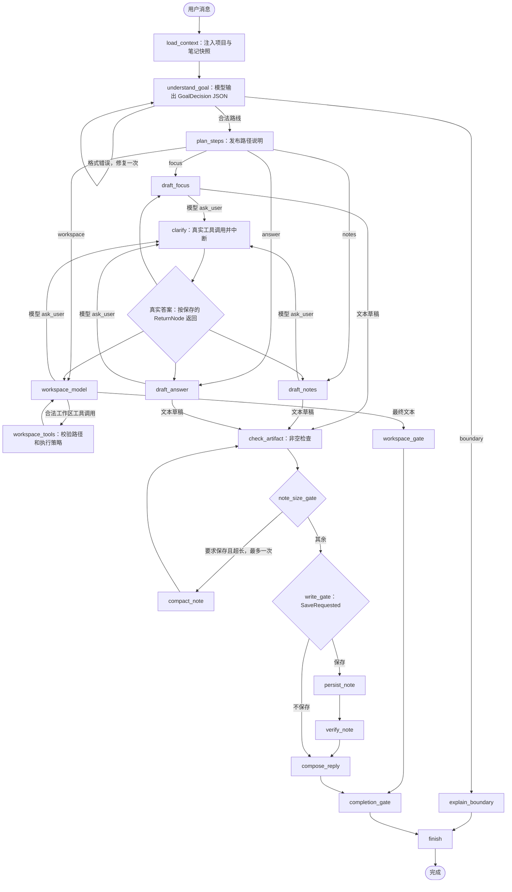

# 阶段 02：研究业务图详细设计

日期：2026-10-19。状态：结构化业务路由与模型 ask_user 已实施。

本文描述当前源码。完整交互协议、预算、版本、测试和已知边界见 [ROUTING_AND_INTERACTION.md](ROUTING_AND_INTERACTION.md)。之前的目标设计保存在 [历史设计](archive/GRAPH_DESIGN-2026-10-19-before-routing.md)，其中结构化证据产物、共享模型预算和完整工具目录等尚未全部实施。

## 1. 业务路径

| 模型返回 route | 处理 |
| --- | --- |
| focus | 整理候选方向、权衡与下一步 |
| notes | 根据已加载的真实笔记生成整理草稿 |
| answer | 项目资料问答、解释和普通追问 |
| workspace | 通过现有文件、命令和写入工具完成代码工作 |
| boundary | 说明外部论文检索、服务器实验等尚未接入的执行能力 |

讨论论文或实验思路仍可走 focus/answer；请求真正执行尚未支持的能力才走 boundary。route、scope、save 由模型输出并经本地结构校验；没有关键词回退。scope 为空也可以直接起草。

## 2. 实际拓扑

图中 H 是说明性分发框，对应 clarify 上的条件边，不是新增节点。scope_gate 和 route_revision 已删除。所有条件函数只读 State；模型选择业务含义和工具，代码限定可以执行的路线。

## 3. 关键条件边

| 起点 | 条件 | 终点 |
| --- | --- | --- |
| understand_goal | GoalError 非空 | understand_goal；只允许一次修复 |
| understand_goal | Route=boundary | explain_boundary |
| understand_goal | 合法普通路线 | plan_steps |
| plan_steps | Route=focus/notes/workspace | 对应业务模型；默认 answer |
| 各 draft / workspace_model | Interaction.Pending 非空 | clarify |
| clarify | ReturnNode=原业务节点 | draft_focus / draft_notes / draft_answer / workspace_model |
| workspace_model | 无交互 pending，存在工作区工具调用 | workspace_tools |
| workspace_model | 已形成文本输出 | workspace_gate |
| note_size_gate | SaveRequested 且超长且未压缩 | compact_note |
| write_gate | SaveRequested | persist_note；否则 compose_reply |

clarify 不返回 understand_goal。工具结果追加到原消息序列，保留原范围、保存意图与此前答案。

## 4. 节点与状态归属

| 类型/节点 | 职责 |
| --- | --- |
| ResearchState | History、项目/笔记快照、路由、Scope、SaveRequested、草稿、输出与交互/工作区状态 |
| GoalDecision | 模型结构化输出的 route/scope/save；仅解释业务路线，不是工具 |
| InteractionState | 保存已接受调用、ReturnNode、已完成追问数与真实确认答案 |
| DraftMessages | 原起草节点完整的调用/结果序列，恢复后接着对话 |
| WorkspaceRunState | 工作区消息、轮次、工具调用数和最终答复状态 |
| load_context | StateNode；注入本轮接收时冻结的快照，不冒充 read_project/list_notes 工具 |
| understand_goal | ChatModelNode；无 Functions，最多一次结构修复 |
| draft_focus / draft_notes / draft_answer | ChatModelNode；文本草稿或 ask_user 调用 |
| clarify | 仅注册 ask_user 的 ToolsNode；稳定调用、Graph 中断与结果校验 |
| workspace_model / workspace_tools | 七个既有工作区工具加 ask_user；交互调用转入 clarify，其余工具转入 workspace_tools |
| check_artifact | 当前只检查草稿非空，不声称已完成研究语义或引用校验 |
| note_size_gate / compact_note | 保存前最多压缩一次，持久化前仍校验 4000 字符上限 |
| write_gate / persist_note / verify_note | 读取保存意图、调用现有 SaveNote 用例、检查 NoteSaved；不冒充独立 save_note 工具 |
| compose_reply / completion_gate | 根据草稿与真实答案形成最终文本，检查非空，并附上确认答案元数据 |
| finish | 返回唯一最终助手消息的隔离副本 |

数据库连接、工具、模型和工作区策略由闭包注入，不进入 ResearchState。工具参数不能指定用户或项目身份。图仍直接位于应用层，未增加 Agent 架构层。

## 5. 交互与副作用边界

模型先生成并提交 ask_user 调用，再由独立工具节点执行中断。重建图或重启服务后，恢复读取已保存的调用，不重新生成题目。一次一问，可连续追问；每轮最多完成三次。用户回答不是写入批准。

工作区整批调用先校验：纯读最多四个；ask_user、write_file、apply_patch、run_shell 必须独占。非法混合批次不执行任何调用。写文件仍沿用现有确认；受限 shell 的完整确认后执行闭环尚未扩展。

本轮交互保存在 State，最终写入助手消息 Extra，下一轮从正式历史读取。前端沿用可编辑选项与自定义回答框；pending 问题、公开阶段说明和最终助手消息分别显示。

## 6. 版本、验证和后续能力

当前定义版本为 autoresearch-phase2-graph-v2，StateCodec 版本为 2。旧版未完成轮次由 worker 在执行前拒绝自动套用新图，提示结束旧轮次后重新发送。SQLite 重开恢复、跨图重建恢复与原业务路径续行均有测试。

当前模型限制为：路由修复一次、追问三次、工作区八轮/二十四次工具调用、图四十八步、worker 每个执行段五分钟。尚未实现全图统一计费预算、结构化引用证据校验、项目笔记工具目录、多问题问卷、复合任务调度、学术 MCP 或服务器实验。

后续论文和实验流程分别增加来源、证据、计划、执行与回执校验路径，并按需共享 ask_user。升级状态和工具契约时同步定义版本和恢复测试。自动与手动验证步骤见 [交互验收](ROUTING_AND_INTERACTION.md#7-自动验收)。
