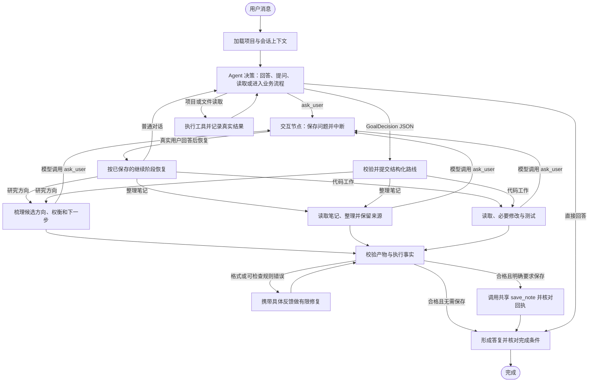

# AutoResearch 工具、路由与用户交互重组提案

日期：2026-10-19。状态：核心路由与 ask_user 已实施；统一项目工具目录、完整 shell 授权和复合任务等仍为目标提案。

本文保留重组前盘点与完整目标方案；已确认采用“简单业务分流使用结构化路由、动态提问使用真实工具调用”。当前实现和验收以 [GRAPH_DESIGN.md](GRAPH_DESIGN.md) 与 [ROUTING_AND_INTERACTION.md](ROUTING_AND_INTERACTION.md) 为准。实现范围限于 AutoResearch 应用，不修改 goHarness 框架。

## 1. 问题与设计结论

当前流程把研究对象限定为“仓库级缺陷 / 单文件缺陷”，适用于演示，不能覆盖计算机专业学生的其他研究主题。问题在业务判断和提示词组织，而不是“条件边由代码执行”本身。

重组后，模型判断当前目标、是否需要追问、问题与选项、需要调用哪些工具。应用校验调用是否合法、是否具备用户授权、是否达到预算以及真实结果是否满足完成条件。Graph 执行允许的路径，并保存和恢复状态。

保留研究业务流程：方向整理需要形成可讨论的方案与下一步；笔记整理需要读取真实笔记并保留来源；代码工作需要读取、修改、验证；后续调研与实验分别增加证据和执行流程。工具循环服务于这些流程。

## 2. 重组前实现盘点（历史基线）

本节记录本次代码改造前的状态，便于理解问题；当前固定 scope_gate、伪路由工具和关键词回退已移除，clarify 已改为真实 ask_user ToolsNode。

| 名称 | 当前真实形态 | 重组处理 |
| --- | --- | --- |
| `select_research_route` | 给模型的 FunctionDefinition，加应用解析器；没有通过 `tool.New` 注册成可执行工具 | 已移除；采用模型输出 GoalDecision JSON 的结构化路由 |
| `list_directory` | 已注册的文件工具 | 保留 |
| `read_file` | 已注册的按行读取工具，返回哈希与截断标记 | 保留 |
| `search_files` | 已注册的文本/正则搜索工具 | 保留 |
| `git_diff` | 已注册的 Git 差异工具 | 保留 |
| `run_shell` | 已注册的命令工具；受限命令返回 `ConfirmationRequired`，当前没有完整的确认后执行通路 | 补齐真实授权与恢复执行；不得把“需要确认”显示成“命令已运行” |
| `write_file` | 已注册工具，确认后创建/覆盖文本文件 | 保留并统一授权协议 |
| `apply_patch` | 已注册工具，校验与确认后应用补丁 | 保留并统一授权协议 |
| `load_context` | 直接把本轮项目与笔记快照放入 State | 保留为初始化节点；不假称模型调用了读取工具 |
| `persist_note` | State 节点直接调用注入的 `SaveNote` 用例 | 抽出共享的 `save_note` 工具实现，图与模型复用同一用例 |
| `clarify` | State 节点直接执行 `graph.Interrupt`，问题与两个选项固定 | 改为模型可调用的 `ask_user`，问题与选项由模型生成 |
| `read_project/list_notes/ask_user/save_note` | 已在阶段设计中出现，当前未作为这四个名称的工具注册 | 在本次重组中统一实现，更新设计与实现的对应关系 |
| `request_clarification` | 此前交流中的示例名称，当前没有实现 | 不再另设同义名称，统一使用 `ask_user` |

`scope_gate` 当前写死“focus 且 scope 为空就追问”；`write_gate` 和 `route_revision` 当前主要是空操作或接线节点。应分别改为调用校验、真实修复流程或直接条件边，不保留只有名字而没有业务职责的门槛。

`understand_goal` 当前同时提供函数定义、要求文本 JSON，并在解析失败时回退到关键词路由。真实模型路径现已采用严格结构化路由协议；错误时返回一次可理解的协议反馈，不能静默用关键词替代模型决策。离线 fixture 可以保留确定性行为。

## 3. LangGraph 的对应做法

LangGraph 官方提供三种相关模式：

| 模式 | 决策来自哪里 | 边怎么处理 | 对本项目的用途 |
| --- | --- | --- | --- |
| 结构化 Router | 前一个模型节点返回 `decision` | `add_conditional_edges` 读取该值，映射到允许节点 | 选择研究、笔记或工作区业务流程 |
| Tool-calling Agent | 模型消息中的 `tool_calls` | `tools_condition` 或同类函数选择工具节点/结束 | 按需读取文件、查笔记、调用命令、询问用户 |
| 状态更新并路由 | 节点执行结果 | `Command(update=..., goto=...)` | 需要同时更新状态和决定下一节点的流程 |

条件边依然由代码执行。官方 Router 示例也是模型先决定，Python 函数再映射下一节点。LangGraph 并不要求每个分支建立独立的 gate 节点，也不要求把每条边包装成工具。

LangGraph 允许交互节点或工具内部调用 `interrupt`，恢复使用 `Command(resume=...)`。goHarness 的中断要求有效的检查点与节点交互上下文；当前源码也已提供带检查点协调的嵌套执行和分支任务中断，不能概括成“只支持顺序根图”。路由与 PostHandler 仍不开放交互，也不能假设任意异步工具回调都具备中断上下文。本提案选择独立的顺序交互节点承接 `ask_user` 和动作审批，是为了固定调用、问题与恢复阶段，并非框架唯一允许的实现；模型先提交请求，节点再调用 `graph.Interrupt`。

AutoResearch 对应使用 `graph.Interrupt` 和 `graph.WithResume`，不引入 LangGraph 依赖，也不声称 goHarness 有完全相同的 `Command` API。当前框架已有 `NewState().Branch(...)`；本提案不要求迁移图的输入输出类型，实施时可以保留现有 `AddBranch`，直接读取已提交的模型决策。

两者的 API 接线语义不能机械照搬：当前 goHarness 的 `AddBranch` 使用条件边加普通兜底边；LangGraph 的普通边可能与条件路由一起调度，不能把 goHarness 的兜底写法直接复制过去。

## 4. 统一的工具目录

### 4.1 目标目录（含后续扩展）

| 工具/控制调用 | 用途 | 模型选择什么 | 应用负责什么 |
| --- | --- | --- | --- |
| `GoalDecision`（非工具） | 结构化选择业务流程 | route、scope、save | 仅允许已实现路线，提交状态后由条件边分发；不接受任意节点名 |
| `ask_user` | 补充信息、选择研究方案 | 问题、选项、单选/多选和是否允许暂缓 | 校验问题结构、保存中断、校验与回填真实回答 |
| `read_project` | 按需刷新项目资料 | 是否读取 | 注入当前项目身份，返回内容与版本 |
| `list_notes` | 分页查项目笔记 | 查询条件、游标与数量 | 当前项目过滤、分页限制与真实记录 |
| `read_note` | 读取指定笔记完整内容，新增候选工具 | 当前项目内笔记 ID | 归属、版本与不存在处理 |
| `save_note` | 保存本轮明确要求记录的内容 | 正文、来源和用途 | 保存意图、长度、来源、稳定操作身份与真实回执 |
| `list_directory/read_file/search_files/git_diff` | 理解现有代码和研究材料 | 查询、路径、行号与基准 | 工作区范围、大小、哈希、输出截断与失败事实 |
| `write_file/apply_patch` | 写研究脚本、配置和材料 | 修改内容 | 文件版本、变更预览、授权、原子性与回执 |
| `run_shell` | 检查环境、运行短测试和构建 | 命令、工作目录与执行目的 | 策略判断、必要授权、超时、退出码与输出限制 |

`GoalDecision` 是结构化路由输出，不注册为工具；请求中不带函数定义。交互使用真实 ask_user 工具，资源操作使用对应能力组。应用校验模型结果、提交 State，再由条件边分发；模型不能传入 finish 或其他任意节点名。当前只落地 ask_user 和既有工作区工具，其余目录项仍是后续工作。

初始化加载小份项目快照，无需模型先调用 `read_project` 才能回答。后者用于用户要求刷新资料时；`list_notes/read_note` 用于超出初始化快照的按需读取。笔记保存失败不得用本地文件写入绕过。

`update_plan` 暂不新增为模型工具。当前进度由已提交的业务步骤和工具事实产生；以后需要模型维护长任务清单时，再引入独立的计划编辑协议。

### 4.2 后续阶段的接入位置

以下是预留能力，不在本次阶段二重组中实现；名称仍需在对应阶段定稿。

| 能力组 | 候选工具 | 对应业务流程 |
| --- | --- | --- |
| 论文来源 | `search_papers/get_paper_metadata/read_paper_section` | 检索 → 筛选 → 阅读 |
| 项目论文与证据 | `save_paper/list_papers/read_paper/search_project_evidence` | 归档 → 分析 → 引用定位 |
| 方向与报告 | 方向提案保存/读取、报告保存/读取 | 比较方向 → 用户选择 → 证据综合 → 报告校验 |
| 实验计划 | `create_experiment_plan/update_experiment_plan/read_experiment_plan` | 明确假设 → 只读环境核查 → 形成版本化计划 |
| 服务器与执行 | `inspect_server/prepare_workspace/submit_experiment` | 计划校验 → 用户确认具体版本 → 提交并核对任务身份 |
| 实验跟踪 | `get_experiment_status/tail_experiment_logs/collect_experiment_artifacts/cancel_experiment` | 跟踪 → 收集 → 比较，或按用户请求取消 |

`analyze_paper/propose_directions/generate_report` 涉及模型推理或多步编排，应优先定义为业务流程。只有需要被其他流程复用时，才暴露受限的工作流入口，内部模型调用仍计入总预算。

学术 MCP 通过应用工具适配与归一化，不把外部工具目录全部暴露给模型。远程长实验走专门提交/跟踪接口，不扩大本地 `run_shell` 的权限来代替实验管理；服务器侧是否部署进程仍按现有 SSH Connector 方案处理。

### 4.3 工具注册的共同约束

工具目录统一维护名称、说明、schema、实现、可用业务阶段、权限策略、超时、输出上限和幂等规则。模型声明与执行器注册由同一目录产生，避免出现“模型看到一个工具，执行器却不认识”。这只是应用模块，不新建 Agent 层。

每个模型节点只获得当前可用的能力组。共同的 `ask_user` 与必要的项目读取能力可以跨流程复用；起草/压缩节点不获得 shell、写文件或路由工具。某项能力尚未接通时，不注册给模型。

## 5. 建议的业务图

图中的块表示职责；实施时再确定哪些是模型节点、ToolsNode 或多步业务路径。校验节点只检查可验证的规则与真实执行事实，研究方向是否有价值仍是模型建议和用户讨论的内容。

具体规则：

1. 简单解释直接回答，不强制每轮先分类、起草、再重新写一遍答复。
2. 问题会实质影响下一步时，模型调用 `ask_user`。没有“所有研究都必须先选缺陷粒度”的前提。
3. 用户回答以原工具调用的结果回传；恢复分发器读取已保存的任务 ID 和继续阶段，返回原业务决策阶段，不能一律回到全局路由。保留已有资料与已确认约束，不清空状态重新解释整轮目标。
4. 如果需要模型理解自由文本回答，可以调用当前业务阶段的决策节点；这是继续当前任务，不是强制重跑全局路由。用户明确改变目标时才重新选路线。
5. 业务内部可以调用相同工具，例如代码检查结论保存为笔记。模型选择的单一 route 不应导致其他必要能力不可用；多目标请求保存后续任务清单，串行推进，每个任务都须满足自己的完成条件。
6. `save_note` 只有一份实现。模型直接提出保存和业务图按已确认意图保存都调用它；同一任务、同一产物版本的保存使用同一操作身份，不再额外保存第二次。
7. 业务校验与保存成功后，能直接展示的产物不再强制交给模型改写。确实需要衔接解释时才生成补充答复。

### 5.1 哪些选择交给模型

| 决策 | 责任方 |
| --- | --- |
| 当前消息是追问、整理请求还是代码操作 | 模型结合历史判断 |
| 哪些信息缺失且值得追问；如何给出选项 | 模型 |
| 选择研究路线、检索查询、文件与后续研究行动 | 模型在可用能力范围内选择 |
| 工具是否已注册、参数结构是否正确 | 代码 |
| 是否越过项目/文件范围、是否需要授权 | 代码 |
| 文件是否已变化、笔记是否真保存、命令是否真执行 | 代码核对真实状态 |
| 重试预算、超时、调用结果配对、结束条件 | 代码 |

条件函数只读取已提交的决策/结果，映射到预先声明的路径；不在条件函数里再次调用模型、写库或执行中断。

## 6. 用户交互与工具执行审批

统一底层中断，保留两种业务载荷。

| 交互类型 | 由谁触发 | 界面 | 回答如何使用 |
| --- | --- | --- | --- |
| `clarification` | 模型调用 `ask_user` | 可编辑的选项、单选/多选、自定义文本框 | 作为用户事实/偏好返回模型，不授予执行权限 |
| `action_approval` | 工具执行策略发现当前动作需要授权 | 动作预览、允许/拒绝；有必要时编辑后重新预览 | 仅授权绑定的动作、目标和版本 |

当前 ask_user 每次一个 question 和可选 choices，每轮最多三次；以下多问题问卷是后续目标。未来建议一次提交 1–3 个相关问题。每个问题含稳定 ID、问题正文、选项列表和选择模式；每个选项含稳定 ID、标题与可选说明，允许用户修改文字。前端始终提供自定义回答入口；后端接收选中 ID、编辑后文字与自定义文字，原样保留。

问题与选项来自模型，但模型不得提供 `approved=true`、会话身份或中断 ID。模型提交请求后，由顺序交互节点生成并保存中断载荷。真实回答通过受会话范围校验的 Resume API 进入。后端验证答案对应的 pending 问题后再恢复。

审批不新增一个由模型调用的“批准工具”。拒绝产生真实的 declined 结果，模型据此说明、调整方案或继续其他工作，不反复请求同一授权。动作内容修改后重新计算版本/摘要，旧确认不能沿用。

工具执行前先校验完整调用批次，规则固定为：

- `ask_user` 独占一批，一次调用内可以包含多个问题。
- 结构化路由单独请求，不携带工具调用；不再存在 select_research_route 工具。
- `save_note/write_file/apply_patch/run_shell` 每批只允许一个调用，无论该调用最终是否需要审批。
- 其余明确注册为纯读的工具可以合批，阶段二最多 4 个；应用按原始调用顺序逐项驱动，不依赖工具节点并发槽位来保证顺序。

当前违反规则时整批不执行并明确失败。后续可为每个合法调用 ID 生成配对的协议错误结果，让模型至多修正一次；调用 ID 缺失或重复等无法正常配对的协议错误直接失败。不能执行一半后再发现夹带了提问、路由或写入调用。中断和检查点错误属于控制信号，必须继续向框架传递，不能包装为普通工具失败。

审批后的外部写入仍须幂等或能核对执行状态；把副作用放在中断后不能解决“写入成功但检查点未提交”的崩溃窗口。本地命令启动后若丢失退出回执，将该操作记为 `unknown`，不得自动重放。只有命令适配器通过稳定操作 ID、进程身份或持久化退出回执核对清楚后，才决定继续或结束；无法核对时以 `execution_unknown` 结束本轮，明确说明不能确认执行结果。超时、取消或后端重启都不等于命令未产生副作用。

## 7. 状态、代码边界和前端输出

以下类型是应用候选契约，不是框架公共 API。`ClarificationRequest` 由模型产生，`clarify` ToolsNode 在当前应用的顺序根图路径中执行 ask_user 并暂停；它不是并发工具的隐式副作用。

| 对象 | 内容 | 生产者 → 消费者 |
| --- | --- | --- |
| `TaskIntent` | 任务 ID、类型、用户目标、约束、后续任务、保存意图来源 | 模型控制调用与应用校验 → 业务流程 |
| `ClarificationRequest` | 问题/选项/选择模式、提出问题的任务与继续阶段 | `ask_user` 参数校验 → 中断与前端 |
| `ClarificationAnswer` | 问题 ID、选中 ID、编辑内容、自定义答案 | 用户 Resume → 工具结果与当前任务 |
| `PendingAction` | 稳定操作 ID、工具、参数摘要、目标版本、预览 | 执行策略 → 审批与恢复执行 |
| `Artifact` | 产物 ID、类型、正文、版本、来源、检查结果 | 业务流程 → 前端、保存与答复 |
| `ToolReceipt` | 调用 ID、真实状态、对象 ID/版本、执行凭据 | 工具 → 完成校验与答复 |

`ResearchState` 保存这些可恢复数据、消息和累计预算，不保存数据库连接、模型实例或 SSH 客户端。图定义、StateCodec 与工具目录一起版本化；旧 pending 轮次继续使用旧定义，无法兼容时明确要求结束旧轮次，不用新载荷强行恢复。

模型决策节点先提交完整响应、调用 ID、规范化参数、任务 ID、操作 ID 与继续阶段，并要求同步检查点保存成功，随后才进入工具执行节点。稳定身份来自已接受的调用和逻辑操作，不在恢复时按时间或 Attempt 重新生成。执行节点从 State 读取固定调用，`ask_user` 使用固定问题载荷；恢复重放工具节点时不再次请求模型生成该问题。审批和命令执行同样先保存参数与目标版本，再等待或执行。命令启动前登记操作台账，已有 `running/unknown` 操作先核对，不能当作尚未启动。

应用仍采用现有分层：`internal/app` 定义图、目录、交互与策略；`internal/domain` 定义项目/笔记/实验规则与接口；`internal/infra` 实现数据库、模型、MCP 和 SSH；`internal/transport` 处理 HTTP/SSE。工具与手动操作复用应用用例，不写两套存储规则。

前端分别展示公开说明的流式增量、工具活动、可折叠产物和待回答卡。不展示内部控制 JSON、系统提示或模型推理过程。原始 token 流与业务进度是不同事件；不通过重复推送整段摘要模拟流式输出。保存后提供真实笔记链接，恢复时按稳定事件/产物 ID 更新原卡片。

## 8. 建议实施顺序与验收

1. 固定工具目录和交互协议，明确模型可调用的真实名称；同步阶段文档，保留旧检查点的兼容方案。
2. 实现 `ask_user` 和统一的控制调用，移除真实模型路径的关键词路由与硬编码研究选项；接入现有选项编辑和自定义输入组件。
3. 抽出项目/笔记工具及共享 `save_note`，让跨路径的保存走同一用例与回执核对。
4. 重组业务图，合并空门槛，保留方向整理、笔记整理、代码验证的专门步骤；不强制每次回答都走完整工作流。
5. 统一文件写入与 shell 的授权/恢复，最后做前后端自动化验证。

关键验收场景：

- 用户讨论视觉模型或数据库优化时，追问不再固定出现“仓库级/单文件缺陷”。
- 用户只要求先给三个研究方向时，可直接给候选与权衡，不机械阻塞在范围选择。
- 用户修改选项或填写自定义答案，刷新/重启后恢复同一任务，不覆盖已确认事实、不重复显示消息。
- “查看代码、运行测试，再把结论记下来”能跨能力完成，并提供真实退出码和一条笔记回执。
- 拒绝文件或命令操作后没有执行；修改动作后原授权失效；只返回需要确认时不能宣称成功。
- 错误工具名、协议错误和未知 route 有明确处理，不静默按关键词执行其他业务。
- 中断前后及副作用提交窗口发生故障，不重复保存/写入；无法判定远程提交结果时先核对。
- 普通追问减少不必要的模型调用；重试和工具内部模型调用不能绕过累计预算。

本轮仅交付设计提案。上述场景是后续实施的验收标准，不是本轮测试结果。

## 9. 参考与当前源码

- [LangGraph Workflows and agents](https://docs.langchain.com/oss/python/langgraph/workflows-agents)：结构化 Router 与工具调用 Agent。
- [LangGraph Graph API](https://docs.langchain.com/oss/python/langgraph/graph-api)：条件边与 Command。
- [LangGraph Interrupts](https://docs.langchain.com/oss/python/langgraph/interrupts)：工具内中断、恢复与副作用要求。
- 当前应用：[research_graph.go](../../internal/app/research_graph.go)、[research_state.go](../../internal/app/research_state.go)、[workspace_tools.go](../../internal/app/workspace_tools.go)。
- 当前框架：[builder.go](../../../../../pkg/graph/builder.go)、[interrupt_input.go](../../../../../pkg/graph/interrupt_input.go)。
