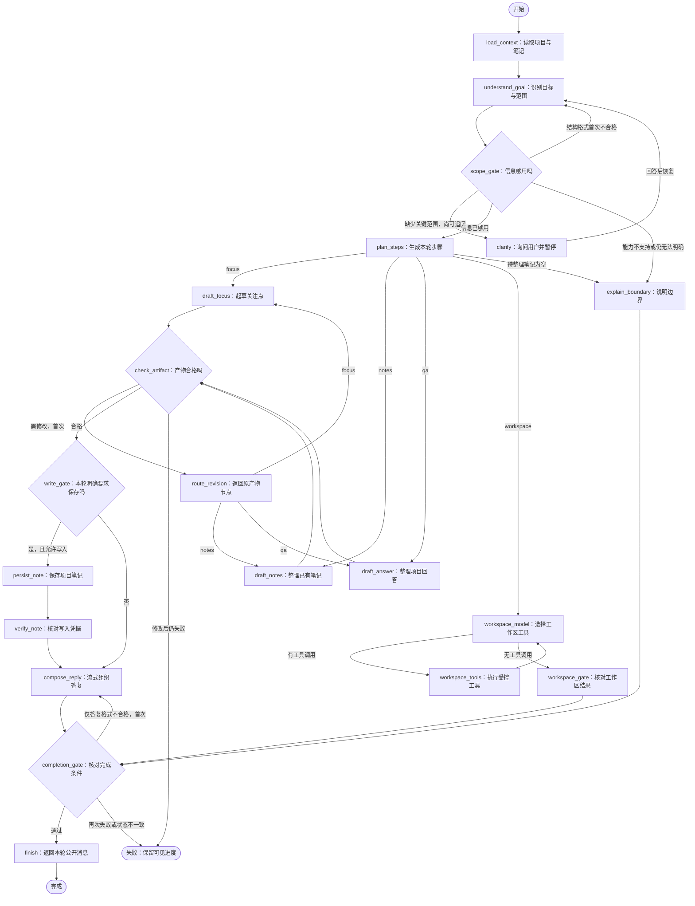

> 历史设计，保留原文供核对；当前实现以 ../GRAPH_DESIGN.md 和 ../ROUTING_AND_INTERACTION.md 为准。

# 阶段 02：研究业务图详细设计

**状态：** 已按阶段二 MVP 实施；本版增加受控工作区工具子图，论文检索、实验执行和 MCP 仍待后续阶段。  
**日期：** 2026-10-19。  
**所属设计：** [DESIGN.md](DESIGN.md)；实施步骤见 [IMPLEMENTATION.md](IMPLEMENTATION.md)。

本文件定义阶段二的节点、状态、路由、产物检查和恢复规则。会话、事务、HTTP、SSE 与取消仍以 DESIGN 为准。图位于四层架构的应用层，产品本身就是一个研究 Agent。

## 1. 先看实际业务

项目研究问题：“Agent 的工具选择如何影响代码修复成功率？”

用户输入：“帮我明确下一步关注点；评测对象不清楚就先问我，整理后保存为项目笔记。”

| 顺序 | 图执行的工作 | 用户看到的结果 |
| --- | --- | --- |
| 1 | 读取本轮项目快照和最近笔记 | 正在读取项目资料；显示真实工具卡 |
| 2 | 识别为“明确研究目标”，提取主题、目标及保存意图 | 本轮任务为整理研究关注点 |
| 3 | 检查研究范围，发现评测对象不明确 | 询问“先关注单文件缺陷还是仓库级缺陷？”并暂停 |
| 4 | 用户选择仓库级；恢复后重新提取范围 | 范围卡显示“仓库级缺陷”，来源为用户补充 |
| 5 | 生成本轮步骤，再起草关注点 | 目标、候选比较方式、2–3 项后续行动、仍待确定的问题 |
| 6 | 检查是否沿用用户范围、是否编造已完成实验、保存内容是否合格 | 检查不通过时最多修改一次；合格后才进入写入节点 |
| 7 | 保存笔记，核对返回的笔记 ID 和正文 | 真实笔记 ID；笔记栏出现新记录 |
| 8 | 根据已检查的产物与真实写入结果组织答复 | 总结本轮结果，说明尚未检索论文或运行实验 |

保存失败时，本轮不能宣称保存成功；等待回答时，不允许先保存一个猜测范围的笔记。另一会话询问“之前整理了什么”，走项目问答路径，不重新起草研究目标。

## 2. 四条当期业务路径

| 路径 Kind | 典型请求 | 必要输入 | 产物和完成条件 |
| --- | --- | --- | --- |
| `focus` | 明确下一步研究关注点、缩小问题、形成待验证思路 | 主题、希望解决的问题、会影响建议的研究对象 | ScopeBrief 与 2–3 项具体下一步；已知事实、建议、待定项分开；用户要求时保存新笔记 |
| `notes` | 把已有笔记整理成研究摘要、合并重复关注点 | 当前项目真实笔记；用户指定时须匹配笔记 ID | NoteDigest，逐项保留来源笔记 ID；保存操作只新增汇总，不修改或删除原笔记 |
| `qa` | 读项目目标、查看笔记、解释当前已经确定的内容 | 项目快照、当前笔记和正式历史 | ProjectAnswer，区分项目事实与一般建议；默认只读，不经过写入节点 |
| `workspace` | 查看项目文件、搜索代码、检查 diff、运行受控测试或在确认后修改文件 | 应用注入的工作区根目录与策略 | 工具结果摘要与工作区答复；写入必须中断等待用户确认 |
| `unsupported` | 搜索新论文、连接远程服务器、自由闲聊等当期未支持请求 | 用户原目标 | 说明当前能力与下一阶段入口；不创建伪论文、伪任务或伪实验结果 |

“列出笔记”归 qa，“整理这些笔记的共识并另存”归 notes。“讨论研究方法”可以归 focus/qa，但不得声称有真实文献证据。混合请求先执行可支持部分，并在产物中列出未执行部分；若任务无法合理拆分，则走 unsupported，明确建议用户拆成下一条目标。本阶段不实现任意任务树或跨任务自动串行调度。

## 3. 总图



图中所有命名块均为真实根图节点。失败出口表示节点返回错误，不是一个伪成功 finish。`route_revision` 只选择本次已经确定的 Kind，不重新理解目标，不绕回 load_context，也不重复保存。

工作区子图有一个显式限额的 `model→tools→model` 循环，主图其余部分没有开放式循环。模型只负责选择已注册工具；图规定必须经过的检查、确认和结束顺序，模型不能发出工具调用改变业务路径。

### 3.1 精确路由表

| 出发节点 | 条件 | 下一节点 |
| --- | --- | --- |
| load_context | 读取成功 | understand_goal |
| understand_goal | 完整响应已提交，包括可修复的格式错误 | scope_gate |
| scope_gate | 结构化输出错误且理解修复次数为 0 | understand_goal，携带一次结构反馈 |
| scope_gate | Kind 不支持；或 2 次追问后仍缺关键范围 | explain_boundary |
| scope_gate | 有关键缺口且 ClarificationRounds < 2 | clarify |
| scope_gate | 输入充分 | plan_steps |
| clarify | 工具返回答案并提交 | understand_goal |
| plan_steps / route_revision | Kind=focus / notes / qa / workspace | draft_focus / draft_notes / draft_answer / workspace_model |
| workspace_model | 尾部有工具调用 | workspace_tools |
| workspace_model | 没有工具调用且已形成答复 | workspace_gate |
| workspace_tools | 工具结果已提交 | workspace_model |
| workspace_gate | 工作区答复已形成 | completion_gate |
| 各 draft 节点 | 完整响应已提交，包括格式错误 | check_artifact |
| check_artifact | 校验失败且 ArtifactRevisions=0 | route_revision，记录反馈并递增修复次数 |
| check_artifact | 通过 | write_gate |
| write_gate | Kind=focus/notes、明确保存、产物可保存 | persist_note |
| write_gate | 只读或无需保存 | compose_reply |
| persist_note | 工具返回成功或 IsError 结果 | verify_note |
| verify_note | 凭据与预期正文一致 | compose_reply |
| compose_reply / explain_boundary | 已提交公开答复 | completion_gate |
| completion_gate | 仅最终答复空白/意外工具调用，ReplyRevisions=0，且来源不是 explain_boundary | compose_reply，递增修复次数 |
| completion_gate | 全部完成条件通过 | finish |

普通顺序边为 Start→load_context→understand_goal、clarify→understand_goal、各 draft→check_artifact、persist_note→verify_note→compose_reply、compose_reply/explain_boundary→completion_gate、finish→End。工具执行/协议错误随节点返回；verify_note 的已提交错误凭据不得通过重试跳过。

表中未列出的错误均直接失败；理解格式第二次失败为 `invalid_goal`，产物第二次失败为 `invalid_artifact`。每个有条件分支的来源节点用 `graph.AddBranch` 注册互斥条件，并有且只有一个普通默认边；默认边指向安全节点，由该节点的前置检查拒绝未知状态。条件只读取 State，不调用 LLM、工具、数据库或 graph.Interrupt。分支节点返回与 ResearchState 不同的 BusinessStepResult，避免条件输入同时匹配节点输出和 State（装配方式见第 7 节）。

路由表中的次数条件在门槛节点入口判断。节点内递增已消耗的修复计数，并将本次选定目标写入 `NextNode`；提交后的分支只判断 NextNode 等于哪个常量，避免“先递增再判断旧次数”选错分支。六个控制节点每次进入先清空旧 NextNode，失败不复用上一节点的路由结果；目标必须属于各节点在本表声明的集合。

## 4. 每个节点做什么

| NodeID / 组件 | 输入与前置条件 | 提交到 State 的内容 | 错误、限制与公开输出 |
| --- | --- | --- | --- |
| load_context / ToolsNode | 可信项目闭包；固定 read_project，再 list_notes(limit=10) | ContextFacts 与原始规范调用/结果消息 | 任一读取失败不让模型猜上下文；展示工具卡；只在本轮初始执行一次 |
| understand_goal / ChatModelNode | 冻结目标、真实项目/笔记、正式历史、用户补充和结构反馈 | GoalDecision 或结构错误；LLMCalls+1 | 内部 JSON 不进入公开消息；无 Functions |
| scope_gate / 业务 Runnable | 已提交的目标解析 | 关键缺口、下一问题、理解修复标记或边界说明 | 不调用模型；缺少关键范围时不能继续起草 |
| clarify / ToolsNode | scope_gate 已固定的问题；只装配 ask_user | 一对调用/答案消息、ScopeAnswer、ClarificationRounds+1 | graph.Interrupt 暂停；未回答不增加轮数；每次一个问题 |
| plan_steps / 业务 Runnable | 支持的 Kind、关键输入完整 | 固定节点映射的 PlanStep 列表、将采用的范围 | 不由模型创造可执行节点；计划为进度清单，无需另加批准 |
| draft_focus / ChatModelNode | 已明确范围、项目和笔记；必要时含一次产物反馈 | Kind=focus 的 DraftArtifact 或结构错误；LLMCalls+1 | 输出关注点、比较建议、2–3 项行动和未决项；内部 JSON |
| draft_notes / ChatModelNode | 非空笔记集合，选定 ID 均属 ContextFacts | Kind=notes 的 DraftArtifact 或结构错误；LLMCalls+1 | 只能整理已有笔记；空集合由 plan_steps 标记空结果，跳过起草并禁用保存 |
| draft_answer / ChatModelNode | 当前项目事实和问题 | Kind=qa 的 DraftArtifact 或结构错误；LLMCalls+1 | 来源只能是当前项目、笔记、正式历史；一般知识须标为建议 |
| check_artifact / 业务 Runnable | 对应 Kind 的草稿或结构错误 | 检查结果、可展示的已检查产物、修复反馈 | 不写笔记；不合格最多回原 draft 一次 |
| route_revision / 业务 Runnable | 首次修复、Kind 不变、反馈非空 | 清除未通过草稿，保留反馈与范围 | 不重读资料，不修改用户答案 |
| write_gate / 业务 Runnable | 已检查产物 | SaveText 或只读原因 | 仅 focus/notes 且有本轮明确保存要求才能写；不能因项目“通常保存”而擅自写入 |
| persist_note / ToolsNode | 非空合格 SaveText；只装配 save_note | 原始调用/结果消息与 NoteReceipt | 工具键由框架提供；正文变更不能复用旧键 |
| verify_note / StateNode | 保存调用与返回值 | SavedNoteID、核对通过标记 | IsError、缺 ID、正文摘要不符均为 `note_write_failed`，不进入成功答复 |
| compose_reply / ChatModelNode | 已检查产物、问题答案、写入/只读事实及能力边界 | ReplyCandidate；LLMCalls+1 | 无 Functions；公开流式文本。修复只重做答复，不再保存笔记 |
| explain_boundary / StateNode | 不支持、关键范围仍不足或空笔记结果 | 模板助手消息、未执行原因 | 不调用模型；清楚区分“能力尚无”“信息不足”“没有笔记” |
| workspace_model / ChatModelNode | 用户明确要求检查或修改当前项目工作区 | Workspace.Messages、轮次和工具调用计数 | 只获得七个工作区工具定义；最多 8 轮，不得选择业务节点 |
| workspace_tools / ToolsNode | workspace_model 生成的尾部工具调用 | 脱敏工具结果追加到 Workspace.Messages | 路径、命令、输出和写入确认由应用策略限制；结果通过 PostHandler 发布摘要 |
| workspace_gate / 业务 Runnable | 工作区模型已返回无工具调用的最终答复 | Workspace.Completed 与 Output | 没有最终答复或预算耗尽直接失败，不进入 finish |
| completion_gate / 业务 Runnable | 全部公开消息、检查状态与保存凭据 | 完成校验状态或一次答复修复反馈 | 不校验通过不能 finish；检查调用配对和业务后置条件 |
| finish / 普通 Runnable | completion_gate 通过 | 返回 Output 的隔离副本 | 框架完成检查点保存后才由 worker 提交业务 completed/result |

### 4.1 工作区子图：模型选工具，代码控业务边

`workspace` 是根图中的一条业务路由，不是第二个 Agent 服务。`workspace_model` 是唯一拥有工作区工具定义的模型节点；模型只能从当前节点注册的七个工具中选择名称和参数：`list_directory`、`read_file`、`search_files`、`git_diff`、`run_shell`、`apply_patch`、`write_file`。

执行顺序固定为 `workspace_model → workspace_tools → workspace_model`，最多 8 轮、24 次工具调用。没有工具调用时才进入 `workspace_gate`，由代码确认结果已形成；模型不能选择 `finish`、`persist_note` 或跳过确认。工作区根目录、用户身份、shell、超时、输出上限均来自应用策略，不接受模型传入的项目 ID 或绝对路径。

四个读取工具只允许工作区内的文本和 Git diff；`run_shell` 只自动执行白名单检查、测试和构建命令，网络、依赖安装、删除、复合命令及未知命令返回确认卡。`write_file` 和 `apply_patch` 在写入前校验路径、UTF-8、文件哈希或 unified diff，并通过 `graph.Interrupt` 等待用户确认。恢复时复用稳定调用 ID 和确认键，已完成调用由工具运行时去重，不重复写入。

工作区工具结果不直接修改框架公共协议。`workspace_tools` 的应用层 PostHandler 将脱敏的工具结果快照发布到公共流，`TurnService` 只投影 `workspace.tool` 摘要（工具名、状态、错误标记和截断预览）；完整参数、环境变量、API Key 和原始模型消息仍留在内部执行上下文。

**空笔记的精确旁路：** notes 路径在 plan_steps 发现所需集合为空时，设置 `BoundaryReason=no_notes`，plan_steps→explain_boundary。若快照非空而指定 ID 不在其中，scope_gate→clarify 请求选择有效 ID；候选最多 6 条时可用选择题，更多时列出 ID 用文本回答，解析结果仍必须在 Facts 内，不自行换笔记。qa 查询空笔记正常回答“目前没有笔记”。初版只覆盖最近 10 条，整理更早笔记时明确说明限制，不假称遍历整个项目。

## 5. 范围检查与产物检查

### 5.1 何时提问

focus 至少要有研究主题、当前目标，以及会改变方案的对象范围。代码修复主题中，缺陷粒度是关键槽位；数据集名称、基线模型和具体指标可以作为待定项，避免一次追问所有研究细节。对于非代码修复主题，缺口由 GoalDecision 的 required_slots 声明，scope_gate 按允许槽位和来源进行检查；最多包含 topic、objective、evaluation_scope，不接受模型添加任意必填字段。

用户本轮明确的约束优先于已完成历史，历史优先于项目默认；笔记冲突列为 unresolved。项目文字和笔记是资料，不获得修改工具权限的指令地位。模型提取的每个已知槽位必须附 `SourceRef`，指向冻结项目字段、输入/正式历史消息 ID、真实笔记 ID 或已接收的补充答案。来源存在性可本地校验，来源是否语义支持仍属于模型质量评估，不能承诺程序能证明任意自然语言结论。

scope_gate 按 topic→objective→evaluation_scope 的顺序逐次追问。每次问题只补一个槽位，问题正文、槽位、选择项在进入 clarify 前提交到 State。回答后重新 understand_goal，但已回答的槽位不能凭模型猜测被覆盖；冲突时只说明并要求新目标，不进行写入。2 次后仍不充分，explain_boundary 给出已知范围和未解决问题，完成本轮；这不是模型或存储错误。

### 5.2 产物门槛

| 检查 | 本地可执行规则 |
| --- | --- |
| 结构 | 必须严格解码成 DraftArtifact；Kind 与本次路线一致；拒绝未知字段、尾随 JSON 和工具调用 |
| 来源 | SourceRefs 只能指向本轮已知事实或正式历史；notes 产物至少引用一条真实笔记，空结果走旁路 |
| 用户范围 | focus 的 topic/objective/evaluation_scope 与已通过的范围一致；模型不能用更小对象偷偷替换仓库级范围 |
| 下一步 | focus 恰有 2–3 项 NextAction，各含目的、动作、预期产物；允许“建议检索/实验”，不产生真实任务 ID |
| 事实边界 | DraftArtifact 只允许项目事实、建议与未决项；没有论文/实验事实字段，不接受论文引用块或实验完成凭据 |
| 写入 | SaveText 由已检查产物按固定模板渲染，1–4000 Unicode 字符；过长须在首次修复缩短，不截断来源 |
| 结束 | Output 全部调用有匹配结果、最终助手文本非空；要求保存时必须已核对真实笔记凭据 |

检查失败给出字段路径和规则码，回到本路径的 draft 节点一次。结构错误也占用这一次修复。不会自动转入另一条路径、放宽用户约束或假造来源来凑齐条件。自然语言仍可能有语义错误，验收用固定案例和人工样例检查；本阶段不宣称已实现文献证据校验器。

completion_gate 对正常业务要求合格产物，要求保存时还要有通过核对的凭据；对 BoundaryReason 非空的 explain_boundary 路径则要求明确边界说明、无写入、调用配对完整，不能因“未生成产物”误报失败。已提交的错误写入凭据为 note_write_failed，不能原轮重试跳过 verify_note；修复原因后在新目标中处理。context_budget_exceeded 同样不能靠重试扩大预算。

澄清用于补充输入；步骤清单用于告知；普通笔记写入沿用用户本轮意图。未来实验的计划确认绑定命令与版本，是另一种业务规则，不能混用本阶段的研究范围回答作为执行授权。

## 6. 状态与产物所有权

以下是应用候选结构，不是新增框架 API。具体 JSON 标签统一为 snake_case；可选字段显式使用指针或空集合，不持有运行对象。

```go
type ResearchState struct {
    History            []schema.Message
    UserMessage        schema.Message
    Output             []schema.Message
    ReplyCandidate     []schema.Message
    Facts              ContextFacts
    Decision           *GoalDecision
    Answers            []ScopeAnswer
    PendingQuestion    *ScopeQuestion
    NextNode           string
    Plan               []PlanStep
    Draft              *DraftArtifact
    CheckedArtifact    *DraftArtifact
    Feedback           []CheckIssue
    BoundaryReason     string
    SaveText           string
    NoteReceipt        *NoteReceipt
    CompletionPassed   bool
    LLMCalls           int
    MaxLLMCalls         int
    ClarificationRounds int
    GoalRevisions      int
    ArtifactRevisions  int
    ReplyRevisions     int
}
```

| 类型 | 必须字段与含义 | 生产者 → 消费者 |
| --- | --- | --- |
| ContextFacts | Project（ID/Revision/Title/Question/Field）、Notes（ID/Text/Revision）；笔记带读取时刻 | load_context → 理解、起草、来源检查 |
| GoalDecision | Kind、Topic/Objective/EvaluationScope（各带 SourceRef）、RequiredSlots、TargetNoteIDs、SaveRequested、SaveIntentSource、UnsupportedParts | understand_goal → scope_gate、plan_steps、write_gate |
| SourceRef | Kind（project/message/note/answer）、ID、Field；一般建议以 claim 类型区分，不伪造来源 | 理解/起草 → 来源检查、页面产物 |
| ScopeQuestion | Slot（topic/objective/evaluation_scope/target_notes）、Question、Choices（可选，2–6 项）；固定于已提交 State，target_notes 是 notes 路径的确定性来源检查 | scope_gate → clarify、pending 页面 |
| ScopeAnswer | Slot、Question、Text、CallMessageID；按稳定顺序追加 | clarify → understand_goal、范围卡 |
| PlanStep | ID、NodeID、Label、Status（pending/completed/skipped）；由固定路线生成 | plan_steps、后续节点提交 → 进度卡 |
| DraftArtifact | Kind、Title、Summary、ScopeBrief、Facts（Text/SourceRefs）、Suggestions、NextActions（Purpose/Action/ExpectedOutput）、SourceNoteIDs、Unresolved、UnsupportedParts | 各 draft → check_artifact、write_gate、compose_reply |
| CheckIssue | Stage、Path、Code、Message；也保存结构解析失败的安全摘要 | 结构解析/门槛 → 有限修复、错误投影 |
| NoteReceipt | NoteID、Text、TextHash、ToolKey；从真实规范工具结果取得 | persist_note → verify_note、最终答复 |
| ProgressSnapshot | TaskKind、Phase、PlanSteps、ScopeBrief、ArtifactSummary、SavedNoteID、BoundaryReason；只含可公开的已检查内容 | 业务节点 → 公开产物卡 → checkpoint 消息进度投影 |

ScopeBrief 复用已通过的 Topic/Objective/EvaluationScope 与 SourceRefs；notes/qa 可以为空。facts 与 suggestions 分栏，禁止把建议自动晋升项目事实。SaveRequested 默认 false；只有本轮用户输入或本轮补充答案中可定位的明确保存意图才能为 true，SaveIntentSource 不接受项目默认或笔记中的指令。具体自然语言识别由模型完成，含糊时保持只读并在答复说明。

结构错误不在 PostHandler 中直接报错丢失修复机会：保留节点响应计数与安全 CheckIssue，清空该阶段无效产物，由下一个门槛决定是否修复。网络/取消/模型协议错误直接返回错误，不冒充可修复 JSON。

**公开对话与内部工作状态分开：**

- `Output` 只保存用户可见的规范工具调用/结果、范围与产物卡、边界说明、通过检查的最终答复；不保存内部 JSON、系统提示或模型推理。compose_reply 先提交 ReplyCandidate，completion_gate 通过后才将其加入 Output；被拒绝的候选只保留页面 partial，不进入规范输出。
- `Decision/Plan/Draft/CheckedArtifact/Answers` 随完整 State 写检查点。它们是本轮工作状态，不新增 Direction、ResearchRun 或 ExperimentRun 业务表。正式研究方向实体仍在阶段四。
- `CheckpointMessages()` 始终返回 History + UserMessage + Output 的副本，完成 Result 始终仅含 Output。内部工作状态不能混进正式历史。
- State Codec 使用 `autoresearch:research-state`、版本 1；尚未发布过阶段二执行，本次细化仍属于同一设计基线。实现后改变字段语义需要升级；UseNumber、DisallowUnknownFields、拒绝尾随值并校验计数/路径不变量。

## 7. 用现有 goHarness 怎样装配

BuildResearchGraph 的参数和返回值保持：

```go
func BuildResearchGraph(
    model llm.ChatModel,
    tools []tool.Tool,
    definitionVersion string,
    builder runnable.Runnable[contextengine.Request, contextengine.Result],
) (*graph.CompiledGraph[[]schema.Message, []schema.Message], error)
```

- 用 `graph.NewGraph`、StateFactory、StateCodec 注册以上所有节点和路由；`SetMaxSteps(48)`；设置真实 DefinitionVersion 后 Compile。每轮工厂注入项目与笔记闭包，模型连接可共享。
- 四类模型工作均用真实 `llm.NewChatModelNode`：understand_goal、三个 draft、compose_reply。PreHandler 按 NodeID 构建请求，PostHandler 提交对应字段。它们不是把一个完整内置 Agent 放进节点。
- understand_goal / draft 使用 JSON 提示与 `llm.NewStructuredOutput[T]().Decode` 本地严格校验；不默认请求原生 JSONSchema。OpenAI-compatible 的 JSONSchema 能力不是统一默认值。compose_reply 使用普通文本；所有模型节点 Functions 为空，意外工具调用按结构错误处理，绝不执行。
- 三个 ToolsNode 各自只注册允许工具：load_context 的 read_project/list_notes；clarify 的 ask_user；persist_note 的 save_note。配置统一为并发 1、15 秒、自动重试 0。
- ToolsNode PreHandler 根据已提交 State **确定性构造**尾部 assistant function-call 消息，模型不决定工具名与参数。消息 ID / FunctionID 基于本轮唯一 UserMessage.ID、NodeID、该节点逻辑访问序号派生；禁止用 Attempt 或时间生成。load_context 固定调用顺序；clarify 的访问序号用已完成 ClarificationRounds。
- PreHandler 不改 State、不写数据库。它可发布稳定 ID 的调用快照用于实时工具卡；PostHandler 重新生成相同调用，保留原始 FunctionID/IsError 结果，EnsureMessageIDs 后把完整调用/结果对追加 Output 并 PublishSnapshots，再更新 Facts/Answers/Receipt。中断时不执行 PostHandler；已完成工具登记由框架复用。
- verify_note、explain_boundary 用 `graph.StateNode[ResearchState]`。有条件出边的六个业务节点使用下面的应用适配器及恒等 PreHandler，输出 BusinessStepResult；其 AddBranch 谓词读 `*ResearchState`，因此只匹配 State。当前直接从 StateNode 接这种条件边会触发 `edge.branch.ambiguous`，不能照搬。finish 返回 Output 副本；中断仅在根图 clarify 的工具内，不在路由/PostHandler 或并行/嵌套路径。
- ContextBuilder 的 Pinned 只注入一次本节点指令、可信事实、当前范围/合格产物和必要反馈；History 为冻结正式历史，Input 为本轮用户消息与公开 Output。不同阶段不要把全部原始内部 JSON 反复附入上下文；输出预留 2048、总窗口 16384，完整工具配对按 contextengine 裁剪。Pinned 与不可裁剪 Input 仍超预算时返回 `context_budget_exceeded`，不调用模型、不静默删用户约束，提示缩小本轮输入。

工具由图主动调用，所以 remote 不要求原生 ToolCalls 能力；本阶段需要普通文本生成和可收集的流。工具参数仍由应用严格 schema 校验。后续若增加允许模型选工具的局部节点，再针对该节点单独要求 ToolCalls，而不是放开主图全局工具权限。

应用适配器只改变纯节点输出类型，不引入新的框架协议或调度逻辑：

```go
type BusinessStepResult struct{}

func newBusinessStep(fn func(context.Context, *ResearchState) error) *runnable.Adapter[*ResearchState, BusinessStepResult] {
    return runnable.InvokableLambda(func(ctx context.Context, s *ResearchState) (BusinessStepResult, error) {
        return BusinessStepResult{}, fn(ctx, s)
    })
}

// 每个业务门槛以同一方式登记；fn 的状态变更由 Graph 在节点边界提交。
err := g.AddNode("scope_gate", newBusinessStep(CheckScope), graph.WithPreHandler(
    func(_ context.Context, s *ResearchState) (*ResearchState, error) { return s, nil },
))
```

### 7.1 预算与终止

| 限制 | 值与消耗规则 |
| --- | --- |
| LLMCalls / MaxLLMCalls | 全轮最多 8 个已提交的完整模型响应，格式错误也计数；所有模型节点共用，恢复不重置 |
| GoalRevisions | 理解 JSON 格式修复最多 1 次，不因澄清归零 |
| ClarificationRounds | 最多 2 次已完成回答，等待期间不占执行段时长 |
| ArtifactRevisions | 全轮产物修复最多 1 次 |
| ReplyRevisions | 最终答复修复最多 1 次；只空白/意外调用可修复，状态和工具配对错误直接失败 |
| 节点步数 | 48，防止错误路由；包含所有允许修复和两次澄清的最复杂路径为 25 次业务节点访问，另验证框架开始/结束计步 |
| 执行段 | 120 秒；工具 15 秒，自动重试 0；恢复开启新执行段但沿用全轮预算 |

预算推导：首次理解 1 + 两次回答后的重新理解 2 + 理解格式修复 1 + 产物起草/修复 2 + 最终答复/修复 2 = 8。普通项目问答只需理解、起草、答复 3 次。每个模型 PreHandler 在调用前检查 LLMCalls<8；第 8 个响应若已满足对应门槛，可继续运行无模型的校验/写入/结束节点；还需要第 9 次调用则 `model_budget_exceeded`。不能用“第 8 次还有工具调用”作为全图预算判据。

定义版本包含节点、分支、模型提示、工具 schema、来源和写入规则、状态编码及预算。修复次数、已接收答案、合格产物和稳定调用身份都须跨恢复保持。计数是已提交响应数，模型请求和节点提交间崩溃仍可能重新请求该步，不承诺计费恰好一次。

## 8. 恢复、事件与页面

### 8.1 关键崩溃位置

| 崩溃位置 | 恢复应有行为 |
| --- | --- |
| clarify 等待回答 | PendingInterrupts 返回原问题；回答动作与 pending 全集核对后恢复原工具，不重做 load_context |
| 理解/草稿已提交检查点 | 保留已提交 Decision/Draft、反馈和预算，从后续节点继续 |
| save_note 已写库、工具节点未提交 | 框架恢复同一逻辑调用，稳定 ToolKey 返回原笔记；不能用新正文覆盖 |
| verify_note 已通过、最终答复中断 | 只恢复答复，不再写入；新 Attempt 的部分文本替换遵循 DESIGN |
| 图已完成、业务提交失败 | 完成检查点 Messages/Result 足够补交，内部 JSON不必也不得变成正式消息 |

load_context 的 read_project 使用 Admit 冻结的项目；list_notes 在第一次工具执行时读取当前项目的最近 10 条并提交到 Facts。恢复后的理解/修复只用已提交 Facts，不因其他会话后来新增笔记改变来源。若初次读取尚未提交就崩溃，可重新读取，首次成功提交的集合成为本轮来源。Admit 的笔记快照保留作接收时上下文，不在工具成功后与 Facts 无标记混合使用。

取消、完成提交竞争、动作消费核对、同会话互斥和完整检查点 CAS 沿用 DESIGN；不能因为增加业务节点而绕过这些规则。

### 8.2 公开事件映射

- 通过 `Event.Meta.NodeID` 与静态节点可见性表识别消息。**只有 compose_reply、explain_boundary，以及三个工具节点的规范消息允许进入即时 message 投影**；已保存的公开产物卡通过后述独立进度投影进入 messages 表。understand_goal、三个 draft 的原始 message/delta 永远不进入业务消息表、SSE 或下一轮历史。
- worker 仍 drain 全部事件，保留 RunID/Sequence 诊断身份；不明 NodeID 的 message 默认拒绝投影并记录受控诊断，不能退回“全部消息都公开”。callback 覆盖所有模型节点，默认不采集载荷，不增加 ObservedModel。
- 原始节点生命周期可以映射为 activity：“理解研究目标”“检查范围”“整理笔记”“检查产物”“保存笔记”。进度卡以确定性业务状态为准，不把模型 JSON 当可读进度。
- 新增应用 `progress` 事件和 snapshot 的 `research_progress` 字段，传输 TaskKind、PlanSteps、ScopeBrief、CheckedArtifact 摘要、已核对的 SavedNoteID。plan_steps、check_artifact 成功、verify_note、explain_boundary 和 completion_gate 用固定模板更新 Output 中一条稳定 ID 的公开产物卡消息；其 `schema.Message.Extra["autoresearch.progress"]` 保存经过 allowlist 的公开 ProgressSnapshot。它属于用户可见产物，不含原始 Decision/Draft、反馈提示或模型推理；本轮只更新自己的卡，不修改 History。
- worker 只从保存成功的最新 `Checkpoint.Messages` 中提取本轮固定卡 ID 的产物卡，校验公开 schema 后投影；模型响应不得设置保留的卡 ID/Extra 键。不从 Values 猜 State、不读取 Execution 内部结构、不使用运行中的共享 State 指针。卡消息的实时框架 message 先不投影，避免提交前被当成已完成；最终文本流继续显示 partial。最终 result 中卡仍是规范公开消息，前端按 ID 合并，不显示原始 Extra JSON。
- 运行中每 200ms 只读核对已保存 head，随后在业务投影事务中比较 ProgressCheckpointVersion；只有新版本且公开卡内容发生变化才更新 ProgressJSON、来源 ID/Version 并发事件，不能重放旧 head 覆盖较新进度。读取不启动图、不消费回答动作。events 增加 source_checkpoint_id，唯一 (turn_id, source_checkpoint_id) WHERE kind='progress'。snapshot 读业务投影，投影与 event_cursor 仍来自同一读事务；保存失败的临时 State 不发布为已完成。
- 新 Attempt 的 turn 替换事件保留 U 并清除旧 partial；同时将 progress 标记 recovering，核对检查点后用持久进度替换。完成 result 同时附最终 research_progress；完成检查点补交也生成同一投影。页面断线从持久 events 续读。
- compose_reply 的真实文本流仍经 MessageAccumulator 转成完整快照；正在生成的文字是草稿，只有 completion_gate 和业务事务完成后成为正式答复。答复修复时废弃上个候选的 ID，最终 result 清掉对应 partial；不把失败候选放进正式 Output。工具真实保存状态始终以凭据卡为准。

compose_reply 的流在内存累积后只投影普通文本块，剔除 reasoning、意外函数块和保留应用 Extra；CommitStageResponse 对 ReplyCandidate 做同样处理，并单独记录意外函数调用为校验错误。工具节点的 FunctionID/IsError 仍原样保留。可见文本的语义真实性仍受模型质量影响，结构检查不能证明任意自然语言摘要正确；来源卡和真实写入凭据提供核查依据。

progress 是应用 SSE 投影，不增加框架事件 Kind、不把诊断 callback 作为业务数据源。阶段二只在右栏显示范围、本轮步骤与已检查产物；不引入可视化图编辑器。

## 9. 后续阶段接在哪里

以下为扩展位置和业务约束，**尚不是阶段三至五的可执行设计**。进入相应阶段须另写节点/状态/实施文档、升级定义版本并验证恢复。

| 阶段与路径 | 在共享理解/澄清之后的业务流程 | 必须保留的专用门槛 |
| --- | --- | --- |
| 03 论文资料 | 检索 → 元数据归一 → 去重归档 → 读取原文/摘要 → 证据抽取 → 定位检查 | 外部结果不等于项目资料；引用须落到冻结原文，摘要不能假称全文 |
| 04 自动调研 | 范围确认 → 检索计划 → 搜索候选 → 人工筛选 → 逐篇分析 → 证据矩阵 → 综合 → 引用检查 → 报告 | 拒绝候选不得分析；证据不足只有限补检或说明缺口；方向正式对象独立存储 |
| 05 论文复现 | 选定论文/仓库 → 提取实验规格 → 服务器只读预检 → 计划与资源校验 → 确认版本 → 幂等提交 → 跟踪 → 收集指标 → 与论文比较 | 缺数据/环境不盲跑；版本变化重确认；提交结果未知先核对任务身份 |
| 05 用户实验 | 明确假设 → 查看已有代码/数据 → 设计对照及参数矩阵 → 计划校验 → 确认版本 → 提交/跟踪 → 比较 → 回写研究笔记 | 区分基线与改动、代码/数据版本、随机种子与指标；失败修复不能绕过确认 |

这些流程在同一个 Agent 的图中接入，共用项目、会话和研究上下文；无须每个流程再创建一个 Agent 服务。MCP 负责工具接入，SSH/Runner 负责执行，业务门槛仍属于应用图和领域规则。

## 10. 实施前与验收时必须覆盖的路径

1. focus 缺评测对象：读取 → 提问 → 跨重启回答 → 起草 → 检查 → 保存 → 核对 → 答复；提问前没有 save_note。
2. qa 查看笔记：无研究范围追问、无计划批准、无写入；能读另一会话保存的真实笔记。
3. notes 汇总：来源全部属于快照，只新增汇总；空集合明确说明，不空写入。
4. 首次产物范围错误可修复一次；第二次仍错直接失败，不写入、不发成功 result。
5. 保存成功后答复失败，恢复不重复写；同工具键不同正文拒绝覆盖。
6. 内部 JSON 出现在框架 stream 中也不能出现在 SSE/业务消息/正式历史；普通答复保持真实流式快照。
7. 进度只来自已保存检查点；节点提交后业务投影前崩溃，重启能重建相同范围、步骤与产物。
8. 所有模型节点共用计数；最多 8 个已提交响应可走完上述最坏路径；下一次调用被拒绝，重试不重置。
9. 修改节点、提示或写入规则导致定义不兼容，旧轮 recovery_required，不静默续跑。

测试任务与命令在 IMPLEMENTATION 中维护；这里定义业务结果，不能仅以图中有若干节点作为通过依据。
